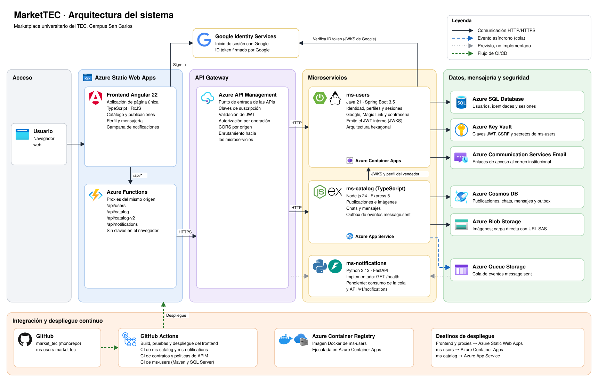
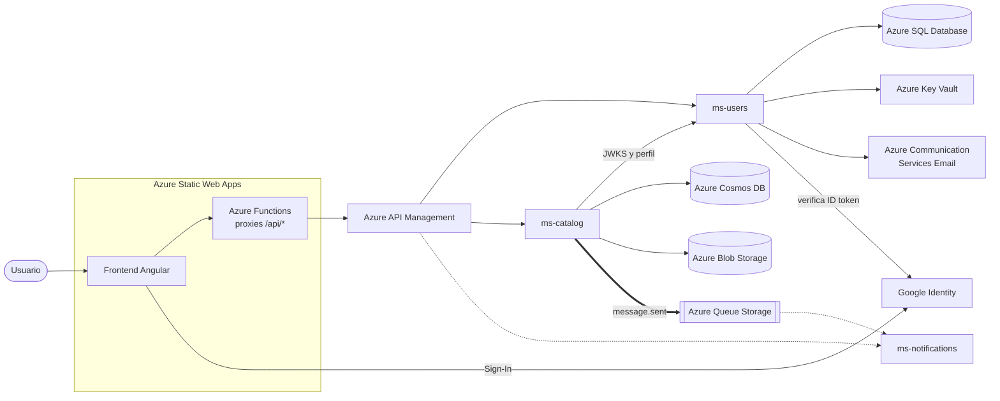

# MarketTEC

Marketplace universitario para la comunidad del **Tecnológico de Costa Rica, Campus San Carlos**. Permite a estudiantes y funcionarios publicar, buscar y consultar productos y servicios, administrar sus publicaciones y conversar con otros usuarios desde una aplicación web responsive.

**Aplicación desplegada:** https://victorious-beach-0a55f0c1e.2.azurestaticapps.net/

## Arquitectura del sistema



El usuario accede al frontend Angular publicado en **Azure Static Web Apps**. El frontend llama a las rutas `/api/*` del mismo origen; las **Azure Functions** de Static Web Apps reenvían esas solicitudes a **Azure API Management**, que valida las credenciales y enruta cada solicitud hacia el microservicio correspondiente.

- **ms-users** (Java 21, Spring Boot) gestiona la identidad, los perfiles y las sesiones. Autentica con Google, con enlace al correo institucional y con contraseña, y emite el JWT interno que validan los demás servicios. Persiste en **Azure SQL Database**, obtiene sus secretos de **Azure Key Vault**, envía los correos con **Azure Communication Services Email** y se ejecuta en **Azure Container Apps**.
- **ms-catalog** (Node.js 24, Express, TypeScript) gestiona publicaciones, imágenes y conversaciones. Valida el JWT de `ms-users` con sus claves públicas y consulta el perfil del vendedor. Persiste en **Azure Cosmos DB**, guarda las imágenes en **Azure Blob Storage** y publica el evento `message.sent` en **Azure Queue Storage** mediante un outbox transaccional.
- **ms-notifications** (Python, FastAPI) es el servicio destinado a consumir los eventos de la cola y exponer las notificaciones que muestra el frontend. Su código actual implementa la base técnica (`GET /health`); el consumo de la cola y la API `/v1/notifications` están pendientes.

GitHub Actions ejecuta la integración continua de todos los componentes y despliega el frontend en Azure Static Web Apps. El diagrama es editable con [draw.io](assets/architecture/markettec-architecture.drawio).

### Diagrama de comunicaciones



Las flechas punteadas representan integraciones previstas que todavía no están implementadas en `ms-notifications`.

## Estructura del proyecto

```text
market_tec/
├── app/
│   ├── frontend/            # Aplicación Angular
│   │   ├── src/app/core/    # Cliente HTTP, autenticación, feature flags y tema
│   │   ├── src/app/features/# auth, home, publications, profile, messenger, notifications
│   │   ├── src/app/shared/  # Componentes reutilizables
│   │   ├── api/             # Azure Functions: proxies del mismo origen hacia las APIs
│   │   └── public/          # Recursos estáticos y staticwebapp.config.json
│   ├── ms-catalog/          # Microservicio de catálogo y mensajería (Node.js)
│   ├── ms-notifications/    # Microservicio de notificaciones (Python)
│   ├── ms-users/            # Base inicial de ms-users; el servicio se desarrolla en su propio repositorio
│   └── backend/             # Servidor Express mínimo de salud; no forma parte del despliegue
├── contracts/               # Contratos OpenAPI, esquemas de eventos y sus validaciones
├── infra/apim/              # Generación y pruebas de políticas de API Management
├── .github/workflows/       # Integración continua y despliegue del frontend
└── .nvmrc                   # Versión de Node.js del proyecto
```

El microservicio de usuarios se mantiene en el repositorio [ms-users-market-tec](https://github.com/a-calderon-org/ms-users-market-tec). Cada microservicio tiene su propio README con la arquitectura interna y las instrucciones detalladas:

- [ms-catalog](app/ms-catalog/README.md)
- [ms-notifications](app/ms-notifications/README.md)
- [ms-users](https://github.com/a-calderon-org/ms-users-market-tec#readme)

## Tecnologías utilizadas

| Área | Tecnologías |
|---|---|
| Frontend | Angular 22, TypeScript 6, RxJS 7.8, Vitest 5, Prettier |
| Proxies web | Azure Functions (Node.js) en Azure Static Web Apps |
| ms-users | Java 21, Spring Boot 3.5, Spring JDBC, Flyway, Nimbus JOSE + JWT, Argon2id, Maven |
| ms-catalog | Node.js 24, TypeScript 7, Express 5, SDK de Azure (Cosmos, Blob, Queue, Identity), sharp |
| ms-notifications | Python 3.12+, FastAPI, Uvicorn, pytest |
| Datos y mensajería | Azure SQL Database, Azure Cosmos DB, Azure Blob Storage, Azure Queue Storage |
| Correo y secretos | Azure Communication Services Email, Azure Key Vault |
| Plataforma | Azure Static Web Apps, Azure API Management, Azure Container Apps, Azure Container Registry, Azure App Service, Microsoft Entra ID (identidades administradas) |
| Autenticación | Google Identity Services, JWT RS256 interno |
| Contratos y CI | OpenAPI, Redocly CLI, GitHub Actions |

## Requisitos previos

| Herramienta | Versión | Uso |
|---|---|---|
| Git | reciente | Clonar los repositorios |
| Node.js | 24 (`.nvmrc`) | Frontend y ms-catalog |
| npm | 11 | Gestión de dependencias de Node.js |
| NVM | recomendado | Seleccionar la versión de Node.js |
| Python | 3.12 o superior | ms-notifications, contratos y políticas de APIM |
| JDK | 21 | ms-users |

## Instalación

```bash
git clone https://github.com/a-calderon-org/market_tec.git
cd market_tec
nvm install
nvm use
```

Dependencias del frontend y de sus proxies:

```bash
cd app/frontend
npm ci
npm ci --prefix api
```

Para instalar los microservicios sigue las instrucciones de cada README. El de usuarios se clona por separado:

```bash
git clone https://github.com/a-calderon-org/ms-users-market-tec.git
```

## Configuración local

El frontend lee su configuración de `app/frontend/src/environments/environment.ts`. Este archivo no se versiona; créalo a partir de la plantilla:

```bash
cd app/frontend
cp src/environments/environment.example.ts src/environments/environment.ts
```

| Propiedad | Descripción |
|---|---|
| `apiBaseUrl` | URL base de la API que consume el frontend |
| `googleClientId` | Client ID de Google OAuth del entorno |
| `catalogApiBaseUrl` | (Opcional) URL del proxy de catálogo |
| `featureFlags` | (Opcional) Activa el núcleo de autenticación con ms-users (`authCoreV2`), el catálogo con JWT interno (`catalogInternalJwt`) y el acceso con contraseña (`passwordAuth`) |

Los proxies de `app/frontend/api` se configuran en Azure Static Web Apps con las variables `MTEC_PUBLIC_ORIGIN`, `MTEC_USERS_UPSTREAM`, `MTEC_CATALOG_UPSTREAM`, `MTEC_CATALOG_V2_UPSTREAM`, `MTEC_NOTIFICATIONS_UPSTREAM` y sus claves de suscripción (`MTEC_*_SUBSCRIPTION_KEY`).

Cada microservicio incluye un archivo `.env.example` con sus variables. No publiques claves, tokens ni secretos en el repositorio.

## Ejecución

Frontend en modo desarrollo:

```bash
cd app/frontend
npm start
```

La aplicación queda disponible en `http://localhost:4200/`.

Microservicios en local (cada uno en su propia terminal):

```bash
# ms-catalog — http://localhost:3000
cd app/ms-catalog && npm ci && npm run dev

# ms-notifications — http://localhost:8000
cd app/ms-notifications && source .venv/bin/activate && uvicorn markettec_notifications.main:app --reload

# ms-users — http://localhost:8080 (en su repositorio)
cd ms-users-market-tec && ./mvnw spring-boot:run -Dspring-boot.run.profiles=local
```

Cada servicio responde en `GET /health`.

## Pruebas y compilación

Frontend:

```bash
cd app/frontend
npm test -- --watch=false   # Pruebas unitarias con Vitest
npm run build               # Build de producción en dist/market-tec-frontend
npm test --prefix api       # Pruebas de los proxies de Azure Functions
```

Las pruebas del frontend necesitan `src/environments/environment.ts` con valores no vacíos en `apiBaseUrl` y `googleClientId`; para pruebas puedes usar valores de ejemplo como `https://example.invalid`.

Microservicios:

```bash
cd app/ms-catalog && npm run check                        # Tipos, compilación y pruebas
cd app/ms-notifications && python -m pytest               # Pruebas con pytest
cd ms-users-market-tec && ./mvnw --batch-mode verify      # Pruebas y empaquetado
```

Contratos y políticas de API Management, desde la raíz del repositorio:

```bash
npm ci --prefix contracts
python -m pip install -r contracts/requirements-validation.txt
npm --prefix contracts exec -- redocly lint contracts/openapi/users.json
python -m unittest discover -s contracts/tests -p 'test_*.py'
python -m unittest discover -s infra/apim -p 'test_*.py'
```

## Aplicación desplegada

MarketTEC está disponible públicamente en:

**https://victorious-beach-0a55f0c1e.2.azurestaticapps.net/**
