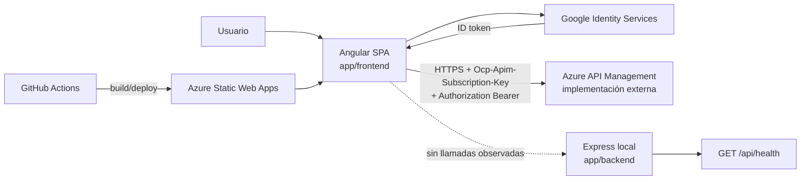

# Arquitectura del sistema

## Vista comprobada

## Fronteras y responsabilidades

### Frontend

`main.ts` inicia `App` con router, cliente HTTP, interceptor y change detection sin Zone.js. `App` aporta shell, navegación, tema, sesión y panel de perfil. Cada feature encapsula vista, estado local y servicio de acceso HTTP. No existe un store global; los servicios singleton mantienen sesión, tema y notificación efímera.

### Backend local

`server.ts` carga `.env`, selecciona `PORT` y escucha. `app.ts` registra CORS abierto, JSON y un endpoint de salud. No hay controladores, capa de dominio, persistencia, autenticación ni endpoints consumidos por la SPA.

### Backend operativo externo

**Inferido:** la API de negocio está detrás de APIM porque `ApiClientService` concatena `environment.apiBaseUrl`, el interceptor agrega la clave APIM y el workflow inyecta esa URL. **No determinado:** qué servicio origina las respuestas, cómo valida tokens o cómo persiste datos.

## Flujo principal

1. El router ejecuta `authGuard`; este reconstruye identidad leyendo claims del token en `sessionStorage`.
2. Los componentes llaman servicios feature.
3. `ApiClientService` construye la URL.
4. `apiKeyInterceptor` agrega clave APIM y, si existe, bearer token; ante 401 limpia sesión y navega a `/login`.
5. El componente traduce éxito/error a signals y la plantilla renderiza carga, error o contenido.

No existe validación de respuestas en tiempo de ejecución ni tipos compartidos con el proveedor externo.

