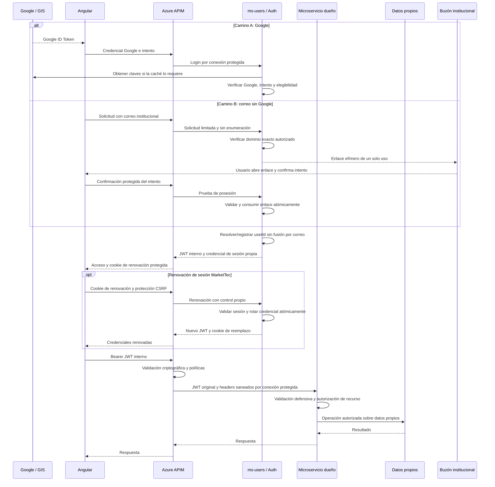

# ADR-004: Seguridad de autenticación y fronteras de confianza

**Estado:** Proposed
**Fecha:** 2026-10-31
**Deciders:** Responsable del proyecto; aprobación pendiente
**Revisores requeridos:** responsables de los tres microservicios, frontend, APIM/infraestructura y revisión de seguridad designada por el proyecto
**Contexto:** MTEC-40 — revisión y decisión de arquitectura; dependencias MTEC-12, MTEC-15, MTEC-34, MTEC-36 y MTEC-17
**Destinatarios:** desarrolladores y mantenedores de MarketTec

> La dirección seleccionada por el responsable del proyecto es Google o correo institucional, identidad interna y sesiones propias de MarketTec, con `ms-users` en un futuro repositorio independiente. La revisión conjunta y aprobación formal exigidas por MTEC-40 están pendientes: ADR-004 permanece **Proposed** y no autoriza implementación, modificación de contratos ni cambios Azure. Los parámetros de seguridad aquí propuestos no se consideran aprobados. ADR-001 continúa Accepted; ADR-002 y ADR-003 continúan Proposed.

## 1. Contexto, alcance y evidencia

Se necesita formalizar dos métodos de acceso —Google Identity Services y correo institucional verificado sin obligación de usar Google— que resuelvan una identidad interna única, y los controles que separan navegador, gateway, servicios y datos. También se debe distinguir la distribución de dominios de ADR-001 de la distribución física de repositorios. Una sesión visual en Angular no demuestra autenticación del servidor. Una firma JWT válida tampoco concede por sí sola acceso a un perfil, publicación, chat o notificación.

### Método y límites

La evidencia inicial se elaboró sobre `ee198d4e78115834d7615e273d9007d2b719ee96`. Esta revisión documental de MTEC-40 usa como base `5dc2d1ebf981b8009fb5b268d7c857e6a1167496`, contrastada con código, contratos y ADR versionados; MTEC-40 y su lista de comentarios se consultaron en modo de solo lectura el 2026-10-31. También se consultaron en solo lectura MTEC-12, MTEC-15, MTEC-34, MTEC-36 y MTEC-17 en esa fecha; las referencias a comentarios históricos de auditoría conservan su consulta inicial. El método comprende inspección estática de sesión/interceptor, adaptadores HTTP y dependencias de los tres servicios, contratos, ADR y ejemplos de Fase II, junto con documentación primaria de Google, Microsoft, IETF y OWASP. La inspección documental y del código no equivale a ejecutar pruebas de seguridad.

Se emplean las etiquetas de certeza del [índice de contexto](../README.md): **Verificado**, **Inferido**, **No determinado** y **Documentado pero no verificado**. Los controles recomendados son propuestas; su existencia operativa no se deduce de la presencia de documentación.

No se dispone de evidencia de lectura del entorno Azure desplegado dentro de este alcance. No se inspeccionaron recursos Azure, no se enviaron credenciales de prueba a sistemas remotos y no se realizaron pruebas de explotación. La [segunda validación histórica](../audits/SECOND_PASS_VALIDATION.md) aporta antecedentes, pero sus afirmaciones sobre interceptor, expiración, ausencia de contratos y estado de Fase II deben contrastarse con esta base posterior.

### Evidencia que fundamenta la propuesta

| Referencia | Evidencia y certeza | Consecuencia para el diseño |
|---|---|---|
| E1 | **Verificado:** [AuthTokenService](../../app/frontend/src/app/core/auth/auth-token.service.ts) decodifica el payload y comprueba `exp`; [GoogleAuthService](../../app/frontend/src/app/features/auth/services/google-auth.service.ts) obtiene `sub` y `email` sin verificación criptográfica ni intercambio HTTP. La [prueba de sesión](../../app/frontend/src/app/features/auth/services/google-auth.service.spec.ts) construye un token sintético con `alg: none` y firma ficticia. | Se puede representar una identidad visual con claims fabricados. **No determinado:** que las APIs remotas acepten esa credencial o permitan acceso indebido a datos. La prueba existente se inspeccionó; no se volvió a ejecutar como parte de este ADR. |
| E2 | **Verificado:** el [interceptor](../../app/frontend/src/app/core/api/api-key.interceptor.ts) restringe origen/ruta, adjunta bearer y subscription key e invalida el token correspondiente ante 401. AuthTokenService ya programa la expiración. | No reabrir como fallos actuales la comparación por prefijo de origen ni la expiración solamente perezosa de la auditoría histórica. Estos controles de cliente no validan la firma. |
| E3 | **Verificado:** [ms-users](../../app/ms-users/README.md), [ms-catalog](../../app/ms-catalog/src/app.ts) y [ms-notifications](../../app/ms-notifications/src/markettec_notifications/main.py) implementan su fundación técnica. [HealthController](../../app/ms-users/src/main/java/com/markettec/users/adapters/in/web/HealthController.java), [pom.xml](../../app/ms-users/pom.xml), el router/middleware Express y el [adaptador FastAPI](../../app/ms-notifications/src/markettec_notifications/adapters/inbound/http.py) no implementan verificación Google/JWT ni autorización de negocio. | No hay autenticación backend implementada en estos servicios. Health, errores y documentación técnica no demuestran protección de futuros endpoints de negocio. Tampoco demuestran qué backend está conectado actualmente a Azure APIM. |
| E4 | **Verificado:** [ADR-001](ADR-001-distribucion-microservicios.md) es Accepted y fija ownership e identidad opaca; deja JWT/APIM fuera de su aprobación. [ADR-002](ADR-002-rol-express-backend.md) y [ADR-003](ADR-003-convencion-timestamps.md) son Proposed. | Auth pertenece a ms-users, sin cuarto servicio, sin acceso a bases ajenas y sin consulta síncrona a ms-users en cada autorización de catálogo. Este ADR no altera esos límites. |
| E5 | **Verificado:** el [contrato de identidad](../../contracts/identity/IDENTITY_CONTRACT.md) recomienda el intercambio y RS256/JWKS. [Users OpenAPI](../../contracts/openapi/users.json) es `draft-pending-team-approval`; `/v1/auth/google` está marcado `proposed` y `/health` está implementado. **Documentado pero no verificado:** la operación del flujo de intercambio recomendado. | Publicar borradores no aprueba sus parámetros ni implementa el intercambio. MTEC-15 exige revisión conjunta. |
| E6 | **Verificado:** [API_AND_EVENTS](../phase2/API_AND_EVENTS.md), sección `POST /auth/google`, contiene un ejemplo de respuesta cuyo primer segmento Base64URL se decodifica a `{"alg":"HS256","typ":"JWT"}`. [AZURE_INFRASTRUCTURE](../phase2/AZURE_INFRASTRUCTURE.md) conserva `jwt-secret`, `JWT_SECRET` y un ejemplo conceptual de APIM que referencia discovery Google. | La contradicción existe en ejemplos de diseño, aunque `HS256` no aparezca escrito literalmente. **Inferido:** esos nombres sugieren un secreto compartido. **No determinado:** algoritmo o claves realmente desplegados; no hay evidencia de implementación HS256. |
| E7 | **Verificado:** [GOOGLE_LOGIN](../../app/GOOGLE_LOGIN.md) afirma validación backend y aceptación de cualquier dominio; [MICROSERVICES_ARCHITECTURE](../phase2/MICROSERVICES_ARCHITECTURE.md) conserva referencias a ADR-001 Proposed y a validación síncrona de usuario. | Hay desfases frente al código, ADR-001 y la propuesta de dominio institucional. Se registran aquí sin editar documentación ajena a este alcance. No usar esas frases como evidencia de controles desplegados. |
| E8 | **Verificado documentalmente en la revisión inicial:** [auditoría MTEC-12](https://allanaron06122005.atlassian.net/browse/MTEC-12?focusedCommentId=10025) y [seguimiento de segunda auditoría](https://allanaron06122005.atlassian.net/browse/MTEC-12?focusedCommentId=10027) del 2026-10-29 mantienen la alternativa interna sin aprobación y Azure no verificado. [MTEC-36](https://allanaron06122005.atlassian.net/browse/MTEC-36) define intercambio seguro; [MTEC-34](https://allanaron06122005.atlassian.net/browse/MTEC-34) lo precede mediante identidad interna. [MTEC-15](https://allanaron06122005.atlassian.net/browse/MTEC-15) distingue contratos publicados de aprobación pendiente. | Los tickets sustentan la necesidad y dependencias, no la eficacia de controles productivos. No se modifican tickets ni sus estados. |
| E9 | **Verificado:** [MTEC-40](https://allanaron06122005.atlassian.net/browse/MTEC-40) permanece To Do y, en la consulta del 2026-10-31, no tiene comentarios; exige revisión humana y aprobación explícita. | No hay evidencia en ese ticket para promover ADR-004 a Accepted. La dirección seleccionada se registra en 2.1; falta revisión y aprobación formal. |
| E10 | **Verificado documentalmente:** MTEC-15 está In Progress; MTEC-34 y MTEC-36 están To Do y describen el acceso Google; MTEC-12 está In Progress, sin evidencia Azure incorporada aquí. MTEC-17 está Done y registra el endurecimiento del interceptor y expiración del token Google en PR #19. | Coordinar el nuevo alcance de correo/sesiones con dominio, autenticación y contratos. MTEC-17 es antecedente completado, no un ticket abierto para implementar esta migración. |

## 2. Alternativas consideradas

Los nombres A/B de esta sección designan las alternativas históricas sobre dónde validar Google, no los caminos de acceso de 3.1 ni las alternativas de distribución de servicios de ADR-001.

| Criterio | Alternativa A: Google ID Token validado en APIM | Alternativa B: Google verificado en ms-users y JWT interno |
|---|---|---|
| Firma y claims de entrada | APIM verificaría firma con claves Google, allowlist de algoritmo, emisor Google, audiencia/client ID autorizado, `exp` y demás claims requeridos. Un token Google no es automáticamente una credencial autorizada para cualquier API. | ms-users verificaría esos mismos elementos antes de resolver o crear identidad y emitir credencial interna. APIM y servicios aceptarían exclusivamente el perfil interno aprobado en rutas protegidas. |
| Obtención y rotación Google | APIM dependería de discovery/JWKS Google y de su caché/recuperación. Habría que probar rotación, `kid` desconocido e indisponibilidad. | Esa dependencia se concentra en el verificador Google de ms-users; APIM y servicios dependen además de las claves públicas internas. Se operan dos ciclos de claves distintos. |
| Asociación a usuario | `sub` Google no puede convertirse en `userId` por simple renombrado. Habría que diseñar cómo obtener un principal interno confiable desde el mapping de ms-users. No se propone consultar ms-users en cada request ni mover su mapping al gateway. | ms-users resolvería una vez por intercambio `(issuer, sub)` externo a `userId` opaco; el `sub` del JWT interno representaría ese `userId`. |
| Acoplamiento | Los validadores y la propagación de identidad quedan acoplados al proveedor, sus claims y vida útil. Restricciones de alta/dominio siguen requiriendo lógica de cuenta interna. | Los servicios consumen identidad de MarketTec; ms-users concentra integración Google y política de alta. Se puede cambiar proveedor sin transformar el identificador de recursos. |
| Frontera de confianza | APIM autenticaría una credencial externa, pero aún habría que proteger el backend, validar defensivamente y propagar una identidad interna no falsificable. | Fronteras separadas: Google acredita identidad externa; ms-users emite principal interno; APIM valida admisión; cada servicio valida y autoriza sus recursos. |
| Autorización y propagación | Ni el token Google ni headers del gateway sustituyen ownership, participación o capacidades. Los backends necesitarían reglas explícitas para traducir la identidad sin interpretar Google `sub` como ID interno. | JWT original interno reenviado, validación local y principal de aplicación. Los servicios no reciben Google ID Tokens ni inventan identidad con headers. Eventos transmiten referencias internas según contratos validados. |
| Coste y limitaciones | Menor operación de un emisor propio, pero no resuelve por sí sola mapping, cuentas ni autorización; forzar su resolución en cada llamada contradiría el límite de ADR-001. | Añade emisor crítico, custodia/rotación de claves, publicación JWKS, disponibilidad del intercambio, revisión de contratos y gestión de revocación. |

### 2.1. Dirección seleccionada y aprobación pendiente

El responsable del proyecto ha seleccionado **la alternativa B como base del diseño**, ampliada con acceso mediante correo institucional sin Google. La alternativa A queda como antecedente evaluado y no es la base del diseño actual. La dirección seleccionada comprende:

- Google o enlace institucional de un solo uso, resueltos por `ms-users` a una identidad interna única.
- JWT interno común para APIs y sesiones renovables propias de MarketTec.
- Propiedad de recursos derivada del principal autenticado y autorización en el servicio dueño.
- Futuro repositorio independiente para `ms-users`, conservando los tres dominios de ADR-001.

Esta selección de dirección no equivale a la aceptación formal del ADR ni a la aprobación del perfil de seguridad:

| Ámbito | Estado y alcance |
|---|---|
| Distribución de tres servicios, ownership de datos e identidad opaca de ADR-001 | **Accepted**, aprobación del 2026-10-29. No se reabre ni se amplía su alcance. |
| Dirección de autenticación y repositorio descrita arriba | Seleccionada por el responsable del proyecto para el diseño de MTEC-40; pendiente de revisión conjunta y registro de aprobación formal. **Documentado pero no verificado** como mecanismo operativo. |
| Perfil JWT, sesiones, elegibilidad, enlaces y operación | **Proposed**; parámetros y responsables en la sección 4. |

Para cerrar MTEC-40 falta evidencia de revisión por responsables de los tres servicios, frontend, APIM/infraestructura y seguridad designada; aprobación explícita del responsable del proyecto de B ampliada y los acuerdos mínimos de la sección 8; y registro formal revisado en ADR-004/DECISION_LOG mediante el PR exigido por el ticket. No se infiere aprobación de un merge previo. Nombre del revisor de seguridad, acta de conformidades/desacuerdos y plazos de pendientes: **No determinado**. Esta edición documental no cierra el ticket.

## 3. Política criptográfica y responsabilidades propuestas

Todos los verbos de obligación de esta sección describen requisitos para una futura implementación aprobada, no controles existentes.

### 3.1. Dos caminos de autenticación e identidad común

Los pasos siguientes son diseño futuro; no definen rutas ni payloads nuevos y no están implementados.

#### Camino A — Google Identity Services

1. Angular obtiene un Google ID Token mediante GIS.
2. Angular envía esa credencial a la futura API de autenticación mediante APIM; el login no requiere previamente un JWT interno.
3. `ms-users` verifica criptográficamente firma, algoritmo, issuer, audience, expiración y claims obligatorios, además de la vinculación al intento y elegibilidad aprobadas.
4. `ms-users` identifica o registra al usuario interno según la política de alta, sin vincular cuentas automáticamente por correo.
5. `ms-users` emite la credencial de MarketTec y establece la sesión propia de 3.4.
6. APIM y los servicios validan el JWT interno; los casos de uso consumen exclusivamente la identidad interna validada.

El Google ID Token es una credencial transitoria, nunca el identificador permanente de publicaciones, chats o perfiles. Google `sub` solo identifica el vínculo externo dentro de `ms-users`.

#### Verificación Google

ms-users usaría una biblioteca mantenida, con pruebas explícitas de firma, algoritmo admitido, emisor y audiencia Google, expiración, tipos de claims y ausencia de campos obligatorios. Las claves provendrían de endpoints Google configurados, con caché según sus metadatos y rechazo seguro si no existe una clave válida disponible. No se confiaría en `jku`, `x5u` o una URL suministrada por el token. El [verificador recomendado por Google](https://developers.google.com/identity/gsi/web/guides/verify-google-id-token) es la referencia para estos checks; decodificar no es verificar.

El mapping de identidad externa usaría `(issuer, sub)`, nunca correo como clave de cuenta. Si se admiten las dos representaciones oficiales del emisor Google, su normalización a un emisor canónico ocurriría **después** de validar contra la allowlist; la regla debe aprobarse y probarse para no crear cuentas duplicadas. Un vínculo existente prevalecería sobre cambios de correo. No se vincularían cuentas distintas automáticamente por coincidencia de email.

La admisión Google también aplicaría la allowlist institucional descrita abajo. Se comprobaría `email_verified` y, cuando se use como evidencia Google Workspace, `hd` verificado según el perfil aprobado; el parámetro `hd` del botón no demuestra pertenencia. Google advierte que un correo de terceros sin `hd` puede no estar bajo su autoridad actual aunque `email_verified` sea verdadero: en ese caso se exigiría prueba adicional de posesión del buzón institucional o se rechazaría según P16. No se impondría Google Workspace al camino de correo sin Google. Ninguno de esos claims demuestra por sí solo matrícula o empleo activo.

Para cuentas nuevas se recomienda alta idempotente después de validar identidad y elegibilidad, con unicidad del mapping y resolución transaccional de concurrencia. Alta automática frente a registro previo, evidencia institucional y reglas de vinculación requieren aprobación. MTEC-34 define el dominio y puertos; este ADR no elige motor de persistencia.

#### Camino B — Correo institucional sin Google

1. El usuario introduce su correo institucional en Angular.
2. La solicitud pasa por APIM; el backend verifica el dominio exacto contra la allowlist aprobada y configurada.
3. `ms-users` solicita prueba de posesión enviando un enlace de acceso de un solo uso al buzón; no exige cuenta Google ni contraseña institucional.
4. El usuario abre el enlace y confirma explícitamente el intento de acceso.
5. El backend valida el secreto contra su verificador almacenado, la integridad del estado asociado, expiración y vinculación al correo, propósito e intento. Consume el enlace atómicamente una sola vez.
6. Solo tras esa prueba, `ms-users` crea o recupera la identidad interna asociada a ese método. Si existe una cuenta por otro método, exige la vinculación descrita abajo.
7. Se emite la misma credencial interna de MarketTec y se establece una sesión propia, independientemente del método inicial.

Requisitos de seguridad para la futura implementación:

- Prevenir enumeración con respuestas y tiempos comparables para cuentas existentes/inexistentes, sin revelar su método de acceso.
- Limitar solicitudes de emisión, reenvío y validación por intento, destinatario y origen de red; prevenir abuso de envío sin bloquear cuentas por peticiones anónimas.
- Generar tokens aleatorios criptográficamente seguros, con entropía suficiente y vencimiento breve. Duración exacta y límites se aprobarán en P18.
- Almacenar verificadores de forma segura, por ejemplo un hash del secreto aleatorio; proteger estado, propósito, destinatario, expiración e intento. No almacenar el token utilizable en claro ni elegir aquí el motor de persistencia.
- Validar y consumir atómicamente para que dos confirmaciones concurrentes no creen dos accesos; rechazar tokens alterados, expirados, ajenos al intento o ya consumidos.
- Proteger frente a escáneres automáticos de correo: una apertura GET o previsualización no consume el secreto ni crea sesión. Exigir confirmación explícita mediante una operación protegida y vinculada al intento; el protocolo entre dispositivos queda por aprobar en P18.
- Usar HTTPS y destinos de enlace configurados y confiables; impedir redirecciones arbitrarias, fugas por referente y analítica de terceros en la confirmación. El enlace de correo transporta un secreto efímero; nunca se coloca un bearer de API o renovación en una URL.
- No registrar tokens ni enlaces sensibles en frontend, APIM, servidor, proveedor de correo, trazas o errores; redactar también URL/query y cookies. Requerir reautenticación reciente para operaciones sensibles.

Se adaptan los controles de tokens de un solo uso de [OWASP Forgot Password](https://cheatsheetseries.owasp.org/cheatsheets/Forgot_Password_Cheat_Sheet.html) al enlace de acceso; esa referencia no define el protocolo de login de MarketTec. La mitigación de escáneres y el consumo atómico son requisitos del diseño que necesitan pruebas propias.

Verificar el correo acredita **control del buzón**, no necesariamente matrícula o empleo activo. La política funcional de elegibilidad y su eventual revalidación deben aprobarse por separado.

#### Allowlist institucional común

Se propone una allowlist configurable de **dominios exactos**: `estudiantec.cr`, `tec.ac.cr` e `itcr.ac.cr` son exclusivamente candidatos, pendientes de confirmación del responsable funcional antes de habilitar registro. No se habilita ninguno mediante esta edición.

La futura comparación usaría el dominio extraído de un correo validado, con normalización definida y uniforme. Se prohíben sufijos ambiguos, coincidencias parciales, comodines, subdominios implícitos y dominios similares: `estudiantec.cr.example.org` y `otroestudiantec.cr` no equivalen a `estudiantec.cr`. Añadir cualquier otro dominio institucional requeriría configuración y aprobación explícita. No se añade validación funcional al código.

#### Identidad interna y vinculación

**Una persona puede tener varios métodos de autenticación, pero debe conservar un único `userId` interno.** El modelo es conceptual, sin aprobar esquema de datos ni modificar contratos:

```text
User
 ├── userId: usr_12345 (ejemplo, no formato aprobado)
 ├── correo institucional verificado
 ├── GoogleIdentity (opcional)
 └── EmailIdentity (opcional)
```

El ID es opaco, estable y generado exclusivamente por `ms-users`; no se deriva del correo ni de Google `sub`, no cambia al añadir métodos y se comparte como referencia lógica entre servicios. El mismo método verificado recupera el mismo usuario incluso ante concurrencia; cambiar un correo o añadir un proveedor no reasigna el ID.

No se fusionan cuentas automáticamente por coincidencia de correo. Vincular métodos exige una operación autenticada y prueba de control reciente de **ambos métodos**, prevención de replay y comprobación de conflictos. Si un método ya pertenece a otra cuenta, no se crea otra identidad ni se fusionan usuarios silenciosamente; se exige resolución explícita. El procedimiento de recuperación/conflictos y las reglas para correos reasignados están pendientes en P16. No se promete deduplicar personas solo por sus direcciones.

### 3.2. Emisión y validación interna

Se propone **RS256 como única entrada inicial de la allowlist interna**, con clave de firma exclusiva de ms-users y distribución de claves públicas mediante JWKS. Una clave verificadora no debe permitir emitir tokens: por ello se prefiere firma asimétrica frente a distribuir un secreto HMAC entre gateway y servicios. ES256 u otra opción requerirían evaluación de compatibilidad y aprobación explícitas; no se propone aceptar simultáneamente HS256 y RS256 como fallback.

El perfil propuesto usaría `iss` interno estable, `aud` explícita, `sub = userId` opaco, `iat`, `exp` y `jti`. `nbf` y su obligatoriedad están abiertos. Claims temporales serían NumericDate en segundos según [RFC 7519](https://www.rfc-editor.org/rfc/rfc7519.html); esto no aprueba la convención general de fechas de ADR-003. Se verificarían tipos, coherencia temporal, duración máxima y capacidades realmente otorgadas. El JWT minimizaría datos personales y no incluiría claves ni secretos; su firma no cifra el contenido.

En el header JOSE se propone `kid` obligatorio y un tipo de token explícito por aprobar. El validador asociaría `kid` únicamente a claves del emisor configurado, con tipo/uso/algoritmo compatibles; nunca usaría ese identificador como ruta o destino de red. El perfil Google y el interno tendrían reglas de aceptación separadas. Las rutas de negocio no aceptarían tokens Google como fallback. La [RFC 8725](https://www.rfc-editor.org/rfc/rfc8725.html) fundamenta la verificación de algoritmo y la separación de contextos; su aplicación concreta se revisaría en cada stack.

APIM rechazaría credenciales ausentes o inválidas en rutas protegidas y comprobaría firma, emisor, audiencia, tiempo y perfil autorizado. La forma de imponer la allowlist se debe demostrar con las capacidades reales de `validate-jwt`, tipos de claves, condiciones adicionales y pruebas negativas; no se supone un atributo de algoritmo inexistente. Cada adaptador backend repetiría la verificación con su configuración aprobada y construiría el principal conceptual del contrato de identidad, sin que dominio o casos de uso dependan de HTTP/JWT.

El flujo conceptual de autorización sería:

```text
Usuario autenticado → JWT MarketTec validado → AuthenticatedPrincipal
                    → userId interno → Operación de negocio autorizada
```

`ms-catalog` obtendría el vendedor de una publicación desde el principal autenticado, nunca desde `sellerUserId`, `senderUserId`, `vendedorId`, `senderId` u otro campo del navegador como prueba de identidad. El ID solo identifica al actor; cada operación aún debe comprobar ownership, participación y autorización del recurso. `ms-notifications` conserva sus reglas propias de acceso y destinatario.

Los servicios aplicarían ownership y capacidades al caso de uso: perfil propio en ms-users; vendedor, participante de chat y emisor de mensaje en ms-catalog; destinatario autenticado en ms-notifications. Una ruta o body selecciona un objeto, pero no acredita su propietario. La emisión de un JWT corresponde a autenticación; la autorización de objetos permanece en el servicio dueño. Un fallo de autenticación produciría 401; un principal válido sin permiso, 403 o la política de ocultación 404 que se acuerde. No se cambia aquí ningún contrato de errores.

### 3.3. JWKS, custodia y rotación

Se recomienda custodiar una clave asimétrica no exportable en Azure Key Vault con identidad administrada y permisos mínimos de firma para ms-users, sujeto a compatibilidad, coste y aprobación. APIM y los demás servicios recibirían únicamente la parte pública. Ninguna clave privada, token o secreto de producción se copiaría a Git, frontend, fixtures o logs. No se reutilizaría la clave JWT como certificado mTLS.

La publicación seguiría el formato [JWK/JWKS de RFC 7517](https://www.rfc-editor.org/rfc/rfc7517.html), sin material privado. Con `openid-config`, APIM necesita metadata de discovery compatible que indique el `jwks_uri`; una URL de JWKS sola no sustituye esa metadata. Debe aprobarse la forma de publicación o la alternativa de aprovisionamiento de claves públicas; este ADR no crea endpoints ni afirma que ms-users sea un proveedor OIDC completo. Metadata y claves públicas deben ser alcanzables por los validadores sin necesitar un JWT que dependa de esas mismas claves, evitando un ciclo de arranque.

La rotación normal propuesta sería: publicar la nueva clave pública, esperar y verificar propagación a todas las cachés, comenzar a firmar con el nuevo `kid`, mantener la anterior mientras puedan existir tokens válidos y retirarla después. El plazo depende de vida máxima del token, skew, cachés y solicitudes en vuelo; no se fija un intervalo definitivo. Microsoft documenta caché y limitación de refresco en [validate-jwt](https://learn.microsoft.com/en-us/azure/api-management/validate-jwt-policy), por lo que no se debe suponer invalidación inmediata. Ante `kid` desconocido se limitarían los refrescos para evitar denegación de servicio y se rechazaría si no puede validarse. Una clave pública conocida puede seguir verificando tokens vigentes durante una caída solo dentro de una política de caché acotada y aprobada.

Un compromiso exige un procedimiento distinto de rotación normal: detener firma comprometida, publicar reemplazo, retirar confianza y forzar rechazo de claves/tokens afectados en **todos** los validadores, incluido APIM con caché. Se necesitan responsables, auditoría y pruebas de recuperación; retirar una clave del JWKS no demuestra por sí solo revocación inmediata.

### 3.4. Expiración, renovación, revocación y replay

Se propone para ambos métodos un **JWT de acceso de aproximadamente 15 minutos**, renovado mediante una **sesión propia de MarketTec**. Duración exacta, skew, máximo absoluto e inactividad de sesión permanecen sujetos a revisión (P10/P11). Esta propuesta sustituye la recomendación inicial de depender de un nuevo intercambio Google para cada renovación; no implementa sesiones ni modifica el contrato vigente.

La credencial de renovación sería rotatoria y revocable, vinculada a la sesión y al usuario interno, con almacenamiento seguro de verificadores. Cada uso válido invalidaría la anterior atómicamente y emitiría un reemplazo; la reutilización detectada exigiría revocar la familia de sesión afectada y reautenticar, con manejo de concurrencia/reintentos por aprobar. Logout, baja de cuenta y eventos de seguridad deben tener semántica explícita de revocación de sesiones. La [RFC 9700, sección 4.14](https://www.rfc-editor.org/rfc/rfc9700.html#section-4.14) orienta la rotación/detección de replay; usarla como referencia no declara un servidor OAuth implementado.

La renovación usaría cookie `HttpOnly`, `Secure` y política `SameSite` explícita acorde con el despliegue. Nombre, ámbito, duración y elección Lax/Strict o necesidad justificada de None están pendientes; None requeriría Secure. Se propone JWT de acceso preferentemente en memoria, protección CSRF en login/renovación/logout/vinculación y CORS con orígenes explícitos coherentes con cookies. SameSite no sustituye CSRF; HttpOnly no elimina XSS. Atributos y límites se revisarán conforme a [OWASP Session Management](https://cheatsheetseries.owasp.org/cheatsheets/Session_Management_Cheat_Sheet.html), sin introducir secretos en Angular ni en documentación.

La sesión interna no demuestra vigencia permanente de identidad externa o elegibilidad institucional. No se asume que Google ID Token pueda renovarse indefinidamente y **nunca se utiliza como refresh token interno**. Una sesión agotada/revocada o una operación sensible exige reautenticación mediante el método habilitado, conforme a P10/P16/P20.

El borrado de sesión del navegador o `disableAutoSelect()` no revocan un bearer ya emitido. `jti` aporta trazabilidad y una posible clave de revocación, pero no evita replay ni revoca nada por su mera presencia. Sin control compartido, una cuenta deshabilitada o token robado puede seguir siendo aceptado hasta `exp` más skew. El proyecto debe decidir si tolera esa ventana o exige denylist/versionado/introspección, con alcance coherente en gateway y servicios y sin introducir consultas a ms-users por request contra ADR-001.

Para el intercambio se recomienda un desafío de servidor con nonce vinculado al intento de login y de un solo uso, verificado en el token Google y consumido atómicamente. GIS permite [configurar nonce](https://developers.google.com/identity/gsi/web/reference/js-reference), pero generar uno solo en el navegador sin correlación/verificación server-side no resuelve replay. El contrato de desafío, su almacenamiento transitorio y tratamiento de reintentos están pendientes en P18; no existen actualmente ni se añaden aquí. Las defensas CSRF deben corresponder al modo GIS elegido: no se presupone que el callback JavaScript actual incluya automáticamente el mecanismo de cookie/body de un POST directo de GIS.

En las APIs, un bearer robado continúa siendo reutilizable durante su ventana de validez aunque el intercambio use nonce. Se proponen TLS, minimización de exposición, controles de frontend, vida breve y detección; protección criptográfica de posesión sería otro diseño por aprobar. No se promete eliminar replay con JWT, CORS o subscription keys.

### 3.5. Resolución propuesta de contradicciones

| Evidencia contradictoria | Resolución propuesta, sin modificar el documento dueño |
|---|---|
| Identidad recomienda RS256/JWKS; el JWT sintético de respuesta de API_AND_EVENTS declara HS256 en su header codificado. | Adoptar un único perfil asimétrico interno si se aprueba B; retirar posteriormente el ejemplo HS256 o marcarlo sustituido. El ejemplo no prueba un emisor HS256 implementado. |
| AZURE_INFRASTRUCTURE usa `jwt-secret` y `JWT_SECRET`. | Sustituir posteriormente la receta por referencias y permisos de la clave asimétrica aprobada, publicación de claves públicas y runbook. No interpretar un nombre de variable como evidencia del algoritmo desplegado. |
| El ejemplo APIM referencia discovery Google para «Google o interno». | Separar validación Google en ms-users de validación interna en rutas de negocio APIM. Documentar issuer/audience/discovery internos y excepciones de intercambio/metadata cuando se aprueben. |
| GOOGLE_LOGIN afirma backend verificador, IDs derivados de Google y cualquier dominio; el código no hace el intercambio y los contratos proponen identidad opaca/admisión institucional. | Corregir después el flujo implementado y la política realmente aprobada. No afirmar hoy verificación remota ni decidir dominios por un ejemplo. |
| Fase II conserva ADR-001 Proposed, validación síncrona de usuario y respuestas antiguas con envelope/campos distintos de Users OpenAPI. | Prevalecen ADR-001 Accepted y el estado draft del contrato versionado. Tras revisión conjunta, alinear prosa y ejemplos con el contrato aprobado, sin fallback a Google `sub` ni llamada por request. |
| Contrato de identidad contempla renovar demostrando Google o diseñar refresh después; Users OpenAPI solo propone intercambio Google y no describe correo, sesiones ni vinculación. | La dirección de MTEC-40 propone sesiones propias comunes. MTEC-15 debe revisar la ampliación y compatibilidad antes de implementar; el borrador versionado sigue siendo la referencia contractual vigente y no se amplía por este ADR. |
| ADR-002 propone directorios en este repositorio, mientras el futuro desarrollo de ms-users se prevé independiente. | Mantener la fundación actual y su documentación de implementación hasta aprobar/ejecutar la transición de 7.1; coordinar la propuesta de ADR-002 sin modificarlo ni atribuirle aprobación. |
| MTEC-34/MTEC-36 describen dominio y acceso centrados en Google; la dirección ampliada incorpora correo y sesiones. | Coordinar alcance de implementación con sus responsables antes de desarrollarlo, sin modificar Jira. MTEC-17 sigue Done; su endurecimiento no implementa JWT interno ni se reabre por este diseño. |

## 4. Parámetros y decisiones pendientes

Los acuerdos de perfil y operación de todas las filas permanecen **Proposed**; P01 registra además la dirección seleccionada y P05 conserva el principio de identidad ya Accepted en ADR-001. «RP» significa responsable del proyecto, quien registra aprobación formal; los responsables de componentes y la revisión de seguridad preparan y validan la propuesta. La asignación de un ticket no equivale a autoridad para aprobar parámetros compartidos. Debe designarse a la persona revisora de seguridad; no se presume una aprobación existente. La sección 8 distingue qué acuerdos requiere cada entrega: no es necesario cerrar todos los detalles operativos para iniciar trabajo local de MTEC-36.

| Parámetro | Alternativas | Recomendación | Justificación | Riesgo | Responsable de aprobación | Estado |
|---|---|---|---|---|---|---|
| P01. Estrategia de identidad | A histórica: Google en APIM; B ampliada: Google o correo en ms-users y credencial interna común | B ampliada, dirección seleccionada en 2.1; falta ratificación conjunta | Alinea mapping y emisión con ms-users sin obligar a Google | Nuevo emisor crítico, control de buzón y migración coordinada | RP, revisión conjunta de servicios/frontend/APIM y seguridad | Proposed; dirección seleccionada |
| P02. Algoritmo y allowlist | RS256; ES256; HMAC | RS256 como única opción interna inicial; tamaño RSA por revisar | Verificadores no pueden firmar; compatibilidad por demostrar | Confusión RS/HS, claves débiles o incompatibilidad de firma remota | RP, ms-users, APIM y seguridad | Proposed |
| P03. `issuer` interno | URI HTTPS estable por entorno; identificador lógico del borrador | URI HTTPS estable; valor exacto abierto | Facilita vincular metadata y evita mezcla de entornos | Emisores demasiado amplios o colisión desarrollo/producción | RP, ms-users, APIM y consumidores | Proposed |
| P04. `audience` | Una API MarketTec; audiencias por servicio | Una audiencia explícita de la API MarketTec compartida por gateway y backends para esta primera propuesta; valor abierto | Menor complejidad con validación local | Token válido podría reutilizarse entre servicios: ownership/scopes siguen obligatorios; revisar si se exige aislamiento mayor | RP, los tres servicios, APIM y seguridad | Proposed |
| P05. `sub` y `userId` | Perfil JWT sobre identidad opaca Accepted en ADR-001; formato físico abierto | `sub` interno = `userId` estable entre métodos; mappings solo en ms-users | Respeta ADR-001 y desacopla proveedor | Confusión de namespaces, duplicación o vinculación errónea | RP y responsables de los tres servicios, con ms-users | Proposed |
| P06. `iat` | Obligatorio; opcional | Obligatorio, NumericDate; rechazar emisión futura fuera de skew y vida máxima incoherente | Controla antigüedad y duración | Relojes desincronizados o unidades erróneas | RP, ms-users, APIM y consumidores | Proposed |
| P07. `nbf` | Omitir; obligatorio desde emisión | Omitir inicialmente; si existe, validarlo siempre | Evita complejidad sin necesidad de activación diferida | Diferencias entre validadores | RP, ms-users, APIM y consumidores | Proposed |
| P08. `exp` | Obligatorio; opcional | Obligatorio, NumericDate y posterior a emisión | Limita credenciales reutilizables | Aceptar tokens sin expiración o de duración excesiva | RP, ms-users, APIM y consumidores | Proposed |
| P09. `jti` | Aleatorio único; ausente | Obligatorio y no sensible, formato por acordar | Correlación y posible revocación | Creer que evita replay sin estado de control | RP, ms-users y seguridad | Proposed |
| P10. Vida útil y renovación | Duración de acceso; máximo e inactividad de sesión; reautenticación | Aproximadamente 15 minutos de acceso y sesión MarketTec con renovación rotatoria/revocable para ambos métodos; límites exactos abiertos | Separa sesión propia de credencial inicial | Robo de renovación, replay, carreras y ventana residual de bearer | RP, frontend, ms-users y seguridad | Proposed |
| P11. Clock skew | 0/30/60 segundos u otro límite medido | Tolerancia mínima medida, acotada e igual en validadores; sin valor definitivo | Evita tolerancias arbitrarias | Amplía aceptación temporal o genera falsos rechazos | RP, APIM, infraestructura y servicios | Proposed |
| P12. JWKS, discovery, `kid` y tipo JOSE | Metadata compatible + JWKS; claves públicas aprovisionadas | Metadata/JWKS configurados, `kid` obligatorio y tipo explícito; URLs, tipo y caché abiertos | Rotación y separación de contextos | Arranque circular, `kid` desconocido, sustitución o refresco abusivo | RP, ms-users, APIM y seguridad | Proposed |
| P13. Rotación normal y emergencia | Manual controlada; automatizada | Publicar antes de firmar; solapamiento calculado; procedimiento de compromiso | Considera tokens y cachés activos | Caídas por retirada prematura o aceptación de clave comprometida | RP, ms-users, infraestructura/APIM y seguridad | Proposed |
| P14. Almacenamiento/custodia de claves | Key Vault no exportable; secreto exportable; otro gestor | Clave no exportable y Managed Identity con permiso mínimo de firma; tamaño, SKU y permisos abiertos | Reduce distribución de material privado | Coste/latencia, permisos excesivos, dependencia del servicio de firma | RP, infraestructura, ms-users y seguridad | Proposed |
| P15. Revocación y baja de cuenta | Esperar expiración; denylist; versión de sesión; introspección | Expiración breve como base, con aceptación explícita de ventana; definir emergencia antes de producción | Evita prometer revocación inexistente | Cuenta/token revocado aún aceptado en alguna caché o servicio | RP, los tres servicios, APIM y seguridad | Proposed |
| P16. Alta, dominios y vinculación | Alta idempotente o registro previo; evidencia de buzón/elegibilidad; recuperación y conflictos | Allowlist exacta configurable; candidatos estudiantec.cr, tec.ac.cr e itcr.ac.cr por confirmar; vínculo autenticado con prueba de ambos métodos, sin fusión por correo | No obliga a Google ni confunde buzón con matrícula/empleo | Exclusión, duplicación, correo reasignado o vínculo indebido | RP y responsable funcional, ms-users y seguridad | Proposed |
| P17. Protección de acceso directo | Red privada; restricciones de acceso; mTLS combinado con controles de red | Solo APIM para negocio; combinación compatible con planes reales, pendiente de verificación | Impide omitir políticas del gateway | Hostname/slot alternativo, reglas incompletas o certificado no validado | RP, infraestructura/APIM, servicios y seguridad | Proposed |
| P18. Replay, enlaces y vinculación del login | Desafío Google; prueba por correo de un solo uso; confirmación del intento | Nonce Google y enlaces con verificadores seguros, vencimiento breve, consumo atómico y protección de escáneres; aprobar duración, entropía, reenvíos, reintentos y uso entre dispositivos | Separa credencial auténtica de intento autorizado | Replay, login CSRF, enumeración, bombardeo de correo y consumo automático | RP, ms-users, frontend, MTEC-15 y seguridad | Proposed |
| P19. Propagación y headers | JWT interno original; aserción firmada adicional; headers | Reenviar JWT y revalidar; eliminar/sobrescribir headers de identidad | Mantiene evidencia criptográfica en backend | Confiar en header sin verificar origen/conexión | RP, APIM, servicios y seguridad | Proposed |
| P20. Scopes y autorización | Solo ownership inicial; capacidades explícitas | Mínimo privilegio, sin admin implícito; matriz de recursos/capacidades por aprobar | Firma no concede permisos sobre objetos | BOLA/IDOR o privilegios excesivos | RP, responsables de dominio de los tres servicios y seguridad | Proposed |
| P21. Perfil Google | Client IDs por entorno; varios clientes; normalización de emisor | Allowlist exacta y mapping canónico tras validación; revisar `azp` si corresponde | Evita sustitución entre clientes/proveedores | Aceptar cliente ajeno o duplicar cuenta por forma de `iss` | RP, ms-users, frontend y seguridad | Proposed |
| P22. Autenticación y excepciones APIM | Negocio; login Google/correo, confirmación, renovación y metadata | Excepciones mínimas sin JWT de acceso previo, con credencial/control propio por operación, límites y CSRF según corresponda; health por definir | Evita ciclos de login, renovación y JWKS | Excepción demasiado amplia, altas masivas o renovación sin prueba | RP, APIM, ms-users y seguridad | Proposed |
| P23. Tokens y cookies en navegador | sessionStorage actual; acceso en memoria y renovación por cookie | Preferir acceso en memoria; renovación HttpOnly/Secure y SameSite explícito; aprobar ámbito, CSRF y CORS para el despliegue | Reduce persistencia de bearer y acceso JavaScript a renovación | XSS, CSRF, cookies bloqueadas o ámbito excesivo | RP, frontend, ms-users, APIM y seguridad | Proposed |
| P24. Subscription key y observabilidad | Clave pública de cuota; credencial privilegiada; control de abuso por usuario/origen de red | Tratar la clave SPA como pública; cuotas y señales sin registrar bearer/credential/claves | No representa usuario ni secreto del navegador | Abuso de cuota, telemetría sensible y cardinalidad de logs | RP, APIM, frontend, infraestructura y seguridad | Proposed |

## 5. Fronteras de confianza propuestas

El flujo es lógico y **Proposed**. Autenticación y renovación pasan por APIM. Login no requiere JWT interno previo; renovación exige credencial de sesión y controles propios, aunque el JWT de acceso haya expirado. Negocio exige JWT interno. No se aprueban rutas HTTP ni políticas concretas.



| Frontera | Confianza propuesta y control necesario | Límite de la garantía |
|---|---|---|
| Navegador → ms-users mediante APIM | HTTPS; prueba Google o de buzón, cuenta y anti-replay antes de emitir; renovación con sesión propia, rotación y CSRF. Límites de tamaño/tasa y errores sanitizados. | Estado Angular, CORS y subscription key no autentican al usuario; un nonce no impide el uso de un bearer interno robado después. |
| ms-users → Google | Endpoints configurados, TLS, caché acotada, validación de claves/claims. | La caída o rotación Google puede impedir nuevos intercambios; no se relaja validación para mantener disponibilidad. |
| ms-users → buzón institucional | Enlace efímero a dominio autorizado; proveedor y transporte de correo por aprobar, sin tokens en logs. | Control de buzón no demuestra matrícula/empleo; entrega fallida no crea sesión y escáner no consume enlace. |
| ms-users → verificadores internos | Clave privada aislada; metadata y JWKS públicos con integridad, disponibilidad y destinos de confianza configurados. | Publicar claves no aprueba issuer/audience ni resuelve revocación inmediata. |
| Angular → APIM en negocio | Validación completa del JWT interno, política específica por operación y control de abuso. | Autenticar la llamada no autoriza el objeto solicitado. |
| APIM → App Services | HTTPS con autenticación de origen y aislamiento de acceso directo aprobados. APIM elimina headers de identidad entrantes y reenvía JWT; backend lo valida. | Headers como `X-User-Id`, `X-Roles` o un certificado reenviado no son evidencia suficiente por sí mismos. CORS/DNS no aíslan el backend. |
| Adaptador → dominio → datos | El adaptador crea un principal validado; caso de uso comprueba ownership/participación/capacidad y accede solo a su almacenamiento. | No confiar en IDs del body/ruta como identidad; no consultar bases de otro servicio ni ms-users por cada request. |
| Servicios y eventos | El productor obtiene IDs de un contexto autorizado; consumidor valida contrato, procedencia y permisos del transporte según diseño independiente. | Un evento o `recipientUserId` no es un bearer de usuario ni autoriza acceso arbitrario. Este ADR no diseña identidad de workloads ni autenticación SSE. |

Para App Service deben evaluarse restricciones de acceso y conectividad según plan real, además de autenticación del origen gateway. La [guía de restricciones de acceso](https://learn.microsoft.com/en-us/azure/app-service/app-service-ip-restrictions) y la [guía mTLS](https://learn.microsoft.com/en-us/azure/app-service/app-service-web-configure-tls-mutual-auth) son referencias de capacidad, no evidencia del entorno. Solicitar un certificado no prueba que la aplicación valide cadena/confianza, vigencia y cliente autorizado; un header de certificado solo puede usarse dentro de una frontera de proxy protegida y saneada. La combinación concreta se mantiene abierta en P17 y no cambia topología aquí.

## 6. Modelo de amenazas

Activos: mappings y cuentas, claves de firma, credenciales de usuario, recursos de cada dominio, disponibilidad y trazabilidad. Se consideran navegador/controlador HTTP hostiles, atacantes con un token propio o robado y compromiso de claves/infraestructura. Las condiciones son escenarios a prevenir, **no explotaciones confirmadas**. Todas las pruebas de esta tabla están pendientes; no se han realizado ataques remotos.

«Pendiente local/Azure» significa que el control requiere implementación y pruebas locales, más comprobación posterior de despliegue. «No determinado en Azure» no afirma exposición ni protección del servicio real.

| Amenaza | Condición de explotación | Impacto | Control preventivo propuesto | Detección propuesta | Componente responsable | Prueba necesaria | Estado de verificación |
|---|---|---|---|---|---|---|---|
| T01. Token falsificado | Un validador confía en payload o clave no autorizada | Suplantación y acceso si además falta autorización | Verificación criptográfica y perfil exacto antes de crear principal | Conteo de rechazos por causa y alertas de anomalías, sin tokens | ms-users, APIM y adaptadores de servicios | JWT fabricado con claims plausibles: 401, sin emitir credencial ni alcanzar caso de uso protegido | E1 verifica aceptación visual por inspección de código/prueba; aceptación API **No determinado** |
| T02. `alg: none` o confusión RS/HS | Se acepta firma ausente o algoritmo elegido por el atacante | Principal falso | Allowlist única por perfil, firma requerida, tipo de clave/algoritmo vinculado | Métrica de algoritmo rechazado | Verificador Google, APIM y servicios | Rechazar `none`, firma vacía y HS256 firmado con bytes de clave pública RSA; incluir token RS256 válido como control | Escenario backend pendiente local/Azure; fixture visual `none` verificado en E1 |
| T03. Firma inválida | Payload/firma alterados o clave de otro emisor | Alteración de identidad o permisos | Biblioteca verificada, clave del emisor configurado; no consumir claims como autoridad antes del éxito | Rechazos de firma y `kid` desconocido | ms-users, APIM y servicios | Alterar un byte, usar clave ajena y `kid` inexistente: rechazo sin procesamiento de negocio | Pendiente local/Azure |
| T04. `aud`/`iss` incorrectos y sustitución de tipo | Token genuino de otro cliente, entorno o proveedor se acepta | Confusión de destinatario o identidad | Allowlists exactas por perfil/entorno; separar Google e interno | Métricas por perfil inválido, con valores sanitizados | ms-users, APIM y servicios | Tokens válidamente firmados con aud/iss erróneos; Google en negocio e interno en intercambio; prueba de emisor canónico | Pendiente local/Azure |
| T05. Expirado, prematuro o tiempo incoherente | Se omiten `exp`/`nbf`, tipos o límite temporal | Extensión de acceso o bypass de vigencia | `exp` obligatorio, skew acotado, `iat`/`nbf` coherentes y duración máxima | Monitoreo de reloj y motivos temporales de rechazo | Emisor, validadores e infraestructura | Bordes de `exp`/skew, `nbf` futuro, `iat` futuro, ausencia/tipos inválidos, segundos frente a milisegundos | Temporizador cliente verificado estáticamente; controles backend pendientes |
| T06. Replay de credenciales | Robo/reenvío del ID token o bearer aún vigente | Login repetido, suplantación y operaciones repetidas | Nonce de servidor de un solo uso para intercambio; TLS, vida breve y política P15/P18; idempotencia por caso de uso cuando corresponda | Intentos repetidos, desafío consumido y anomalías de sesión sin registrar credenciales | ms-users, frontend, APIM y servicios | Dos intercambios concurrentes con mismo desafío; reintento aprobado; bearer robado durante/después de ventana y revocación | Pendiente; replay bearer residual explícito, `jti` no lo evita |
| T07. Headers de identidad falsificados | Navegador envía `X-User-Id`/roles y backend los toma como autoridad | Suplantación o elevación | Eliminar/sobrescribir headers y derivar principal del JWT revalidado; verificar origen gateway | Alertas de headers prohibidos sin copiar su contenido sensible | APIM y adaptadores backend | Header ajeno con token propio/ausente: no cambia principal; llamada directa no obtiene confianza | Pendiente local/Azure |
| T08. Acceso directo a App Services | Hostname/slot/IP admite tráfico externo por fuera de frontera aprobada | Omisión de gateway y mayor superficie de ataque | Aislamiento/red y autenticación de origen por aprobar; revisar hosts alternativos y excepciones técnicas | Logs de acceso denegado y origen inesperado | Infraestructura/APIM y servicios | Intento autorizado a hostname directo, alternativos y slot: bloqueo aun con JWT válido; probar sin origen/certificado válido | **No determinado en Azure** |
| T09. Omisión de políticas APIM | Operación/API/producto/herencia o excepción deja ruta sin validación | Entrada de credencial inválida o bypass de cuotas | Revisar políticas efectivas y herencia por todas las operaciones; excepciones mínimas de login/metadata | Trazabilidad gateway/backend, rutas sin validación y divergencias de configuración | Responsable APIM y seguridad | Matriz de rutas protegidas con token ausente/inválido; backend de negocio no invocado; login/metadata sin ciclo de autenticación | **No determinado en Azure** |
| T10. Acceso a recurso de otro usuario | Token válido, pero se confía en IDs de ruta/body o solo en firma | BOLA/IDOR, lectura o modificación ajena | Ownership/participación/capacidad en cada caso de uso; IDs de actor derivados del principal | Denegaciones de acceso y patrón de enumeración con datos mínimos | Servicio dueño de perfiles, catálogo/chats o notificaciones | Usuario A intenta leer/modificar objetos restringidos de B; 403/404 sin efecto y acceso propio permitido | Endpoints de negocio no implementados; pendiente local/Azure |
| T11. Tokens/claves en logs | Request/response, headers, excepciones, trazas o almacenamiento cliente exponen secretos | Robo de sesión o de clave, fuga de datos personales | Redactar Authorization, credential, cookies, enlaces/query y material privado en toda la cadena; no bearer de API/renovación en URL; acceso/retención mínimos | Revisión automática con credenciales señuelo y alertas de secretos | Frontend, servicios, APIM y observabilidad | Capturar logs/trazas/error con señuelos; comprobar ausencia de tokens completos y material privado | No hay auditoría de logs desplegados; pendiente local/Azure |
| T12. Compromiso o rotación incorrecta de claves | Permisos excesivos, clave filtrada o caché desalineada | Emisión maliciosa o caída masiva de validación | Custodia mínima, separación por entorno/uso, precarga de clave y runbook de compromiso | Auditoría de firma/cambios de claves y errores por `kid` | ms-users, infraestructura, APIM y seguridad | Solapamiento de claves, caída JWKS, `kid` nuevo, retirada normal y compromiso con cachés precargadas | Pendiente local/Azure; revocación inmediata no demostrada |
| T13. Confusión Google `sub` / `userId` | Se usa correo/sub externo como ID interno o fallback | Ownership erróneo, cuentas duplicadas o vinculadas indebidamente | Mapping único `(issuer, sub)` solo en ms-users; `sub` interno opaco, sin fallback | Conflictos de mapping y cambios de vínculo auditados sin exponer claims | ms-users y responsables de contratos/consumidores | Mismo sub de emisor distinto; correo cambiado; concurrencia; consumidores no interpretan Google sub; sin acceso a bases ajenas | Regla de ADR-001 verificada; implementación pendiente |
| T14. Abuso de subscription key del navegador | Se extrae la clave pública SPA y se trata como autenticación/privilegio | Consumo de cuota/coste o acceso si la clave concede privilegios | No otorgar identidad/roles por clave; JWT y autorización independientes; cuotas y límites de abuso | Métricas por usuario autenticado y origen de red con umbrales acordados | APIM, frontend e infraestructura | Reutilizar clave sin JWT válido: rechazo en negocio; no obtiene privilegios ni omite controles de abuso | Exposición inherente al cliente verificada; permisos/cuotas **No determinado en Azure** |
| T15. Sustitución/abuso de JWKS | Se siguen URLs del token, metadata manipulada o refrescos ilimitados | SSRF, aceptación de clave hostil o denegación de servicio | Destinos fijados, TLS, tipos/uso/algoritmo de clave, límites y caché acotada | Picos de refresco, fallos de metadata y cambios auditados | Verificadores, APIM e infraestructura | `jku`/`x5u` hostiles ignorados; `kid` aleatorio masivo limitado; JWKS sin claves privadas | Pendiente local/Azure |
| T16. Login CSRF o extracción por XSS | Intento de login no vinculado o script accede al bearer | Sesión de cuenta incorrecta o robo de token | Vinculación de intento, CSRF según modo GIS, controles de origen y prevención XSS; almacenamiento P23 | Intentos de desafío inválido, señales CSP y pruebas con señuelos | Frontend, ms-users, APIM y seguridad | Login desde origen no permitido y desafío ajeno rechazados; revisar que el callback no presuponga cookie/body GIS; evaluación XSS separada | Pendiente; sessionStorage actual accesible a JavaScript |
| T17. Abuso o consumo indebido de enlace institucional | Enumeración, fuerza bruta, token filtrado, escáner GET o confirmaciones concurrentes | Acceso indebido, denegación o abuso de correo | Respuesta uniforme, límites, verificador seguro, vínculo al intento y consumo atómico tras confirmación | Métricas de emisión/rechazo/consumo sin secretos | ms-users, frontend, APIM y entrega de correo | Cuenta existente/inexistente indistinguibles; dominio similar rechazado; GET no consume; token alterado/expirado/repetido/ajeno rechazado; carrera produce un consumo | Pendiente local; correo no implementado |
| T18. Robo/replay de renovación o vinculación indebida | Cookie robada, CSRF, carreras de refresh o fusión por correo | Secuestro de sesión/cuenta | Rotación/revocación, detección de reutilización, CSRF y prueba reciente de ambos métodos para vincular | Alertas de reutilización/conflictos y auditoría mínima | ms-users, frontend, APIM y seguridad | Rotación concurrente/reintento, familia revocada, sesión expirada; vínculo sin prueba de un método rechazado; mismo userId tras vínculo legítimo | Pendiente local; sesiones y vinculación no implementadas |

## 7. Consecuencias y riesgos residuales

La alternativa B mantiene el mapping y las credenciales bajo ms-users, permite verificadores con claves públicas y evita acoplar cada dominio a claims Google. El control de recursos permanece junto a sus datos, conservando los tres servicios de ADR-001.

El coste es operar un emisor, distribución de claves, entrega segura de enlaces y ciclo de sesiones propias, coordinar políticas en gateway y tres servicios y migrar Angular al contrato que se apruebe. Se necesitan pruebas de compatibilidad entre Java, Node, Python y APIM, y límites de disponibilidad/caché. La firma remota y el registro de cuenta pueden fallar; no se debe emitir una credencial ante validación incompleta.

Persisten robo/replay de bearer durante su vigencia, retraso de bajas de cuenta sin revocación compartida, compromiso del firmante, errores de autorización y ataques XSS. Una audiencia única aumenta reutilización entre servicios y exige reglas de recursos/capacidades correctas. Persisten compromiso/reasignación del buzón, abuso de entrega, escáneres y robo de renovación; los controles propuestos deben probarse. No se demuestra que Google o un buzón verificado representen matrícula/empleo activo ni que Azure impida acceso directo. Cualquier exposición y su severidad siguen condicionadas a evidencia del entorno real.

### 7.1. Límites físicos de repositorios y transición del scaffold

Separar repositorios no cambia responsabilidades de ADR-001: siguen siendo **tres microservicios**, con mensajería en `ms-catalog`. No se decide separar repositorios de `ms-catalog` ni `ms-notifications`. Nombre definitivo y URL del futuro repositorio de `ms-users`: **No determinado**.

| Repositorio | Responsabilidad y fuente autoritativa prevista |
|---|---|
| `a-calderon-org/market_tec` actual | Angular existente, documentación arquitectónica general, registro de decisiones, contratos compartidos en `contracts/`, validaciones contractuales y reglas de compatibilidad. Conserva las fundaciones actuales hasta sus transiciones expresamente aprobadas. |
| Futuro repositorio independiente de `ms-users` | Dominio de usuarios, identidades externas, registro institucional, verificación de correo y Google, emisión JWT, sesiones, JWKS, repositorios de datos y persistencia propios, tests, pipeline y despliegue independiente. Motor productivo y detalles de despliegue siguen sin aprobar. |

**Verificado:** [app/ms-users](../../app/ms-users/README.md) es una fundación ejecutable Java 21/Spring Boot con [build Maven](../../app/ms-users/pom.xml), configuración, tests de health/arquitectura y [workflow específico](../../.github/workflows/ci-ms-users.yml). No implementa dominio de usuarios, autenticación ni persistencia. La fundación local no es todavía el futuro repositorio autoritativo. En MTEC-40 se conserva sin eliminar, migrar ni copiar archivos a otro repositorio.

Antes de desarrollar en el repositorio independiente debe aprobarse una transición explícita que:

1. Inventaríe historial y código aprovechable, build/tests, configuraciones y variables de entorno sin copiar secretos, workflows y documentación.
2. Defina cómo consumir versiones de contratos canónicos de `market_tec` con trazabilidad, validación y compatibilidad. No se mantendrán contratos paralelos divergentes ni se escoge aquí un mecanismo de distribución.
3. Designe responsable, revisión y punto de corte para convertir el nuevo repositorio en fuente autoritativa de `ms-users`, incluida validación de build/tests y tratamiento de pipeline/despliegue.
4. Defina el destino de `app/ms-users` tras el corte (retirada o referencia histórica claramente marcada) y actualice consumidores/documentación en una tarea posterior autorizada. No se deben mantener dos implementaciones activas divergentes ni desplegarlas como autoridades competidoras.

La transición no está ejecutada ni aprobada en sus detalles. ADR-002 sigue Proposed y conserva una propuesta de directorios dentro de este repositorio: describe el antecedente de la fundación, no una autorización para desarrollar dos versiones de `ms-users`. Se deberá coordinar esa propuesta y el mapa/workflows cuando se autorice el corte, sin reescribir otros ADR en MTEC-40.

## 8. Implementación por etapas y criterios de salida

Estas etapas describen trabajo futuro. Ninguna se ejecuta por publicar este ADR.

| Etapa | Trabajo recomendado | Dependencias y evidencia de salida |
|---|---|---|
| 1. MTEC-40: aprobación arquitectónica | Revisar dirección B ampliada de 2.1 y amenazas; designar seguridad; aprobar perfil mínimo de ambos métodos, sesiones y transición de repositorio, con acuerdos, responsables y plazos de decisiones diferidas. Revisar compatibilidad Angular sin modificarlo. | Aprobación formal del RP y revisión conjunta de componentes afectados. MTEC-15 debe registrar aprobación de las interfaces compartidas que se implementarán; no basta fusionar borradores. Aplicar los hitos siguientes sin convertir todo P01–P24 en un bloqueo inicial. |
| 2. MTEC-36: futura autenticación | En repositorio independiente, tras transición de 7.1 y dominio/mapping de MTEC-34: Google, correo, emisor, sesiones y JWKS/rotación aprobados. Coordinar ampliación del alcance con sus responsables, sin modificar Jira aquí. | Contratos revisados en MTEC-15; pruebas positivas/negativas de ambos métodos, enlaces, sesiones, claims, cuenta, concurrencia y claves; errores conforme al contrato aprobado; ausencia de secretos en logs. Desarrollo local no demuestra integración Azure. |
| 3. Seguridad defensiva | Adaptadores de autenticación en los tres servicios; principal confiable; autorización de ownership/participación/capacidad y rechazo de headers como autoridad. | Pruebas de token ausente/falsificado, principal válido, acceso propio/ajeno y efectos de cuenta/token revocado según P15. Sin consultas por request a ms-users ni bases compartidas. |
| 4. APIM e infraestructura | Preparar políticas efectivas por operación, metadata/JWKS, saneamiento de headers y conectividad/origen protegidos; aislar App Services conforme a P17. | Solo tras aprobación, verificación de capacidades reales y autorización de despliegue. Pruebas controladas de conectividad, credenciales rechazadas, ausencia de bypass y continuidad de rotación. Nunca aplicar ejemplos conceptuales como configuración aprobada. |
| 5. Verificación Azure | Cuando exista Azure MCP o acceso autorizado de solo lectura, inspeccionar políticas globales/producto/API/operación, herencia, backends, red, hosts/slots y origen/certificados; comprobar issuer/audience/discovery/JWKS y rotación. | Evidencia fechada y sanitizada del recurso, revisión de configuración efectiva y pruebas 401/403 autorizadas aparte; token legítimo aceptado, inválido rechazado y acceso directo bloqueado. Lectura autorizada no concede permiso de cambiar recursos ni ejecutar pruebas activas. |

### Acuerdos necesarios por hito

| Hito | Acuerdos imprescindibles | Detalles que no bloquean ese hito |
|---|---|---|
| Inicio de implementación interoperable de MTEC-36 | Ratificación de B ampliada (P01), algoritmo y claims/identidad (P02–P12, P21), alta/dominios/vinculación (P16), enlaces/anti-replay (P18), renovación/revocación y transporte/CSRF de sesión (P10/P15/P23), y propagación de principal (P19). Definir transición autoritativa de 7.1. Revisar en MTEC-15 la interfaz afectada; disponer del dominio/mapping de MTEC-34 para integrar el caso de uso. | Valores productivos de issuer/audience pueden cerrarse por entorno antes de integrarlo, usando configuración y fixtures de prueba identificados como tales. No requiere resolver SKU/permisos finales de Key Vault, intervalos operativos de rotación, topología Azure, cuotas ni migración completa del frontend. |
| Integración de autenticación y consumidores | Cerrar contratos de ambos accesos, desafío/enlace, renovación, logout y vinculación; principal/claims, issuer/audience/tiempos del entorno, metadata/JWKS (P12), ownership (P19/P20), cookies/CSRF/CORS (P23) y excepciones de autenticación/renovación/metadata (P22). | Automatización definitiva de rotación, umbrales finales de alertas y otros detalles operativos pueden avanzar en paralelo sin presentar la integración como producción segura. |
| Habilitación productiva | Evidencia de custodia, rotación normal/emergencia, revocación y ventana residual aceptada (P13–P15); protección de origen y acceso directo (P17); controles P20/P22–P24, configuración efectiva Azure y pruebas autorizadas de la matriz. | Ninguna incertidumbre sobre controles críticos puede omitirse: un aplazamiento requiere alcance y riesgo residual aceptados formalmente. |

El dominio de MTEC-34 y las pruebas aisladas de puertos/verificadores con fakes no dependen de decidir la topología Azure. Aceptar la estrategia no aprobaría automáticamente decisiones operativas aún abiertas ni autorizaría despliegues. No se considera resuelto MTEC-12 sin evidencia de políticas y pruebas del entorno; tampoco se cierra MTEC-15 solo por este ADR.

### Dependencias y exclusiones por ticket

| Ticket | Trabajo posterior coordinado; no ejecutado en MTEC-40 |
|---|---|
| MTEC-15 | Revisar/aprobar identidad y OpenAPI de ambos métodos, enlaces, sesiones, vinculación y errores, con compatibilidad de consumidores. Los borradores actuales no cubren el diseño completo. |
| MTEC-34 | Dominio de usuarios, múltiples identidades y puertos/persistencia propios en repositorio independiente, sin elegir aquí almacenamiento productivo. |
| MTEC-36 | Implementar autenticación aprobada sobre MTEC-34 y contratos revisados; confirmar su alcance actualizado para correo y sesiones. |
| MTEC-12 | Inspección/validación futura de APIM, protección de origen, claves y despliegue Azure con autorización específica. Azure sigue no verificado. |
| MTEC-17 (Done) | Antecedente de endurecimiento del interceptor y expiración Google, ya completado. La futura migración Angular al JWT/sesión aprobados requiere planificación propia; no se reabre MTEC-17 ni se modifica frontend aquí. |

### Matriz mínima de validación futura

| Área | Positiva | Negativas y evidencia requeridas |
|---|---|---|
| Google/intercambio | Identidad elegible verificada → un único userId estable y credencial interna | Firma/algoritmo/issuer/audience/tiempo/dominio inválidos; nonce repetido; mapping concurrente; ninguna emisión o alta no autorizada |
| Correo institucional | Dominio aprobado y enlace confirmado recuperan/crean usuario interno | Dominios parciales/similares, enumeración, abuso de tasa, expiración, alteración, repetición, intento ajeno, escáner GET y consumo concurrente |
| Identidad/vinculación | Ambos métodos vinculados conservan el mismo userId | Sin prueba reciente de ambos métodos no hay vínculo; conflicto no fusiona ni duplica; correo reasignado no toma una cuenta automáticamente |
| Sesiones | Ambos métodos renuevan acceso con sesión MarketTec y rotación | Credencial anterior/revocada rechazada; replay/carreras, expiración absoluta/inactividad, logout, CSRF, CORS/cookies y reautenticación sensible |
| Perfil interno | Token de emisor y clave aprobados aceptado en APIM y cada stack | Ausente, `none`, RS/HS, firma inválida, claims erróneos, clave ajena, tipos temporales y contexto Google/internal mezclados |
| Recursos | Acceso propio/participación permitidos | Lectura/escritura ajena bloqueada, actor del body ignorado, ausencia de efecto en datos y principal no suplantado por headers |
| Claves y operación | Clave nueva y anterior válidas durante solapamiento calculado | Clave comprometida rechazada en todos los validadores, cachés precargadas, caída JWKS, no material privado ni tokens en logs |
| Azure | Ruta legítima por gateway con origen backend validado | Acceso directo/alternativo bloqueado, políticas efectivas en todas las rutas, login/JWKS sin dependencia circular y rechazo observable 401/403 |

## 9. Documentación afectada después de la aprobación

En MTEC-40 solo se actualizan este ADR y [DECISION_LOG](DECISION_LOG.md), conforme a la [convención ADR](README.md). No cambia ningún hecho de implementación ni contrato; por ello no corresponde presentar actualizaciones de arquitectura, auditoría o deuda como si se hubiera desplegado seguridad. Los desfases de E6/E7, el alcance todavía centrado en Google de MTEC-34/MTEC-36, el diseño parcial de contratos y la propuesta de directorios de ADR-002 quedan señalados para coordinación posterior, sin presentarlos como comportamiento vigente. No se crea otro documento de estrategia: su fuente canónica es 7.1.

Tras aprobación se aplicaría el [protocolo de actualización](../maintenance/UPDATE_PROTOCOL.md), coordinando con los responsables de los documentos:

| Documento dueño | Actualización posterior necesaria |
|---|---|
| [Contrato de identidad](../../contracts/identity/IDENTITY_CONTRACT.md) y [Users OpenAPI](../../contracts/openapi/users.json) | Registrar perfil/claims, ambos métodos, alta/dominios/vinculación, enlaces/anti-replay, renovación/logout y excepciones aprobados; versionar incompatibilidades. No actualizar antes de revisión conjunta de MTEC-15. |
| [Infraestructura Azure](../phase2/AZURE_INFRASTRUCTURE.md) | Alinear custodia asimétrica, distribución de claves, políticas y protección del origen con capacidades verificadas; distinguir propuesta de despliegue. |
| [APIs y eventos](../phase2/API_AND_EVENTS.md), [arquitectura de servicios](../phase2/MICROSERVICES_ARCHITECTURE.md) y [trazabilidad](../phase2/REQUIREMENTS_TRACEABILITY.md) | Retirar ejemplo HS256 y ambigüedad Google/interno; alinear ejemplos con contrato aprobado y límites Accepted de ADR-001. |
| [Roadmap](../phase2/IMPLEMENTATION_ROADMAP.md) y [backlog](../phase2/JIRA_BACKLOG.md) | Coordinar etapas, dependencias, ampliación de autenticación y transición de repositorio con tickets vigentes sin tratar identificadores históricos propuestos como tickets reales. |
| [GOOGLE_LOGIN](../../app/GOOGLE_LOGIN.md), [estado frontend](../frontend/STATE_MANAGEMENT.md) e [integración](../integration/FRONTEND_BACKEND.md) | Describir el intercambio y almacenamiento cuando se implementen; separar presentación de autenticación y dominio Google de identidad interna. |
| [Mapa del repositorio](../REPOSITORY_MAP.md), [fundación implementada](../phase2/IMPLEMENTED_FOUNDATION.md), README y workflows de ms-users | Actualizar ubicación autoritativa, consumo de contratos, ejecución y CI cuando se apruebe/ejecute la transición de 7.1. Conservar la descripción de la fundación actual hasta entonces. |
| [Deuda técnica](../audits/TECHNICAL_DEBT.md) y evidencia de auditoría | Registrar controles comprobados, limitaciones y riesgo residual cuando existan pruebas, conservando auditorías históricas. |

## 10. Condiciones para decidir

La revisión requerida por MTEC-40 debe ratificar la dirección de 2.1 y dejar evidencia de conformidades/desacuerdos, parámetros mínimos exactos y entornos aprobados, dominios/alta/vinculación, sesiones/revocación, enlaces, protección de origen y criterios de prueba. Debe identificar responsables y plazos de decisiones diferidas, incluida la transición de 7.1. Las excepciones requieren riesgo residual explícito. Hasta contar con esa evidencia y aprobación formal, ADR-004 conserva **Proposed**; esta edición no autoriza implementación ni cierra MTEC-40 o sus dependencias.
