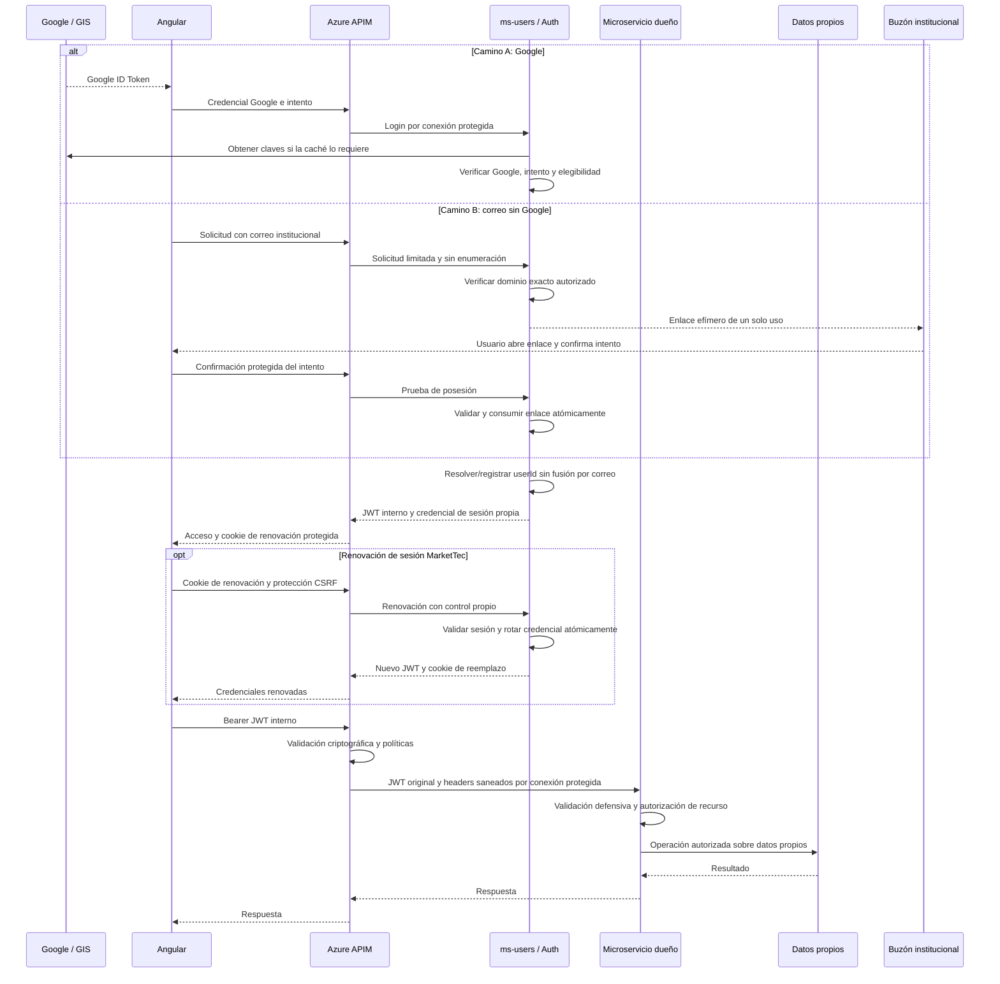

# ADR-004: Seguridad de autenticación y fronteras de confianza

**Estado:** Proposed
**Fecha:** 2026-10-31
**Revisión técnica pendiente de aprobación:** 2026-11-01 — MTEC-40, subfases 1 y 2; [informe QA](../../docs/MTEC40_QA_REVIEW.md)
**Deciders:** Responsable del proyecto; aprobación pendiente
**Revisores requeridos:** responsables de los tres microservicios, frontend, APIM/infraestructura y revisión de seguridad designada por el proyecto
**Contexto:** MTEC-40 — revisión y decisión de arquitectura; dependencias MTEC-12, MTEC-15, MTEC-34, MTEC-35, MTEC-36 y MTEC-37; antecedente MTEC-17
**Destinatarios:** desarrolladores y mantenedores de MarketTec

> La dirección seleccionada por el responsable del proyecto es Google o correo institucional, identidad interna y sesiones propias de MarketTec, con `ms-users` en el repositorio independiente `a-calderon-org/ms-users-market-tec` ya existente. La revisión conjunta y aprobación formal exigidas por MTEC-40 están pendientes: ADR-004 permanece **Proposed** y no autoriza implementación, modificación de contratos ni cambios Azure. Los parámetros de seguridad aquí propuestos no se consideran aprobados. ADR-001 continúa Accepted; ADR-002 y ADR-003 continúan Proposed.

## 1. Contexto, alcance y evidencia

Se necesita formalizar dos métodos de acceso —Google Identity Services y correo institucional verificado sin obligación de usar Google— que resuelvan una identidad interna única, y los controles que separan navegador, gateway, servicios y datos. También se debe distinguir la distribución de dominios de ADR-001 de la distribución física de repositorios. Una sesión visual en Angular no demuestra autenticación del servidor. Una firma JWT válida tampoco concede por sí sola acceso a un perfil, publicación, chat o notificación.

### Método y límites

La evidencia inicial se elaboró sobre `ee198d4e78115834d7615e273d9007d2b719ee96`; la revisión del 2026-10-31 usó `5dc2d1ebf981b8009fb5b268d7c857e6a1167496`. Esta revisión del **2026-11-01** contrasta íntegramente ADR-004, DECISION_LOG, ADR-001, IDENTITY_CONTRACT y Users OpenAPI sobre `market_tec@de6192b4df8f75df1f58ad07b9c03710b2cc91c1`, con código Angular/adaptadores, configuración y validadores existentes. Se consultaron en solo lectura MTEC-40, MTEC-36, MTEC-15, MTEC-12, MTEC-34, MTEC-35 y MTEC-37; MTEC-17 conserva su evidencia histórica. Se contrastaron las recomendaciones con documentación primaria enlazada de Google, Microsoft, IETF y OWASP.

El conector GitHub devolvió 404 para `ms-users-market-tec`. La subfase 1 inspeccionó objetos locales de `main@650411bdf0a5b9375fbe6911595f3150d79c633d` y de la preparación MTEC-37 en `7f963a98494a74acbe2479c91a372224ec55a033`, sin resolver entonces el contenido remoto. En la subfase 2, `git ls-remote` y consultas de solo lectura a GitHub REST confirmaron `main@19ce9f18281c4d6a73985772824e60d4587bd80c`: es un merge de esas dos bases y su árbol coincide exactamente con `7f963a9` (`6e58edc1251248d1548e5b65fb5e1396f91dd6d7`). Por ello el contenido local inspeccionado sí representa ese HEAD remoto. GitHub informa success para el run `41364044664` de ese SHA; se leyó su estado, sin auditar logs ni reejecutar pruebas. No se modificó ese repositorio ni se deduce despliegue de ese merge/CI. Evidencia, comandos y límites en el informe QA y 7.1.

Se emplean las etiquetas de certeza del [índice de contexto](../README.md): **Verificado**, **Inferido**, **No determinado** y **Documentado pero no verificado**. Los controles recomendados son propuestas; su existencia operativa no se deduce de la presencia de documentación.

No se dispone de evidencia de lectura del entorno Azure desplegado dentro de este alcance. No se inspeccionaron recursos Azure, no se enviaron credenciales de prueba a sistemas remotos y no se realizaron pruebas de explotación. La [segunda validación histórica](../audits/SECOND_PASS_VALIDATION.md) aporta antecedentes, pero sus afirmaciones sobre interceptor, expiración, ausencia de contratos y estado de Fase II deben contrastarse con esta base posterior.

### Evidencia que fundamenta la propuesta

| Referencia | Evidencia y certeza | Consecuencia para el diseño |
|---|---|---|
| E1 | **Verificado:** [AuthTokenService](../../app/frontend/src/app/core/auth/auth-token.service.ts) decodifica el payload y comprueba `exp`; [GoogleAuthService](../../app/frontend/src/app/features/auth/services/google-auth.service.ts) obtiene `sub` y `email` sin verificación criptográfica ni intercambio HTTP. La [prueba de sesión](../../app/frontend/src/app/features/auth/services/google-auth.service.spec.ts) construye un token sintético con `alg: none` y firma ficticia. | Se puede representar una identidad visual con claims fabricados. **No determinado:** que las APIs remotas acepten esa credencial o permitan acceso indebido a datos. La prueba existente se inspeccionó; no se volvió a ejecutar como parte de este ADR. |
| E2 | **Verificado:** el [interceptor](../../app/frontend/src/app/core/api/api-key.interceptor.ts) restringe origen/ruta, adjunta bearer y subscription key e invalida el token correspondiente ante 401. AuthTokenService ya programa la expiración. | No reabrir como fallos actuales la comparación por prefijo de origen ni la expiración solamente perezosa de la auditoría histórica. Estos controles de cliente no validan la firma. |
| E3 | **Verificado:** [ms-users](../../app/ms-users/README.md), [ms-catalog](../../app/ms-catalog/src/app.ts) y [ms-notifications](../../app/ms-notifications/src/markettec_notifications/main.py) implementan su fundación técnica. [HealthController](../../app/ms-users/src/main/java/com/markettec/users/adapters/in/web/HealthController.java), [pom.xml](../../app/ms-users/pom.xml), el router/middleware Express y el [adaptador FastAPI](../../app/ms-notifications/src/markettec_notifications/adapters/inbound/http.py) no implementan verificación Google/JWT ni autorización de negocio. | No hay autenticación backend implementada en estas fundaciones de `market_tec`; el dominio y persistencia independientes se distinguen en E11. Health, errores y documentación técnica no demuestran protección de futuros endpoints de negocio. Tampoco demuestran qué backend está conectado actualmente a Azure APIM. |
| E4 | **Verificado:** [ADR-001](ADR-001-distribucion-microservicios.md) es Accepted y fija ownership e identidad opaca; deja JWT/APIM fuera de su aprobación. [ADR-002](ADR-002-rol-express-backend.md) y [ADR-003](ADR-003-convencion-timestamps.md) son Proposed. | Auth pertenece a ms-users, sin cuarto servicio, sin acceso a bases ajenas y sin consulta síncrona a ms-users en cada autorización de catálogo. Este ADR no altera esos límites. |
| E5 | **Verificado:** el [contrato de identidad](../../contracts/identity/IDENTITY_CONTRACT.md) recomienda el intercambio y RS256/JWKS. [Users OpenAPI](../../contracts/openapi/users.json) es `draft-pending-team-approval`; `/v1/auth/google` está marcado `proposed` y `/health` está implementado. **Documentado pero no verificado:** la operación del flujo de intercambio recomendado. | Publicar borradores no aprueba sus parámetros ni implementa el intercambio. MTEC-15 exige revisión conjunta. |
| E6 | **Verificado:** [API_AND_EVENTS](../phase2/API_AND_EVENTS.md), sección `POST /auth/google`, contiene un ejemplo de respuesta cuyo primer segmento Base64URL se decodifica a `{"alg":"HS256","typ":"JWT"}`. [AZURE_INFRASTRUCTURE](../phase2/AZURE_INFRASTRUCTURE.md) conserva `jwt-secret`, `JWT_SECRET` y un ejemplo conceptual de APIM que referencia discovery Google. | La contradicción existe en ejemplos de diseño, aunque `HS256` no aparezca escrito literalmente. **Inferido:** esos nombres sugieren un secreto compartido. **No determinado:** algoritmo o claves realmente desplegados; no hay evidencia de implementación HS256. |
| E7 | **Verificado:** [GOOGLE_LOGIN](../../app/GOOGLE_LOGIN.md) afirma validación backend y aceptación de cualquier dominio; [MICROSERVICES_ARCHITECTURE](../phase2/MICROSERVICES_ARCHITECTURE.md) conserva referencias a ADR-001 Proposed y a validación síncrona de usuario. | Hay desfases frente al código, ADR-001 y la propuesta de dominio institucional. Se registran aquí sin editar documentación ajena a este alcance. No usar esas frases como evidencia de controles desplegados. |
| E8 | **Verificado documentalmente en la revisión inicial:** [auditoría MTEC-12](https://allanaron06122005.atlassian.net/browse/MTEC-12?focusedCommentId=10025) y [seguimiento de segunda auditoría](https://allanaron06122005.atlassian.net/browse/MTEC-12?focusedCommentId=10027) del 2026-10-29 mantienen la alternativa interna sin aprobación y Azure no verificado. [MTEC-36](https://allanaron06122005.atlassian.net/browse/MTEC-36) define intercambio seguro; [MTEC-34](https://allanaron06122005.atlassian.net/browse/MTEC-34) lo precede mediante identidad interna. [MTEC-15](https://allanaron06122005.atlassian.net/browse/MTEC-15) distingue contratos publicados de aprobación pendiente. | Los tickets sustentan la necesidad y dependencias, no la eficacia de controles productivos. No se modifican tickets ni sus estados. |
| E9 | **Verificado:** [MTEC-40](https://allanaron06122005.atlassian.net/browse/MTEC-40) sigue To Do, sin comentarios al 2026-11-01; bloquea MTEC-36 y exige revisión humana y aprobación explícita. Su descripción conserva el recuento histórico de 16 amenazas; este ADR ya contiene T01–T18. | No acredita aprobación. El merge documental previo ni esta preparación satisfacen la revisión humana. |
| E10 | **Verificado en Jira, 2026-11-01:** MTEC-34 y MTEC-35 Done; MTEC-37 In Progress; MTEC-36 To Do, bloqueado por MTEC-40; MTEC-15 y MTEC-12 In Progress. **Documentado pero no verificado independientemente:** comentarios de MTEC-34/35 reportan dominio validado, PR #2 fusionado y 111 pruebas normales + 34 SQL; MTEC-37 reporta preparación y QA local; la subfase 2 confirma por GitHub REST el merge y el estado success del CI de `19ce9f1`, sin acreditar operación Azure. | Done de dominio/persistencia no acredita autenticación, permisos runtime/migrador, Managed Identity, migración Azure o APIM. MTEC-17 conserva su estado histórico Done; no se reabre. |
| E11 | **Verificado por inspección local de ms-users:** `650411b` contiene `UserService`, `Email`, `ExternalIdentityKey`, `AuthenticatedPrincipal`, `SqlUserStore` y Flyway `V1__initial_users_schema.sql`; `7f963a9` añade perfil `sql-appservice`, observabilidad y CI. Referencias exactas en 7.1. | Ya existe dominio/persistencia independiente, a diferencia de `app/ms-users`. `AuthenticatedPrincipal` local solo expone `userId()`; vinculación queda denegada por defecto y no hay verificador Google/JWT, sesiones o correo implementados en esas bases inspeccionadas. |

## 2. Alternativas consideradas

Los nombres A/B de esta sección designan las alternativas históricas sobre dónde validar Google, no los caminos de acceso de 3.1 ni las alternativas de distribución de servicios de ADR-001.

| Criterio | Alternativa A: Google ID Token validado en APIM | Alternativa B: Google verificado en ms-users y JWT interno |
|---|---|---|
| Firma y claims de entrada | APIM verificaría firma con claves Google, allowlist de algoritmo, emisor Google, audiencia/client ID autorizado, `exp` y demás claims requeridos. Un token Google no es automáticamente una credencial autorizada para cualquier API. | ms-users verificaría esos mismos elementos antes de resolver o crear identidad y emitir credencial interna. APIM y servicios aceptarían exclusivamente el perfil interno aprobado en rutas protegidas. |
| Obtención y rotación Google | APIM dependería de discovery/JWKS Google y de su caché/recuperación. Habría que probar rotación, `kid` desconocido e indisponibilidad. | Esa dependencia se concentra en el verificador Google de ms-users; APIM y servicios dependen además de las claves públicas internas. Se operan dos ciclos de claves distintos. |
| Asociación a usuario | `sub` Google no puede convertirse en `userId` por simple renombrado. Habría que diseñar cómo obtener un principal interno confiable desde el mapping de ms-users. No se propone consultar ms-users en cada request ni mover su mapping al gateway. | ms-users resolvería una vez por intercambio `(issuer, sub)` externo a `userId` opaco; el `sub` del JWT interno representaría ese `userId`. |
| Acoplamiento | Los validadores y la propagación de identidad quedan acoplados al proveedor, sus claims y vida útil. Restricciones de alta/dominio siguen requiriendo lógica de cuenta interna. | Los servicios consumen identidad de MarketTec; ms-users concentra integración Google y política de alta. Se puede cambiar proveedor sin transformar el identificador de recursos. |
| Frontera de confianza | APIM autenticaría una credencial externa, pero aún habría que proteger el backend, validar defensivamente y propagar una identidad interna no falsificable. | Fronteras separadas: Google acredita identidad externa; ms-users emite principal interno; APIM valida admisión; cada servicio valida y autoriza sus recursos. |
| Autorización y propagación | Ni el token Google ni headers del gateway sustituyen ownership, participación o capacidades. Los backends necesitarían reglas explícitas para traducir la identidad sin interpretar Google `sub` como ID interno. | JWT original interno reenviado, validación local y principal de aplicación. Los servicios no reciben Google ID Tokens ni inventan identidad con headers. Eventos transmiten referencias internas según contratos validados. |
| Coste y limitaciones | Menor operación de un emisor propio, pero no resuelve por sí sola mapping, cuentas ni autorización; forzar su resolución en cada llamada contradiría el límite de ADR-001. | Añade emisor crítico, custodia/rotación de claves, publicación JWKS, disponibilidad del intercambio, revisión de contratos y gestión de revocación. |

**Evaluación de la revisión — Inferido:** B ampliada sigue siendo la opción más adecuada al requisito de acceso sin Google y a ADR-001. A por sí sola no autentica el correo institucional ni materializa el mapping interno; añadirle otro emisor y traducción en gateway recuperaría gran parte del coste de B con dos perfiles de admisión. A sería reconsiderable si se retirara el requisito sin Google o se aprobara una plataforma externa que resolviera ambos métodos y el mapping, con otra revisión de coste/contratos. No hay evidencia que justifique cambiar ahora la dirección seleccionada.

La adopción de B queda condicionada a capacidad real para operar firma/rotación, sesiones y correo, responsables de incidentes y contratos aprobados. Si esa capacidad falta, se mantiene el bloqueo; publicar una recomendación no permite degradar validaciones ni habilitar rutas inseguras para continuar.

### 2.1. Dirección seleccionada y aprobación pendiente

El responsable del proyecto ha seleccionado **la alternativa B como base del diseño**, ampliada con acceso mediante correo institucional sin Google. La alternativa A queda como antecedente evaluado y no es la base del diseño actual. La dirección seleccionada comprende:

- Google o enlace institucional de un solo uso, resueltos por `ms-users` a una identidad interna única.
- JWT interno común para APIs y sesiones renovables propias de MarketTec.
- Propiedad de recursos derivada del principal autenticado y autorización en el servicio dueño.
- Repositorio independiente existente para `ms-users`, con procedimiento de autoridad única pendiente en 7.1, conservando los tres dominios de ADR-001.

Esta selección de dirección no equivale a la aceptación formal del ADR ni a la aprobación del perfil de seguridad:

| Ámbito | Estado y alcance |
|---|---|
| Distribución de tres servicios, ownership de datos e identidad opaca de ADR-001 | **Accepted**, aprobación del 2026-10-29. No se reabre ni se amplía su alcance. |
| Dirección de autenticación y repositorio descrita arriba | Seleccionada por el responsable del proyecto para el diseño de MTEC-40; pendiente de revisión conjunta y registro de aprobación formal. **Documentado pero no verificado** como mecanismo operativo. |
| Perfil JWT, sesiones, elegibilidad, enlaces y operación | **Proposed**; parámetros y responsables en la sección 4. |

Para cerrar MTEC-40 falta evidencia de revisión por responsables de los tres servicios, frontend, APIM/infraestructura y seguridad designada; aprobación explícita del responsable del proyecto de B ampliada y los acuerdos mínimos de la sección 8; y registro formal revisado en ADR-004/DECISION_LOG mediante el PR exigido por el ticket. No se infiere aprobación de un merge previo. Nombre del revisor de seguridad, acta de conformidades/desacuerdos y plazos de pendientes: **No determinado**. Esta edición documental no cierra el ticket.

## 3. Política criptográfica y responsabilidades propuestas

Todos los verbos de obligación de esta sección describen requisitos para una futura implementación aprobada, no controles existentes.

### 3.1. Dos caminos de autenticación e identidad común

Los pasos siguientes son diseño futuro; no definen rutas ni payloads nuevos y no están implementados.

#### Camino A — Google Identity Services

1. Angular obtiene un Google ID Token mediante GIS.
2. Angular envía esa credencial a la futura API de autenticación mediante APIM; el login no requiere previamente un JWT interno.
3. `ms-users` verifica criptográficamente firma, algoritmo, issuer, audience, expiración y claims obligatorios, además de la vinculación al intento y elegibilidad aprobadas.
4. `ms-users` identifica o registra al usuario interno según la política de alta, sin vincular cuentas automáticamente por correo.
5. `ms-users` emite la credencial de MarketTec y establece la sesión propia de 3.4.
6. APIM y los servicios validan el JWT interno; los casos de uso consumen exclusivamente la identidad interna validada.

El Google ID Token es una credencial transitoria, nunca el identificador permanente de publicaciones, chats o perfiles. Google `sub` solo identifica el vínculo externo dentro de `ms-users`.

#### Verificación Google

ms-users usaría una biblioteca mantenida, con pruebas explícitas de firma, algoritmo admitido, emisor y audiencia Google, expiración, tipos de claims y ausencia de campos obligatorios. Las claves provendrían de endpoints Google configurados, con caché según sus metadatos y rechazo seguro si no existe una clave válida disponible. No se confiaría en `jku`, `x5u` o una URL suministrada por el token. El [verificador recomendado por Google](https://developers.google.com/identity/gsi/web/guides/verify-google-id-token) es la referencia para estos checks; decodificar no es verificar.

El mapping de identidad externa usaría `(issuer, sub)`, nunca correo como clave de cuenta. Si se admiten las dos representaciones oficiales del emisor Google, su normalización a un emisor canónico ocurriría **después** de validar contra la allowlist; la regla debe aprobarse y probarse para no crear cuentas duplicadas. Un vínculo existente prevalecería sobre cambios de correo. No se vincularían cuentas distintas automáticamente por coincidencia de email.

La admisión Google también aplicaría la allowlist institucional descrita abajo. Se exigiría `email_verified` booleano verdadero y, cuando se use como evidencia Google Workspace, `hd` firmado y perteneciente a la allowlist Workspace aprobada, con su relación al dominio del correo definida por funcional; el parámetro `hd` del botón no demuestra pertenencia. Google advierte que un correo de terceros sin `hd` puede no estar bajo su autoridad actual aunque `email_verified` sea verdadero: en ese caso se exigiría prueba adicional de posesión del buzón institucional o se rechazaría según P16. No se impondría Google Workspace al camino de correo sin Google. Ninguno de esos claims demuestra por sí solo matrícula o empleo activo.

Para cuentas nuevas se recomienda alta idempotente después de validar identidad y elegibilidad, con unicidad del mapping y resolución transaccional de concurrencia. Alta automática frente a registro previo, evidencia institucional y reglas de vinculación requieren aprobación. MTEC-34 define el dominio y puertos; este ADR no elige motor de persistencia.

#### Perfil mínimo Google para deliberación (P18/P21; Proposed)

| Elemento | Propuesta y prueba de aceptación |
|---|---|
| Firma y claves | Solo RS256, como anuncia el [discovery Google](https://accounts.google.com/.well-known/openid-configuration); biblioteca mantenida y firma obligatoria. Obtener JWKS del destino Google configurado (`https://www.googleapis.com/oauth2/v3/certs` en metadata consultada), TLS, caché conforme a Cache-Control y refresco limitado ante `kid` desconocido. Rechazar `none`, RS/HS, clave ajena y caída sin clave válida; no usar `tokeninfo` por request como verificador de producción. |
| Emisor/cliente | Allowlist de `accounts.google.com` y `https://accounts.google.com`; canonicalizar a la segunda forma solo después de verificar. `aud` debe corresponder al client ID configurado para ese entorno/intento; no admitir todo cliente de la organización. Inventario exacto de client IDs/orígenes: **No determinado**, pendiente frontend/ms-users. Proponer una única audiencia igual al client ID del intento y rechazar inicialmente arrays/múltiples audiencias hasta aprobar su perfil. Si aparece `azp`, comprobar su tipo y coincidencia exacta con el cliente autorizado para ese intento, también con una sola audiencia; no basta que pertenezca a la organización. Revisar con [OIDC Core, validación de ID Token](https://openid.net/specs/openid-connect-core-1_0.html#IDTokenValidation). Probar cliente/presentador ajenos y formas de emisor. |
| Tiempo/intento | `sub`, `iss`, `aud`, `iat`, `exp` obligatorios con tipos y coherencia; validar `nbf` si llega. Propuesta de skew compartido en P11. Nonce generado por servidor, 256 bits aleatorios y TTL de 5 min, asociado a cookie de preautenticación protegida según P23, propósito, client ID e intento; igualdad exacta con claim y consumo atómico antes de emitir. Rechazar nonce ausente, expirado, de otro navegador o repetido. El soporte GIS de [nonce](https://developers.google.com/identity/gsi/web/reference/js-reference#nonce) no implementa por sí solo esta correlación. |
| Cuenta/errores | Después de firma, intento y P16: resolver `(issuer canónico, sub)`; alta idempotente si se aprueba. Conflicto por correo no vincula ni fusiona. Probar dos altas simultáneas, correo cambiado y misma pareja ya existente: un único mapping/userId. Credencial inválida: 401 genérico; solicitud malformada: 400; proveedor indisponible sin clave: error temporal sin sesión, semántica final MTEC-15. No devolver claims/tokens en errores. |

Las cifras de desafío son propuestas para limitar replay y retención de estado; necesitan aprobación y prueba de usabilidad. No se reduce arbitrariamente la vida del token Google a los 15 min del JWT interno: la frescura del login se acota con el intento. La verificación de correo/`hd` y elegibilidad descrita arriba sigue siendo obligatoria según P16; el identificador externo nunca sustituye al `userId`.

#### Camino B — Correo institucional sin Google

1. El usuario introduce su correo institucional en Angular.
2. La solicitud pasa por APIM; el backend verifica el dominio exacto contra la allowlist aprobada y configurada.
3. `ms-users` solicita prueba de posesión enviando un enlace de acceso de un solo uso al buzón; no exige cuenta Google ni contraseña institucional.
4. El usuario abre el enlace y confirma explícitamente el intento de acceso.
5. El backend valida el secreto contra su verificador almacenado, la integridad del estado asociado, expiración y vinculación al correo, propósito e intento. Consume el enlace atómicamente una sola vez.
6. Solo tras esa prueba y la política P16 aprobada, `ms-users` crea o resuelve la identidad interna del método. Recuperar una identidad existente por correo también está sujeto a la política de buzones reasignados descrita abajo; el enlace solo prueba posesión actual. Si existe una cuenta por otro método, exige la vinculación descrita abajo.
7. Se emite la misma credencial interna de MarketTec y se establece una sesión propia, independientemente del método inicial.

Requisitos de seguridad para la futura implementación:

- Prevenir enumeración con respuestas y tiempos comparables para cuentas existentes/inexistentes, sin revelar su método de acceso.
- Limitar solicitudes de emisión, reenvío y validación por intento, destinatario y origen de red; prevenir abuso de envío sin bloquear cuentas por peticiones anónimas.
- Generar tokens aleatorios criptográficamente seguros, con entropía suficiente y vencimiento breve. Duración exacta y límites se aprobarán en P18.
- Almacenar verificadores de forma segura, por ejemplo un hash del secreto aleatorio; proteger estado, propósito, destinatario, expiración e intento. No almacenar el token utilizable en claro ni elegir aquí el motor de persistencia.
- Validar y consumir atómicamente para que dos confirmaciones concurrentes no creen dos accesos; rechazar tokens alterados, expirados, ajenos al intento o ya consumidos.
- Proteger frente a escáneres automáticos de correo: una apertura GET o previsualización no consume el secreto ni crea sesión. Exigir confirmación explícita mediante una operación protegida y vinculada al intento; el protocolo entre dispositivos queda por aprobar en P18.
- Usar HTTPS y destinos de enlace configurados y confiables; impedir redirecciones arbitrarias, fugas por referente y analítica de terceros en la confirmación. El enlace de correo transporta un secreto efímero; nunca se coloca un bearer de API o renovación en una URL.
- No registrar tokens ni enlaces sensibles en frontend, APIM, servidor, proveedor de correo, trazas o errores; redactar también URL/query y cookies. Requerir reautenticación reciente para operaciones sensibles.

Se adaptan los controles de tokens de un solo uso de [OWASP Forgot Password](https://cheatsheetseries.owasp.org/cheatsheets/Forgot_Password_Cheat_Sheet.html) al enlace de acceso; esa referencia no define el protocolo de login de MarketTec. La mitigación de escáneres y el consumo atómico son requisitos del diseño que necesitan pruebas propias.

Verificar el correo acredita **control del buzón**, no necesariamente matrícula o empleo activo. La política funcional de elegibilidad y su eventual revalidación deben aprobarse por separado.

#### Allowlist institucional común

Se propone una allowlist configurable de **dominios exactos**: `estudiantec.cr`, `tec.ac.cr` e `itcr.ac.cr` son exclusivamente candidatos, pendientes de confirmación del responsable funcional antes de habilitar registro. No se habilita ninguno mediante esta edición.

La futura comparación usaría el dominio extraído de un correo validado, con normalización definida y uniforme. Se prohíben sufijos ambiguos, coincidencias parciales, comodines, subdominios implícitos y dominios similares: `estudiantec.cr.example.org` y `otroestudiantec.cr` no equivalen a `estudiantec.cr`. Añadir cualquier otro dominio institucional requeriría configuración y aprobación explícita. No se añade validación funcional al código.

#### Identidad interna y vinculación

**Una persona puede tener varios métodos de autenticación, pero debe conservar un único `userId` interno.** El modelo es conceptual, sin aprobar esquema de datos ni modificar contratos:

```text
User
 ├── userId: usr_12345 (ejemplo, no formato aprobado)
 ├── correo institucional verificado
 ├── GoogleIdentity (opcional)
 └── EmailIdentity (opcional)
```

El ID es opaco, estable y generado exclusivamente por `ms-users`; no se deriva del correo ni de Google `sub`, no cambia al añadir métodos y se comparte como referencia lógica entre servicios. El mismo método verificado recupera el mismo usuario incluso ante concurrencia; cambiar un correo o añadir un proveedor no reasigna el ID.

No se fusionan cuentas automáticamente por coincidencia de correo. Vincular métodos exige una operación autenticada y prueba de control reciente de **ambos métodos**, prevención de replay y comprobación de conflictos. Si un método ya pertenece a otra cuenta, no se crea otra identidad ni se fusionan usuarios silenciosamente; se exige resolución explícita. El procedimiento de recuperación/conflictos y las reglas para correos reasignados están pendientes en P16. No se promete deduplicar personas solo por sus direcciones.

#### Parámetros de correo y recuperación para deliberación (P16/P18; Proposed)

| Decisión | Alternativas y recomendación razonada | Riesgo y prueba necesaria |
|---|---|---|
| Dominio/alta/elegibilidad | Dominios candidatos de la allowlist frente a registro previo autorizado. Recomendar alta idempotente solo tras prueba y elegibilidad funcional aprobadas; si se exige matrícula/empleo activo, se necesita fuente y revalidación definidas antes de habilitarla. | No confundir buzón con vínculo institucional. Hasta decidir, registro deshabilitado. Probar dominios parecidos, subdominios y exclusión de cuentas no elegibles. |
| Secreto y caducidad | Recomendar 32 bytes CSPRNG (256 bits), Base64URL, TTL inicial 10 min frente a códigos cortos/plazos mayores. Guardar SHA-256 del secreto de alta entropía, nunca secreto en claro, junto con correo normalizado, propósito, intento y expiración. | Equilibra entrega tardía y ventana de robo, sujeto a medición. No aplicar hash rápido a contraseñas. Probar aleatoriedad/tamaño, vencimiento con reloj controlado, alteración y ausencia de secretos persistidos/logueados. |
| Enumeración y tasa | Mismo acuse genérico y procesamiento comparable para toda dirección sintácticamente válida, registrada o no. Propuesta piloto: 3 envíos/15 min por destinatario, espera de 60 s entre reenvíos y 20 solicitudes/15 min por origen; 5 confirmaciones fallidas por intento. Combinar límite global de envío y presupuesto pendiente de APIM/correo. | Valores ajustables, pendientes de pruebas de carga/NAT y aprobación; no bloquear una cuenta por tráfico anónimo ni revelarla con 429 selectivo. Probar cuentas existentes/inexistentes, destinatarios rotatorios, ráfagas y red compartida. |
| GET/consumo/reenvío | GET muestra confirmación, sin consumir ni crear sesión; POST protegido comprueba intento, prueba y caducidad con consumo transaccional único. Reenvío idempotente durante cooldown; nuevo enlace invalida el anterior para el mismo intento después de autorizar reenvío. | Escáner, carreras y respuesta perdida. Dos confirmaciones producen como máximo una sesión; reintentar no emite otra. Si la respuesta se pierde tras consumo, reiniciar autenticación; entrega fallida no consume como éxito ni crea usuario. |
| Dispositivos | Recomendar confirmar en el navegador que inició el intento, ligado por cookie aleatoria HttpOnly/Secure y control CSRF; alternativa cross-device requiere protocolo adicional aprobado. Un navegador distinto reinicia allí el flujo, sin trasladar sesión con el enlace. | Reduce login CSRF por enlaces compartidos; limita comodidad. Probar escáner/preview, cookie ausente, navegador ajeno y enlace reenviado. Sin bloqueo duro por IP o user-agent. |
| Recuperación y conflictos | Para vincular: sesión del usuario actual con reautenticación de máximo 5 min y prueba reciente del método nuevo; sin unión por email. Si ya hay método/correo en conflicto, detener alta/vínculo y resolver de forma explícita sin revelar cuenta. Si no controla ningún método, no hay recuperación automática; RP/funcional debe aprobar prueba alternativa y responsable antes de ofrecerla. | El código actual no garantiza persona única ni correo único entre métodos. No convertir nuevo control de buzón reasignado en acceso a cuenta histórica. Probar pérdida de método, cambio de correo, conflicto y baja; bloquear vínculo que ya pertenece a otro userId. |

**Pendiente bloqueante P16 — continuidad del titular:** excluir la recuperación alternativa no resuelve el riesgo de un login ordinario a una `EmailIdentity` existente tras reasignación del buzón. Un enlace nuevo y el mismo correo no distinguen al titular histórico del nuevo; el dominio/persistencia inspeccionado tampoco aporta esa prueba. Funcional, ms-users y SEG deben acordar evidencia institucional estable/no reasignable o un procedimiento adicional de continuidad, o limitar explícitamente el método y aceptar su riesgo residual. Hasta resolverlo no habilitar ese acceso histórico ni prometer protección frente a reasignación. Probar el caso de dos titulares sucesivos del mismo buzón sin fusionar ni reasignar cuentas automáticamente. No se elige aquí una política de negocio ni se modifica el esquema.

**Reautenticación pendiente P16/P18:** `iat` reciente y nonce válido acreditan emisión/correlación del intento, no necesariamente autenticación interactiva reciente del usuario en Google. Antes de habilitar vínculos u operaciones sensibles, definir qué prueba y reloj satisfacen los 5 min propuestos para cada método; evaluar `auth_time`/`max_age` solo si el flujo elegido los soporta y verifica, o una prueba adicional aprobada. Una cookie MarketTec o un callback GIS silencioso no se declaran prueba suficiente por sí solos.

Estos valores son propuestas de piloto, no reglas institucionales acreditadas. `Email` del repositorio independiente normaliza solo el dominio y conserva mayúsculas, puntos y alias de la parte local; aprobar esa regla sin inferir equivalencias Gmail. El namespace de `EmailIdentity` necesita revisión con MTEC-15: no inventar un Google `sub` para correo ni una nueva clave contractual aquí.

### 3.2. Emisión y validación interna

Se propone **RS256 como única entrada inicial de la allowlist interna**, con clave de firma exclusiva de ms-users y distribución de claves públicas mediante JWKS. Propuesta: RSA de 2048 bits como mínimo conforme a [RFC 7518, sección 3.3](https://www.rfc-editor.org/rfc/rfc7518.html#section-3.3); revisar 3072 bits según compatibilidad/latencia. No se aprueba por aparecer en un ejemplo. Una clave verificadora no debe permitir emitir tokens: por ello se prefiere firma asimétrica frente a distribuir un secreto HMAC entre gateway y servicios. ES256 u otra opción requerirían evaluación de compatibilidad y aprobación explícitas; no se propone aceptar simultáneamente HS256 y RS256 como fallback.

El perfil propuesto usaría `iss` interno estable, `aud` explícita, `sub = userId` opaco, `iat`, `exp` y `jti`. `nbf` y su obligatoriedad están abiertos. Claims temporales serían NumericDate en segundos según [RFC 7519](https://www.rfc-editor.org/rfc/rfc7519.html); esto no aprueba la convención general de fechas de ADR-003. Se verificarían tipos, coherencia temporal, duración máxima y capacidades realmente otorgadas. El JWT minimizaría datos personales y no incluiría claves ni secretos; su firma no cifra el contenido.

En el header JOSE se propone `kid` obligatorio y un tipo de token explícito por aprobar. El validador asociaría `kid` únicamente a claves del emisor configurado, con tipo/uso/algoritmo compatibles; nunca usaría ese identificador como ruta o destino de red. El perfil Google y el interno tendrían reglas de aceptación separadas. Las rutas de negocio no aceptarían tokens Google como fallback. La [RFC 8725](https://www.rfc-editor.org/rfc/rfc8725.html) fundamenta la verificación de algoritmo y la separación de contextos; su aplicación concreta se revisaría en cada stack.

APIM rechazaría credenciales ausentes o inválidas en rutas protegidas y comprobaría firma, emisor, audiencia, tiempo y perfil autorizado. La forma de imponer la allowlist se debe demostrar con las capacidades reales de `validate-jwt`, tipos de claves, condiciones adicionales y pruebas negativas; no se supone un atributo de algoritmo inexistente. Cada adaptador backend repetiría la verificación con su configuración aprobada y construiría el principal conceptual del contrato de identidad, sin que dominio o casos de uso dependan de HTTP/JWT.

El flujo conceptual de autorización sería:

```text
Usuario autenticado → JWT MarketTec validado → AuthenticatedPrincipal
                    → userId interno → Operación de negocio autorizada
```

`ms-catalog` obtendría el vendedor de una publicación desde el principal autenticado, nunca desde `sellerUserId`, `senderUserId`, `vendedorId`, `senderId` u otro campo del navegador como prueba de identidad. El ID solo identifica al actor; cada operación aún debe comprobar ownership, participación y autorización del recurso. `ms-notifications` conserva sus reglas propias de acceso y destinatario.

Los servicios aplicarían ownership y capacidades al caso de uso: perfil propio en ms-users; vendedor, participante de chat y emisor de mensaje en ms-catalog; destinatario autenticado en ms-notifications. Una ruta o body selecciona un objeto, pero no acredita su propietario. La emisión de un JWT corresponde a autenticación; la autorización de objetos permanece en el servicio dueño. Un fallo de autenticación produciría 401; un principal válido sin permiso, 403 o la política de ocultación 404 que se acuerde. No se cambia aquí ningún contrato de errores.

### 3.3. JWKS, custodia y rotación

Como opción de despliegue se recomienda evaluar una clave asimétrica no exportable en Azure Key Vault con identidad administrada y permisos mínimos de firma para ms-users, frente a otro custodio aprobado. La elección sigue sujeta a compatibilidad, coste y aprobación; no es requisito para desarrollar localmente con claves efímeras (5.1). APIM y los demás servicios recibirían únicamente la parte pública. Ninguna clave privada, token o secreto de producción se copiaría a Git, frontend, fixtures o logs. No se reutilizaría la clave JWT como certificado mTLS.

La publicación seguiría el formato [JWK/JWKS de RFC 7517](https://www.rfc-editor.org/rfc/rfc7517.html), sin material privado. Con `openid-config`, APIM necesita metadata de discovery compatible que indique el `jwks_uri`; una URL de JWKS sola no sustituye esa metadata. Debe aprobarse la forma de publicación o la alternativa de aprovisionamiento de claves públicas; este ADR no crea endpoints ni afirma que ms-users sea un proveedor OIDC completo. Metadata y claves públicas deben ser alcanzables por los validadores sin necesitar un JWT que dependa de esas mismas claves, evitando un ciclo de arranque.

La rotación normal propuesta sería: publicar la nueva clave pública, esperar y verificar propagación a todas las cachés, comenzar a firmar con el nuevo `kid`, mantener la anterior mientras puedan existir tokens válidos y retirarla después. El plazo depende de vida máxima del token, skew, cachés y solicitudes en vuelo; no se fija un intervalo definitivo. Microsoft documenta caché y limitación de refresco en [validate-jwt](https://learn.microsoft.com/en-us/azure/api-management/validate-jwt-policy), por lo que no se debe suponer invalidación inmediata. Ante `kid` desconocido se limitarían los refrescos para evitar denegación de servicio y se rechazaría si no puede validarse. Una clave pública conocida puede seguir verificando tokens vigentes durante una caída solo dentro de una política de caché acotada y aprobada.

Un compromiso exige un procedimiento distinto de rotación normal: detener firma comprometida, publicar reemplazo, retirar confianza y forzar rechazo de claves/tokens afectados en **todos** los validadores, incluido APIM con caché. Se necesitan responsables, auditoría y pruebas de recuperación; retirar una clave del JWKS no demuestra por sí solo revocación inmediata.

### 3.4. Expiración, renovación, revocación y replay

Se propone para ambos métodos un **JWT de acceso de 15 minutos (900 s)**, renovado mediante una **sesión propia de MarketTec**. Duración exacta, skew, máximo absoluto e inactividad de sesión permanecen sujetos a revisión (P10/P11). Esta propuesta sustituye la recomendación inicial de depender de un nuevo intercambio Google para cada renovación; no implementa sesiones ni modifica el contrato vigente.

La credencial de renovación sería rotatoria y revocable, vinculada a la sesión y al usuario interno, con almacenamiento seguro de verificadores. Cada uso válido invalidaría la anterior atómicamente y emitiría un reemplazo; la reutilización detectada exigiría revocar la familia de sesión afectada y reautenticar, con manejo de concurrencia/reintentos por aprobar. Logout, baja de cuenta y eventos de seguridad deben tener semántica explícita de revocación de sesiones. La [RFC 9700, sección 4.14](https://www.rfc-editor.org/rfc/rfc9700.html#section-4.14) orienta la rotación/detección de replay; usarla como referencia no declara un servidor OAuth implementado.

La renovación usaría cookie `HttpOnly`, `Secure` y política `SameSite` explícita acorde con el despliegue. Nombre, ámbito, duración y elección Lax/Strict o necesidad justificada de None están pendientes; None requeriría Secure. Se propone JWT de acceso preferentemente en memoria, protección CSRF en login/renovación/logout/vinculación y CORS con orígenes explícitos coherentes con cookies. SameSite no sustituye CSRF; HttpOnly no elimina XSS. Atributos y límites se revisarán conforme a [OWASP Session Management](https://cheatsheetseries.owasp.org/cheatsheets/Session_Management_Cheat_Sheet.html), sin introducir secretos en Angular ni en documentación.

La sesión interna no demuestra vigencia permanente de identidad externa o elegibilidad institucional. No se asume que Google ID Token pueda renovarse indefinidamente y **nunca se utiliza como refresh token interno**. Una sesión agotada/revocada o una operación sensible exige reautenticación mediante el método habilitado, conforme a P10/P16/P20.

El borrado de sesión del navegador o `disableAutoSelect()` no revocan un bearer ya emitido. `jti` aporta trazabilidad y una posible clave de revocación, pero no evita replay ni revoca nada por su mera presencia. Sin control compartido, una cuenta deshabilitada o token robado puede seguir siendo aceptado hasta `exp` más skew. El proyecto debe decidir si tolera esa ventana o exige denylist/versionado/introspección, con alcance coherente en gateway y servicios y sin introducir consultas a ms-users por request contra ADR-001.

Para el intercambio se recomienda un desafío de servidor con nonce vinculado al intento de login y de un solo uso, verificado en el token Google y consumido atómicamente. GIS permite [configurar nonce](https://developers.google.com/identity/gsi/web/reference/js-reference), pero generar uno solo en el navegador sin correlación/verificación server-side no resuelve replay. El contrato de desafío, su almacenamiento transitorio y tratamiento de reintentos están pendientes en P18; no existen actualmente ni se añaden aquí. Las defensas CSRF deben corresponder al modo GIS elegido: no se presupone que el callback JavaScript actual incluya automáticamente el mecanismo de cookie/body de un POST directo de GIS.

En las APIs, un bearer robado continúa siendo reutilizable durante su ventana de validez aunque el intercambio use nonce. Se proponen TLS, minimización de exposición, controles de frontend, vida breve y detección; protección criptográfica de posesión sería otro diseño por aprobar. No se promete eliminar replay con JWT, CORS o subscription keys.

#### Semántica inicial de sesión y revocación (Proposed)

Para P10 se propone máximo absoluto de sesión de **8 h**, inactividad de **30 min** y reautenticación sensible de **5 min**, sin «recordarme» inicial. Renovar no extiende el máximo absoluto; la inactividad se mide por uso válido de sesión, no por actividad arbitraria del navegador. Se comparan con 24 h/varios días: la propuesta reduce persistencia de robo a costa de más logins; seguridad y funcional deben validar esos límites. Refresh opaco de 256 bits, verificador hash y familia persistida en `ms-users`; no reutilizar el ID token Google. Al confirmar login se rota el contexto previo para impedir fijación.

La base propuesta es rotación estricta atómica, sin gracia: serializar refresh en frontend, invalidar el anterior y revocar la familia ante reutilización de una credencial consumida. Una respuesta perdida obliga a reautenticar, sin reemitir tokens al poseedor del refresh anterior. La alternativa de reintento idempotente/gracia acotada requiere protocolo y prueba adicionales; no se acepta una ventana reutilizable implícita. Expiración absoluta o por inactividad impide renovar; no invalida automáticamente el access JWT ya emitido. P10/P15 deben acordar si su `exp` se limita también al vencimiento absoluto de sesión o si se acepta la vigencia residual restante; probar ambos bordes sin presentar 8 h/30 min como corte distribuido inmediato. Logout revoca la sesión/familia actual e invalida su cookie; «cerrar todas», baja y compromiso revocan todas las sesiones del usuario. MTEC-15 debe acordar idempotencia y respuestas.

**Ventana residual explícita P15:** sin revocación distribuida de acceso, logout/baja no invalidan el JWT ya emitido. Con acceso de 900 s y skew propuesto de 30 s, el límite nominal es **`exp + 30 s` según el reloj del validador**, equivalente a 930 s respecto del `iat` declarado cuando `exp - iat = 900 s`. Desde la revocación queda la vigencia restante más skew; el desfase entre relojes debe medirse antes de comprometer un SLA de baja en tiempo real. Los 8 h de sesión no prolongan un JWT individual. Recomendar esta base únicamente para piloto de bajo riesgo y previa aceptación formal; si se exige baja inmediata, acordar difusión de revocaciones/denylist a todos los validadores, su persistencia y SLA, sin consulta síncrona por request a ms-users. `jti` o versión sin distribución no resuelven el problema.

El compromiso de la clave permite fabricar también tiempos y jti: esperar 15 min no basta mientras siga siendo confiable. El runbook propuesto detiene firma, sustituye clave y retira/bloquea el `kid` comprometido en cada validador con caché ya cargada; si no puede garantizarse, suspende rutas protegidas antes de reabrirlas con evidencia. Responsable operativo, SLA y mecanismo efectivo APIM están pendientes. Se requiere simulacro autorizado; no se promete rechazo inmediato con solo borrar la clave del JWKS.

### 3.5. Resolución propuesta de contradicciones

| Evidencia contradictoria | Resolución propuesta, sin modificar el documento dueño |
|---|---|
| Identidad recomienda RS256/JWKS; el JWT sintético de respuesta de API_AND_EVENTS declara HS256 en su header codificado. | Adoptar un único perfil asimétrico interno si se aprueba B; retirar posteriormente el ejemplo HS256 o marcarlo sustituido. El ejemplo no prueba un emisor HS256 implementado. |
| AZURE_INFRASTRUCTURE usa `jwt-secret` y `JWT_SECRET`. | Sustituir posteriormente la receta por referencias y permisos de la clave asimétrica aprobada, publicación de claves públicas y runbook. No interpretar un nombre de variable como evidencia del algoritmo desplegado. |
| El ejemplo APIM referencia discovery Google para «Google o interno». | Separar validación Google en ms-users de validación interna en rutas de negocio APIM. Documentar issuer/audience/discovery internos y excepciones de intercambio/metadata cuando se aprueben. |
| GOOGLE_LOGIN afirma backend verificador, IDs derivados de Google y cualquier dominio; el código no hace el intercambio y los contratos proponen identidad opaca/admisión institucional. | Corregir después el flujo implementado y la política realmente aprobada. No afirmar hoy verificación remota ni decidir dominios por un ejemplo. |
| Fase II conserva ADR-001 Proposed, validación síncrona de usuario y respuestas antiguas con envelope/campos distintos de Users OpenAPI. | Prevalecen ADR-001 Accepted y el estado draft del contrato versionado. Tras revisión conjunta, alinear prosa y ejemplos con el contrato aprobado, sin fallback a Google `sub` ni llamada por request. |
| Contrato de identidad contempla renovar demostrando Google o diseñar refresh después; Users OpenAPI solo propone intercambio Google y no describe correo, sesiones ni vinculación. | La dirección de MTEC-40 propone sesiones propias comunes. MTEC-15 debe revisar la ampliación y compatibilidad antes de implementar; el borrador versionado sigue siendo la referencia contractual vigente y no se amplía por este ADR. |
| ADR-002 propone directorios internos; ya existe dominio/persistencia en `ms-users-market-tec`. | La referencia histórica a repositorio futuro queda corregida en 7.1. Conservar el scaffold sin nuevos cambios de negocio; coordinar autoridad, mapa y workflows en tarea posterior, sin editar ADR-002 aquí. |
| Los títulos/alcance histórico de MTEC-34/MTEC-36 se centran en Google; la dirección ampliada incorpora correo y sesiones. | Coordinar alcance de implementación con sus responsables antes de desarrollarlo, sin modificar Jira. MTEC-17 sigue Done; su endurecimiento no implementa JWT interno ni se reabre por este diseño. |

## 4. Parámetros y decisiones pendientes

Las 24 decisiones se someten a deliberación; **ninguna aprobación de ADR-004 está acreditada**. P05 preserva el principio opaco Accepted de ADR-001, pero su perfil JWT sigue Proposed. «RP» es responsable del proyecto; «SEG» es revisión de seguridad designada, cuya persona aún es **No determinado**. Los roles pueden corresponder a la misma persona, sin presumir autoridad conjunta. El RP registra aceptación formal con revisión de los roles indicados; asignación Jira no equivale a aprobación.

Hitos acumulativos: **I (categoría A del QA)** = acuerdo mínimo para implementar interoperablemente MTEC-36; **F (categoría B)** = cierre de contrato/parámetro e integración frontend/consumidores; **D (categoría C)** = evidencia antes de desplegar un sistema protegido en Azure. La **categoría D del QA** identifica detalles diferibles con rol propietario e hito de revisión propuesto; no equivale al hito D de despliegue. Todas las filas aplican a D; la presencia en F no exige migrar Angular antes de I. «Diferible» describe solo el detalle indicado y un plazo propuesto por hito, nunca un aplazamiento aprobado. El responsable de la fila prepara ese pendiente; falta asignación nominal y fecha calendario en el acta de la sección 10.

| Decisión | Alternativas reales | Recomendación, valor y razón (Proposed) | Riesgos | Pruebas necesarias | Bloqueo y detalle diferible con plazo propuesto | Responsable de aprobación | Estado |
|---|---|---|---|---|---|---|---|
| P01. Estrategia | A: Google en APIM; B: métodos en ms-users y JWT propio | Ratificar B ampliada; mapping y correo sin Google bajo ms-users, conforme a evaluación 2 | Emisor/sesiones/correo críticos y coste operativo | Ambos métodos → mismo userId tras vínculo legítimo; sin dependencia de Google para correo (T13/T17/T18) | I/F/D; sin diferir elección | RP + tres servicios, frontend, APIM, SEG | Proposed |
| P02. Algoritmo | RS256; ES256; HMAC | RS256 único, RSA ≥2048 bits; revisar 3072 por coste/compatibilidad; verificadores solo públicos | Confusión RS/HS, coste de firma o soporte desigual | Java/Node/Python y APIM: RS válido, none/HS/clave ajena rechazados (T02/T03) | I/F/D; tamaño exacto del custodio productivo antes de D, ms-users/infra | RP + ms-users, APIM, SEG | Proposed |
| P03. Issuer | URI HTTPS por entorno; identificador lógico | URI HTTPS estable y exacta. Fixture aislada `https://identity.dev.markettec.invalid`; no es URL desplegada ni discovery operativo | Mezcla de entornos, cambio de emisor | Issuer exacto aceptado; otro entorno/sufijo rechazado (T04) | I: regla/configuración; F/D: URI real antes de integrar entorno, ms-users/APIM | RP + ms-users, APIM, consumidores | Proposed |
| P04. Audience | Una API; por servicio | Una audiencia por entorno, fixture `markettec-api-dev`; no comodines. Reduce complejidad inicial | Reutilización entre servicios; no sustituye ownership | Aud ajena/ausente rechazada; token propio no autoriza recurso ajeno (T04/T10) | I: semántica; F/D: valor real antes de integrar entorno, servicios/APIM | RP + tres servicios, APIM, SEG | Proposed |
| P05. Sub/userId | Interno opaco; externo/correo | `sub = userId` interno estable; mapping `(issuer,subject)` solo ms-users. Formato local usr_ + UUIDv4 no obliga al consumidor | Confusión de namespaces, duplicados por método | Mapping concurrente, cambios de email, vínculo y consumidores opacos (T13/T18) | I/F/D; formato de transporte revisado con MTEC-15 antes de I | RP + tres servicios, ms-users, MTEC-15 | Proposed; principio opaco Accepted en ADR-001 |
| P06. Iat | Obligatorio; opcional | Obligatorio NumericDate entero en segundos; `iat ≤ ahora + skew`, edad/duración máxima acotadas | Milisegundos, emisión futura | Tipos, límites, futuro y duración incoherente en cada validador (T05) | I/F/D; sin diferir semántica | RP + ms-users, APIM, consumidores | Proposed |
| P07. Nbf | Omitir; obligatorio | Omitir inicialmente; si existe validarlo y exigir coherencia con exp | Validadores desiguales o aceptación prematura | Sin nbf válido; nbf futuro o incoherente rechazado (T05) | I/F/D; sin diferir regla | RP + ms-users, APIM, consumidores | Proposed |
| P08. Exp | Obligatorio; opcional | Obligatorio, entero en segundos; `exp > iat`, `exp - iat ≤ 900 s` en perfil inicial P10 | Acceso indefinido o excesivo | Ausente, tipo inválido, expirado y borde con skew (T05/T06) | I/F/D; todo cambio de vida requiere coherencia P10 | RP + ms-users, APIM, consumidores | Proposed |
| P09. Jti | UUIDv4/aleatorio; ausente | Obligatorio, UUIDv4 generado por emisor, sin PII; correlación/revocación eventual | No evita replay por sí mismo; logs correlacionables | Unicidad, obligatoriedad y replay no tratado como autorización (T06/T11) | I/F/D; retención operativa antes de D, SEG/observabilidad | RP + ms-users, SEG | Proposed |
| P10. Acceso/sesión | 5/15/60 min; reintercambio; refresh rotatorio | 900 s acceso; sesión 8 h absoluta/30 min inactiva, reauth 5 min; refresh opaco rotatorio 256 bits; semántica en 3.4 | Robo, carrera, respuesta perdida y más logins | Expiración absoluta/inactiva, rotación única, concurrencia/reuso/logout (T06/T18) | I/F/D; límites exactos para entorno aprobados antes de I, ajustables sin superar política | RP + frontend, ms-users, SEG | Proposed |
| P11. Skew | 0/30/60 s o medido | 30 s inicial homogéneo, condicionado a medir relojes; margen explícito al TTL | Hasta 30 s extra o falsos rechazos | Bordes ±30 s, desfase real y tipos (T05) | I/F/D; medición y ajuste antes de F/D, infra/validadores | RP + APIM, infra, servicios | Proposed |
| P12. JWKS/kid/discovery/tipo | Metadata + JWKS; claves aprovisionadas | JWKS público sin privados, kid obligatorio, `typ=at+jwt` interno; metadata mínima compatible para APIM, sin declarar OIDC completo | SSRF, caché, ciclo de arranque o confusión de tipo | kid desconocido/duplicado, jku hostil, caída, clave privada ausente, Google rechazado en negocio (T04/T12/T15) | I: perfil/publicación; F: URLs/cachés y compatibilidad; D: prueba real. URLs productivas antes de F, ms-users/APIM | RP + ms-users, APIM, SEG | Proposed |
| P13. Rotación | Manual controlada; automatizada | Publicar/prepropagar antes de firmar; mantener anterior hasta último exp + skew y evidencia de cachés; emergencia bloquea kid o tráfico | Retirada prematura o confianza persistente en comprometida | Nueva/anterior, caída y compromiso con cachés calientes (T12/T15) | I: estrategia normal/emergencia coherente con P12/P15; F: protocolo/cachés compatibles; D: automatización/cadencia y SLA, ms-users/infra | RP + ms-users, infra/APIM, SEG | Proposed |
| P14. Custodia/firma | Key Vault + MI; otro custodio; clave exportable | Local: clave efímera aislada por proceso/prueba. Azure: evaluar no exportable + permiso mínimo de firma, sin compra/SKU aprobados | Coste/latencia, permisos excesivos y dependencia externa | Verificador no firma; fallo de custodio no emite; runtime sin exportar/administrar clave (T11/T12) | D; custodio/SKU/permisos diferibles hasta antes de D, infra/ms-users; aislamiento local mínimo desde I | RP + infra, ms-users, SEG | Proposed |
| P15. Revocación | Expiración; denylist distribuida; versión difundida; introspección | Sesiones revocables y aceptación explícita del residual nominal hasta exp + 30 s (930 s respecto de iat), con desfase medido; si no tolerable, diseñar difusión sin consulta por request | Logout/baja no invalidan bearer; compromiso no limitado por TTL | Baja, logout/reuso y emergencia rechazan según ventana acordada en todos los validadores (T06/T12/T18) | I: semántica/ventana; F/D: mecanismo probado; SLA/difusión antes de D, servicios/APIM/SEG | RP + tres servicios, APIM, SEG | Proposed |
| P16. Alta/dominios/vínculo | Alta idempotente; registro previo; prueba institucional adicional | Candidatos exactos estudiantec.cr/tec.ac.cr/itcr.ac.cr pendientes de funcional; alta tras elegibilidad y prueba; no fusión por email; recuperación cerrada hasta definir evidencia | Buzón reasignado, exclusión o duplicación; no garantiza persona única | Dominio exacto, no elegible, colisiones entre métodos, pérdida/recuperación y reauth ambos (T13/T17/T18) | I/F/D; no diferir elegibilidad ni continuidad del titular para login por correo existente; recuperación alternativa puede excluirse del piloto antes de F, RP/funcional | RP + funcional, ms-users, SEG | Proposed |
| P17. Acceso directo | Restricciones; mTLS; privado según plan | Negocio solo por APIM y backend revalida JWT; elegir control de origen compatible con capacidades/coste reales | Host/slot alternativo o certificados no verificados | Acceso directo incluso con JWT válido bloqueado; origen gateway inválido rechazado (T07/T08/T09) | I: negocio vía APIM, backend revalida JWT y origen no se acredita por headers del navegador; F: interfaz de confianza compatible; D: control Azure concreto y evidencia, infra/APIM. No bloquea fakes locales | RP + infra/APIM, servicios, SEG | Proposed |
| P18. Replay/desafíos/enlaces | Nonce server; bearer sin vínculo; enlace/código | Google nonce 256 bits/5 min; correo 256 bits/10 min, SHA-256, consumo atómico y navegador iniciador; tasas piloto en 3.1 | Enumeración, CSRF login, escáner, reenvío y carrera | Nonce ajeno/repetido, GET no consume, TTL, dos confirmaciones y abuso/NAT (T06/T16/T17) | I/F/D; tasas globales y proveedor antes de F, ms-users/frontend/APIM; cross-device excluido salvo protocolo aprobado | RP + ms-users, frontend, MTEC-15, SEG | Proposed |
| P19. Principal/headers | JWT reenviado; aserción adicional; headers | JWT interno original; gateway sanea headers y adaptador revalida antes de principal; dominio usa userId confiable | Header de identidad o actor de body tomado como autoridad | X-User-Id/roles falsos con/sin bearer no cambian actor; ownership propio/ajeno (T07/T10/T13) | I/F/D; shape adicional del principal con MTEC-15 antes de F, servicios | RP + APIM, tres servicios, SEG | Proposed |
| P20. Scopes/autorización | Ownership inicial; capacidades; roles amplios | Ownership/participación obligatorios; sin admin/scopes implícitos. Matriz de recursos/capacidades por servicio antes de integrar | BOLA/IDOR y exceso de permisos; claim obsoleto | Acceso propio permitido, ajeno denegado sin efectos y capacidades exactas (T10) | F/D; catálogo de capacidades diferible hasta F, responsables de dominio; mínimo ownership desde I por P19 | RP + tres responsables de dominio, SEG | Proposed |
| P21. Perfil Google | Un client ID/entorno; múltiples; normalizar emisor | RS256, issuers oficiales exactos, aud/client ID del intento, tiempo, nonce y elegibilidad; normalizar después de verificar según 3.1 | Cliente ajeno, duplicado por iss, hd/email mal interpretados | Firma/iss/aud/tiempo/nonce inválidos y email/hd según política; mismo mapping en variantes iss (T02–T06/T13/T16) | I/F/D; client IDs reales antes de F, frontend/ms-users; fakes aislados desde I | RP + ms-users, frontend, SEG | Proposed |
| P22. Excepciones APIM | Negocio; login/enlace/refresh/metadata; health | Excepción exacta por método/operación sin JWT previo solo donde corresponda; prueba propia/CSRF/tasa; health mínimo sin detalles | Wildcard o herencia evita autenticación; ciclos de login/JWKS | Negocio requiere JWT; access vencido puede renovar solo con refresh vigente; refresh vencido no renueva; preflight acotado; metadata sin ciclo (T09/T15/T17) | I: clases de operación y prueba propia sin JWT previo, sin ciclos; F: tabla exacta método/ruta y contrato; D: políticas efectivas, APIM/ms-users/MTEC-15 | RP + APIM, ms-users, SEG | Proposed |
| P23. Navegador/cookies/CSRF/CORS | sessionStorage; memoria+cookie; topologías same/cross-site | Acceso en memoria; cookies de renovación/preautenticación host-only HttpOnly/Secure, Path y SameSite explícitos; origen exacto + token CSRF ligado a sesión/intento. Lax para same-site; None solo si justificado por topología y probado | XSS, CSRF y cookies de terceros bloqueadas; CORS no autentica | Cross-origin permitido/prohibido, CSRF ausente/ajeno, expiración y cookie por navegador (T11/T16/T18) | I: transporte y CSRF; F/D: hostname/path/SameSite/orígenes reales antes de F, frontend/APIM/ms-users | RP + frontend, ms-users, APIM, SEG | Proposed |
| P24. Subscription key/logs | Clave de cuota pública; privilegio; señales usuario/red | Clave SPA pública, sin privilegio de usuario; cuota/abuso aparte de JWT, logs sin bearer, cookies, enlaces, PII o claves | Agotamiento de cuotas/coste y fuga por telemetría | Clave sola no autentica; señuelos ausentes de logs/trazas; límites de abuso (T11/T14/T17) | D; cuotas, alertas y retención antes de D, APIM/infra; redacción y límites básicos desde I | RP + APIM, frontend, infra, SEG | Proposed |

**Resultado QA:** 24/24 decisiones revisadas. Los 18 perfiles mínimos I de la subfase 1 (P01–P12, P15, P16, P18, P19, P21 y P23) se mantienen, pero no son una lista exhaustiva de condiciones iniciales: también deben acordarse las partes conceptuales de P13 (rotación), P17 (frontera/backend) y P22 (admisión/excepciones). Son **21 decisiones con algún acuerdo A/I**, sin exigir cerrar en I sus detalles de despliegue. P14 conserva aislamiento local; P20 conserva ownership ya Accepted por ADR-001; P24 conserva redacción y ausencia de privilegio por subscription key. Sus elecciones productivas no añaden bloqueos arquitectónicos iniciales. Todos los detalles diferidos conservan propietario por rol y revisión antes de F/D según fila; faltan nombres y fechas comprometidas, no se inventan. Ningún aplazamiento está aprobado ni permite desplegar sin controles críticos acreditados.

## 5. Fronteras de confianza propuestas

El flujo es lógico y **Proposed**. Autenticación y renovación pasan por APIM. Login no requiere JWT interno previo; renovación exige credencial de sesión y controles propios, aunque el JWT de acceso haya expirado. Negocio exige JWT interno. No se aprueban rutas HTTP ni políticas concretas.



| Frontera | Confianza propuesta y control necesario | Límite de la garantía |
|---|---|---|
| Navegador → ms-users mediante APIM | HTTPS; prueba Google o de buzón, cuenta y anti-replay antes de emitir; renovación con sesión propia, rotación y CSRF. Límites de tamaño/tasa y errores sanitizados. | Estado Angular, CORS y subscription key no autentican al usuario; un nonce no impide el uso de un bearer interno robado después. |
| ms-users → Google | Endpoints configurados, TLS, caché acotada, validación de claves/claims. | La caída o rotación Google puede impedir nuevos intercambios; no se relaja validación para mantener disponibilidad. |
| ms-users → buzón institucional | Enlace efímero a dominio autorizado; proveedor y transporte de correo por aprobar, sin tokens en logs. | Control de buzón no demuestra matrícula/empleo; entrega fallida no crea sesión y escáner no consume enlace. |
| ms-users → verificadores internos | Clave privada aislada; metadata y JWKS públicos con integridad, disponibilidad y destinos de confianza configurados. | Publicar claves no aprueba issuer/audience ni resuelve revocación inmediata. |
| Angular → APIM en negocio | Validación completa del JWT interno, política específica por operación y control de abuso. | Autenticar la llamada no autoriza el objeto solicitado. |
| APIM → App Services | HTTPS con autenticación de origen y aislamiento de acceso directo aprobados. APIM elimina headers de identidad entrantes y reenvía JWT; backend lo valida. | Headers como `X-User-Id`, `X-Roles` o un certificado reenviado no son evidencia suficiente por sí mismos. CORS/DNS no aíslan el backend. |
| Adaptador → dominio → datos | El adaptador crea un principal validado; caso de uso comprueba ownership/participación/capacidad y accede solo a su almacenamiento. | No confiar en IDs del body/ruta como identidad; no consultar bases de otro servicio ni ms-users por cada request. |
| Servicios y eventos | El productor obtiene IDs de un contexto autorizado; consumidor valida contrato, procedencia y permisos del transporte según diseño independiente. | Un evento o `recipientUserId` no es un bearer de usuario ni autoriza acceso arbitrario. Este ADR no diseña identidad de workloads ni autenticación SSE. |

Para App Service deben evaluarse restricciones de acceso y conectividad según plan real, además de autenticación del origen gateway. La [guía de restricciones de acceso](https://learn.microsoft.com/en-us/azure/app-service/app-service-ip-restrictions) y la [guía mTLS](https://learn.microsoft.com/en-us/azure/app-service/app-service-web-configure-tls-mutual-auth) son referencias de capacidad, no evidencia del entorno. Solicitar un certificado no prueba que la aplicación valide cadena/confianza, vigencia y cliente autorizado; un header de certificado solo puede usarse dentro de una frontera de proxy protegida y saneada. La combinación concreta se mantiene abierta en P17 y no cambia topología aquí.

### 5.1. Compatibilidad de desarrollo y Azure (Proposed)

| Área | Evidencia y límite | Propuesta para revisión |
|---|---|---|
| Desarrollo aislado | **Verificado:** `ms-users@650411b` conserva almacén in-memory; MTEC-37 separa perfiles local y SQL. No se requiere Azure para revisar este ADR. | Futuros tests JWT/Google/JWKS con claves CSPRNG efímeras, reloj fijo y servidores/fakes locales; correo capturado en memoria/sumidero local sin entrega. Deshabilitar credenciales/destinos Azure y envío real en pruebas; issuer/audience separados y nunca aceptados en despliegue. No se implementa aquí. |
| Azure for Students / SQL | **Documentado pero no verificado en esta revisión:** documentación MTEC-35 registra suscripción Students y sonda SQL de lectura; no acredita runtime. La [oferta SQL](https://learn.microsoft.com/en-us/azure/azure-sql/database/free-tier?view=azuresql) distingue cuota gratuita, pausa al agotarla y sobreconsumo facturable; Students Starter no equivale a Students. | Antes de D, infra debe acreditar elegibilidad/oferta efectiva, límites y pausa sin sobreconsumo; pruebas/cargas de firma, logs, conexiones y probes no deben consumir Azure por defecto. No se vuelve a decidir almacenamiento productivo en MTEC-40. |
| App Service F1 | Los [planes Free/Shared](https://learn.microsoft.com/en-us/azure/app-service/overview-hosting-plans) tienen cómputo compartido/cuotas y no escalan horizontalmente. [VNet Integration](https://learn.microsoft.com/en-us/azure/app-service/overview-vnet-integration) exige cómputo dedicado y resuelve salida, no aislamiento de entrada. **No determinado:** plan/capacidades efectivos del entorno. | F1 se evalúa como desarrollo, sin promesa de disponibilidad de emisor/JWKS. Considerar arranque en frío, cuotas y cachés; no exigir B1, VNet o private endpoints como compra aprobada. Si F1 no sostiene controles/disponibilidad, mantener piloto local o presentar alternativa/coste al RP antes de exponer negocio. |
| Runtime y migraciones | **Verificado estáticamente en `7f963a9`:** perfil sql-appservice usa Managed Identity explícita y no ejecuta Flyway; eso no prueba [MI real](https://learn.microsoft.com/en-us/azure/app-service/overview-managed-identity) ni permisos. | Identidades separadas: runtime solo DML necesario sobre datos propios, sin DDL/administración; migrador privilegiado controlado, fuera del arranque/pipeline ordinario. No reutilizar administrador o Azure CLI local como identidad de producción. Acreditar pruebas de permisos positivos/negativos en MTEC-37 antes de D. |
| Custodio y presupuesto | Key Vault es una opción, con [costes por operaciones/tipo de clave](https://azure.microsoft.com/en-us/pricing/details/key-vault/) y dependencia de permisos/conectividad; no consta aprobación de SKU ni de MI de firma. | Comparar Key Vault/otro custodio, latencia, volumen, fallos, rotación y coste total. Firma local efímera solo en entorno aislado. Aprobar presupuesto/operador/runbook antes de D; no añadir servicios facturables para desarrollo local. |
| APIM y orígenes web | **No determinado en Azure:** políticas efectivas, aislamiento y hosts. El código no acredita SameSite ni CORS desplegados. | Inventariar hostnames/orígenes por entorno antes de F. Static Web Apps y dominio azure-api.net pueden ser cross-site: Lax no garantiza refresh por fetch. Evaluar entrada same-site frente a None+Secure con CSRF y prueba de bloqueo de cookies de terceros; no degradar HttpOnly/Secure por conveniencia ni cambiar topología sin aprobación. |

Para caché/rotación, [Microsoft documenta](https://learn.microsoft.com/en-us/azure/api-management/validate-jwt-policy) consulta de configuración/JWKS cada hora y recuperación limitada a una vez cada 5 min ante clave faltante/fallo, con intervalos sujetos a cambio. Son referencias de capacidad, no mediciones del entorno. No fijar SLA de emergencia suponiendo que una eliminación JWKS vacía esa caché. Las pruebas de P12/P13/P15 deben incluir estados calientes y fríos del gateway.

## 6. Modelo de amenazas

Activos: mappings y cuentas, claves de firma, credenciales de usuario, recursos de cada dominio, disponibilidad y trazabilidad. Se consideran navegador/controlador HTTP hostiles, atacantes con un token propio o robado y compromiso de claves/infraestructura. Las condiciones son escenarios a prevenir, **no explotaciones confirmadas**. Todas las pruebas de esta tabla están pendientes; no se han realizado ataques remotos.

«Pendiente local/Azure» significa que el control requiere implementación y pruebas locales, más comprobación posterior de despliegue. «No determinado en Azure» no afirma exposición ni protección del servicio real.

| Amenaza | Condición de explotación | Impacto | Control preventivo propuesto | Detección propuesta | Componente responsable | Prueba necesaria | Estado de verificación |
|---|---|---|---|---|---|---|---|
| T01. Token falsificado | Un validador confía en payload o clave no autorizada | Suplantación y acceso si además falta autorización | Verificación criptográfica y perfil exacto antes de crear principal | Conteo de rechazos por causa y alertas de anomalías, sin tokens | ms-users, APIM y adaptadores de servicios | JWT fabricado con claims plausibles: 401, sin emitir credencial ni alcanzar caso de uso protegido | E1 verifica aceptación visual por inspección de código/prueba; aceptación API **No determinado** |
| T02. `alg: none` o confusión RS/HS | Se acepta firma ausente o algoritmo elegido por el atacante | Principal falso | Allowlist única por perfil, firma requerida, tipo de clave/algoritmo vinculado | Métrica de algoritmo rechazado | Verificador Google, APIM y servicios | Rechazar `none`, firma vacía y HS256 firmado con bytes de clave pública RSA; incluir token RS256 válido como control | Escenario backend pendiente local/Azure; fixture visual `none` verificado en E1 |
| T03. Firma inválida | Payload/firma alterados o clave de otro emisor | Alteración de identidad o permisos | Biblioteca verificada, clave del emisor configurado; no consumir claims como autoridad antes del éxito | Rechazos de firma y `kid` desconocido | ms-users, APIM y servicios | Alterar un byte, usar clave ajena y `kid` inexistente: rechazo sin procesamiento de negocio | Pendiente local/Azure |
| T04. `aud`/`iss` incorrectos y sustitución de tipo | Token genuino de otro cliente, entorno o proveedor se acepta | Confusión de destinatario o identidad | Allowlists exactas por perfil/entorno; separar Google e interno | Métricas por perfil inválido, con valores sanitizados | ms-users, APIM y servicios | Tokens válidamente firmados con aud/iss erróneos; Google en negocio e interno en intercambio; prueba de emisor canónico | Pendiente local/Azure |
| T05. Expirado, prematuro o tiempo incoherente | Se omiten `exp`/`nbf`, tipos o límite temporal | Extensión de acceso o bypass de vigencia | `exp` obligatorio, skew acotado, `iat`/`nbf` coherentes y duración máxima | Monitoreo de reloj y motivos temporales de rechazo | Emisor, validadores e infraestructura | Bordes de `exp`/skew, `nbf` futuro, `iat` futuro, ausencia/tipos inválidos, segundos frente a milisegundos | Temporizador cliente verificado estáticamente; controles backend pendientes |
| T06. Replay de credenciales | Robo/reenvío del ID token o bearer aún vigente | Login repetido, suplantación y operaciones repetidas | Nonce de servidor de un solo uso para intercambio; TLS, vida breve y política P15/P18; idempotencia por caso de uso cuando corresponda | Intentos repetidos, desafío consumido y anomalías de sesión sin registrar credenciales | ms-users, frontend, APIM y servicios | Dos intercambios concurrentes con mismo desafío; reintento aprobado; bearer robado durante/después de ventana y revocación | Pendiente; replay bearer residual explícito, `jti` no lo evita |
| T07. Headers de identidad falsificados | Navegador envía `X-User-Id`/roles y backend los toma como autoridad | Suplantación o elevación | Eliminar/sobrescribir headers y derivar principal del JWT revalidado; verificar origen gateway | Alertas de headers prohibidos sin copiar su contenido sensible | APIM y adaptadores backend | Header ajeno con token propio/ausente: no cambia principal; llamada directa no obtiene confianza | Pendiente local/Azure |
| T08. Acceso directo a App Services | Hostname/slot/IP admite tráfico externo por fuera de frontera aprobada | Omisión de gateway y mayor superficie de ataque | Aislamiento/red y autenticación de origen por aprobar; revisar hosts alternativos y excepciones técnicas | Logs de acceso denegado y origen inesperado | Infraestructura/APIM y servicios | Intento autorizado a hostname directo, alternativos y slot: bloqueo aun con JWT válido; probar sin origen/certificado válido | **No determinado en Azure** |
| T09. Omisión de políticas APIM | Operación/API/producto/herencia o excepción deja ruta sin validación | Entrada de credencial inválida o bypass de cuotas | Revisar políticas efectivas y herencia por todas las operaciones; excepciones mínimas de login/metadata | Trazabilidad gateway/backend, rutas sin validación y divergencias de configuración | Responsable APIM y seguridad | Matriz de rutas protegidas con token ausente/inválido; backend de negocio no invocado; login/metadata sin ciclo de autenticación | **No determinado en Azure** |
| T10. Acceso a recurso de otro usuario | Token válido, pero se confía en IDs de ruta/body o solo en firma | BOLA/IDOR, lectura o modificación ajena | Ownership/participación/capacidad en cada caso de uso; IDs de actor derivados del principal | Denegaciones de acceso y patrón de enumeración con datos mínimos | Servicio dueño de perfiles, catálogo/chats o notificaciones | Usuario A intenta leer/modificar objetos restringidos de B; 403/404 sin efecto y acceso propio permitido | Sin endpoints de negocio en fundaciones locales; dominio independiente con ownership probado según reporte, no adaptador autenticado; pendiente local/Azure |
| T11. Tokens/claves en logs | Request/response, headers, excepciones, trazas o almacenamiento cliente exponen secretos | Robo de sesión o de clave, fuga de datos personales | Redactar Authorization, credential, cookies, enlaces/query y material privado en toda la cadena; no bearer de API/renovación en URL; acceso/retención mínimos | Revisión automática con credenciales señuelo y alertas de secretos | Frontend, servicios, APIM y observabilidad | Capturar logs/trazas/error con señuelos; comprobar ausencia de tokens completos y material privado | No hay auditoría de logs desplegados; pendiente local/Azure |
| T12. Compromiso o rotación incorrecta de claves | Permisos excesivos, clave filtrada o caché desalineada | Emisión maliciosa o caída masiva de validación | Custodia mínima, separación por entorno/uso, precarga de clave y runbook de compromiso | Auditoría de firma/cambios de claves y errores por `kid` | ms-users, infraestructura, APIM y seguridad | Solapamiento de claves, caída JWKS, `kid` nuevo, retirada normal y compromiso con cachés precargadas | Pendiente local/Azure; revocación inmediata no demostrada |
| T13. Confusión Google `sub` / `userId` | Se usa correo/sub externo como ID interno o fallback | Ownership erróneo, cuentas duplicadas o vinculadas indebidamente | Mapping único `(issuer, sub)` solo en ms-users; `sub` interno opaco, sin fallback | Conflictos de mapping y cambios de vínculo auditados sin exponer claims | ms-users y responsables de contratos/consumidores | Mismo sub de emisor distinto; correo cambiado; concurrencia; consumidores no interpretan Google sub; sin acceso a bases ajenas | Regla de ADR-001 verificada; implementación pendiente |
| T14. Abuso de subscription key del navegador | Se extrae la clave pública SPA y se trata como autenticación/privilegio | Consumo de cuota/coste o acceso si la clave concede privilegios | No otorgar identidad/roles por clave; JWT y autorización independientes; cuotas y límites de abuso | Métricas por usuario autenticado y origen de red con umbrales acordados | APIM, frontend e infraestructura | Reutilizar clave sin JWT válido: rechazo en negocio; no obtiene privilegios ni omite controles de abuso | Exposición inherente al cliente verificada; permisos/cuotas **No determinado en Azure** |
| T15. Sustitución/abuso de JWKS | Se siguen URLs del token, metadata manipulada o refrescos ilimitados | SSRF, aceptación de clave hostil o denegación de servicio | Destinos fijados, TLS, tipos/uso/algoritmo de clave, límites y caché acotada | Picos de refresco, fallos de metadata y cambios auditados | Verificadores, APIM e infraestructura | `jku`/`x5u` hostiles ignorados; `kid` aleatorio masivo limitado; JWKS sin claves privadas | Pendiente local/Azure |
| T16. Login CSRF o extracción por XSS | Intento de login no vinculado o script accede al bearer | Sesión de cuenta incorrecta o robo de token | Vinculación de intento, CSRF según modo GIS, controles de origen y prevención XSS; almacenamiento P23 | Intentos de desafío inválido, señales CSP y pruebas con señuelos | Frontend, ms-users, APIM y seguridad | Login desde origen no permitido y desafío ajeno rechazados; revisar que el callback no presuponga cookie/body GIS; evaluación XSS separada | Pendiente; sessionStorage actual accesible a JavaScript |
| T17. Abuso o consumo indebido de enlace institucional | Enumeración, fuerza bruta, token filtrado, escáner GET o confirmaciones concurrentes | Acceso indebido, denegación o abuso de correo | Respuesta uniforme, límites, verificador seguro, vínculo al intento y consumo atómico tras confirmación | Métricas de emisión/rechazo/consumo sin secretos | ms-users, frontend, APIM y entrega de correo | Cuenta existente/inexistente indistinguibles; dominio similar rechazado; GET no consume; token alterado/expirado/repetido/ajeno rechazado; carrera produce un consumo | Pendiente local; correo no implementado |
| T18. Robo/replay de renovación o vinculación indebida | Cookie robada, CSRF, carreras de refresh o fusión por correo | Secuestro de sesión/cuenta | Rotación/revocación, detección de reutilización, CSRF y prueba reciente de ambos métodos para vincular | Alertas de reutilización/conflictos y auditoría mínima | ms-users, frontend, APIM y seguridad | Rotación concurrente/reintento, familia revocada, sesión expirada; vínculo sin prueba de un método rechazado; mismo userId tras vínculo legítimo | Pendiente local; sesiones y vinculación no implementadas |

## 7. Consecuencias y riesgos residuales

La alternativa B mantiene el mapping y las credenciales bajo ms-users, permite verificadores con claves públicas y evita acoplar cada dominio a claims Google. El control de recursos permanece junto a sus datos, conservando los tres servicios de ADR-001.

El coste es operar un emisor, distribución de claves, entrega segura de enlaces y ciclo de sesiones propias, coordinar políticas en gateway y tres servicios y migrar Angular al contrato que se apruebe. Se necesitan pruebas de compatibilidad entre Java, Node, Python y APIM, y límites de disponibilidad/caché. La firma remota y el registro de cuenta pueden fallar; no se debe emitir una credencial ante validación incompleta.

Persisten robo/replay de bearer durante su vigencia, retraso de bajas de cuenta sin revocación compartida, compromiso del firmante, errores de autorización y ataques XSS. Una audiencia única aumenta reutilización entre servicios y exige reglas de recursos/capacidades correctas. Persisten compromiso/reasignación del buzón, abuso de entrega, escáneres y robo de renovación; los controles propuestos deben probarse. No se demuestra que Google o un buzón verificado representen matrícula/empleo activo ni que Azure impida acceso directo. Cualquier exposición y su severidad siguen condicionadas a evidencia del entorno real.

### 7.1. Límites físicos de repositorios y transición del scaffold

Separar repositorios no cambia responsabilidades de ADR-001: siguen siendo **tres microservicios**, con mensajería en `ms-catalog`. No se decide separar repositorios de `ms-catalog` ni `ms-notifications`. La referencia anterior a nombre/URL futuros queda corregida por evidencia: existe [a-calderon-org/ms-users-market-tec](https://github.com/a-calderon-org/ms-users-market-tec), con desarrollo independiente de dominio y persistencia.

| Repositorio | Responsabilidad y estado de autoridad |
|---|---|
| `a-calderon-org/market_tec` | Angular, arquitectura, ADR, contratos compartidos canónicos en `contracts/`, validación y compatibilidad. `app/ms-users` permanece como scaffold histórico; no desarrollar allí una segunda implementación de negocio. Su workflow actual no acredita despliegue del servicio independiente. |
| `a-calderon-org/ms-users-market-tec` | Ubicación del dominio/persistencia implementados y destino único propuesto para nuevos cambios de ms-users: identidad, perfiles, verificadores, emisión, sesiones, claves públicas y persistencia propios. Autenticación y cierre operativo siguen pendientes; autoridad operativa/pipelines requieren el corte documentado siguiente. |

**Verificado:** `app/ms-users` en esta base es un scaffold Java 21/Spring Boot de health/arquitectura sin dominio/persistencia. En el repositorio independiente, los objetos locales de `650411bdf0a5b9375fbe6911595f3150d79c633d` contienen [UserService](https://github.com/a-calderon-org/ms-users-market-tec/blob/650411bdf0a5b9375fbe6911595f3150d79c633d/src/main/java/com/markettec/users/application/usecases/UserService.java), [Email](https://github.com/a-calderon-org/ms-users-market-tec/blob/650411bdf0a5b9375fbe6911595f3150d79c633d/src/main/java/com/markettec/users/domain/model/Email.java), [principal de aplicación](https://github.com/a-calderon-org/ms-users-market-tec/blob/650411bdf0a5b9375fbe6911595f3150d79c633d/src/main/java/com/markettec/users/application/ports/in/AuthenticatedPrincipal.java), JDBC/transacciones y [Flyway V1](https://github.com/a-calderon-org/ms-users-market-tec/blob/650411bdf0a5b9375fbe6911595f3150d79c633d/src/main/resources/db/migration/V1__initial_users_schema.sql). V1 contempla GOOGLE/INSTITUTIONAL_EMAIL y unicidad efectiva de `(issuer,subject)` mediante hashes con comprobación de colisiones por adaptador; no hay unicidad de correo por persona. La composición deniega por defecto vinculación mediante `IdentityLinkAuthorization`; no acredita un flujo de vínculo seguro ya expuesto.

**Verificado en QA del 2026-11-01:** `git ls-remote` confirma `main@19ce9f18281c4d6a73985772824e60d4587bd80c` y `recovery/mtec37-appservice-readiness@7f963a98494a74acbe2479c91a372224ec55a033`. GitHub REST identifica en el [commit remoto](https://github.com/a-calderon-org/ms-users-market-tec/commit/19ce9f18281c4d6a73985772824e60d4587bd80c) los padres `650411b` y `7f963a9`; ambos árboles final/local son `6e58edc1251248d1548e5b65fb5e1396f91dd6d7`. La comparación desde `650411b` añade cuatro commits y modifica 31 archivos de preparación, observabilidad, SQL runtime, CI y documentación; desde `7f963a9` no cambia archivos. El [CI de ese HEAD](https://github.com/a-calderon-org/ms-users-market-tec/actions/runs/41364044664) figura completed/success; no se auditaron sus logs ni se repitieron sus pruebas. La limitación de la subfase 1 queda resuelta para contenido/merge, no para seguridad desplegada. Los recuentos de pruebas de [MTEC-34](https://allanaron06122005.atlassian.net/browse/MTEC-34?focusedCommentId=10138), [MTEC-35](https://allanaron06122005.atlassian.net/browse/MTEC-35?focusedCommentId=10139) y [MTEC-37](https://allanaron06122005.atlassian.net/browse/MTEC-37?focusedCommentId=10140) siguen **Documentados pero no verificados independientemente** en este QA. MTEC-37 permanece In Progress.

**Inferido del código y del historial verificados:** el repositorio independiente ya es la fuente de código de dominio/persistencia en la práctica; la transición documental y la autoridad operativa/de despliegue continúan pendientes del corte formal. El merge y su CI no acreditan autenticación Google/correo, sesiones, MI real, migración Azure o políticas APIM.

Procedimiento de corte propuesto, a revisar por RP y responsable ms-users antes de integrar MTEC-36:

1. Confirmar HEAD remoto revisable, historial de MTEC-34/35 y preparación MTEC-37, build/tests y checks del candidato. El destino ya existe: no copiar de nuevo el scaffold ni crear otro repositorio. Preservar todos los worktrees existentes.
2. Registrar responsable y punto de corte que declaren al repositorio independiente única implementación autoritativa de ms-users; dirigir allí cambios de negocio. El scaffold queda conservado sin divergencia funcional; su retirada o marca formal y redirección de README/CI se tramitan después en tarea autorizada. No se elimina `app/ms-users` aquí ni se desactiva su workflow en esta subfase.
3. Acordar con MTEC-15 una versión/commit de los contratos canónicos de `market_tec`, método de consumo y checks de compatibilidad. Resolver el principal local mínimo (`userId()`), VerifiedExternalIdentity, canonicalización de emisor y puertos de vínculo frente al perfil compartido futuro; no duplicar contratos ni suponer implementado GoogleTokenVerifier por aparecer en un ticket.
4. Acreditar que solo el artefacto del repositorio independiente puede desplegarse como ms-users, trazabilidad de versión, propietario y rollback; coordinar CI, mapa y documentación afectados según protocolo, en tarea posterior. No mantener dos pipelines que publiquen autoridades competidoras.

Los responsables, la fecha de corte y la autoridad de despliegue aún necesitan evidencia formal. Esto corrige ubicación/estado, no crea otra decisión arquitectónica ni reabre ADR-001. ADR-002 sigue Proposed y su propuesta de directorios se coordinará sin reescribirlo en MTEC-40.

## 8. Implementación por etapas y criterios de salida

Estas etapas describen trabajo futuro. Ninguna se ejecuta por publicar este ADR.

| Etapa | Trabajo recomendado | Dependencias y evidencia de salida |
|---|---|---|
| 1. MTEC-40: aprobación arquitectónica | Revisar dirección B ampliada de 2.1 y amenazas; designar seguridad; aprobar perfil mínimo de ambos métodos, sesiones y transición de repositorio, con acuerdos, responsables y plazos de decisiones diferidas. Revisar compatibilidad Angular sin modificarlo. | Aprobación formal del RP y revisión conjunta de componentes afectados. MTEC-15 debe registrar aprobación de las interfaces compartidas que se implementarán; no basta fusionar borradores. Aplicar los hitos siguientes sin convertir todo P01–P24 en un bloqueo inicial. |
| 2. MTEC-36: futura autenticación | En repositorio independiente, tras transición de 7.1 y dominio/mapping de MTEC-34: Google, correo, emisor, sesiones y JWKS/rotación aprobados. Coordinar ampliación del alcance con sus responsables, sin modificar Jira aquí. | Contratos revisados en MTEC-15; pruebas positivas/negativas de ambos métodos, enlaces, sesiones, claims, cuenta, concurrencia y claves; errores conforme al contrato aprobado; ausencia de secretos en logs. Desarrollo local no demuestra integración Azure. |
| 3. Seguridad defensiva | Adaptadores de autenticación en los tres servicios; principal confiable; autorización de ownership/participación/capacidad y rechazo de headers como autoridad. | Pruebas de token ausente/falsificado, principal válido, acceso propio/ajeno y efectos de cuenta/token revocado según P15. Sin consultas por request a ms-users ni bases compartidas. |
| 4. APIM e infraestructura | Preparar políticas efectivas por operación, metadata/JWKS, saneamiento de headers y conectividad/origen protegidos; aislar App Services conforme a P17. | Solo tras aprobación, verificación de capacidades reales y autorización de despliegue. Pruebas controladas de conectividad, credenciales rechazadas, ausencia de bypass y continuidad de rotación. Nunca aplicar ejemplos conceptuales como configuración aprobada. |
| 5. Verificación Azure | Cuando exista Azure MCP o acceso autorizado de solo lectura, inspeccionar políticas globales/producto/API/operación, herencia, backends, red, hosts/slots y origen/certificados; comprobar issuer/audience/discovery/JWKS y rotación. | Evidencia fechada y sanitizada del recurso, revisión de configuración efectiva y pruebas 401/403 autorizadas aparte; token legítimo aceptado, inválido rechazado y acceso directo bloqueado. Lectura autorizada no concede permiso de cambiar recursos ni ejecutar pruebas activas. |

### Acuerdos necesarios por hito

| Hito | Acuerdos imprescindibles | Detalles que no bloquean ese hito |
|---|---|---|
| Inicio de implementación interoperable de MTEC-36 | Ratificación de B ampliada (P01), algoritmo y claims/identidad (P02–P12, P21), alta/dominios/vinculación y continuidad del titular (P16), enlaces/anti-replay (P18), renovación/revocación y transporte/CSRF de sesión (P10/P15/P23), propagación de principal (P19), estrategia conceptual de rotación (P13), frontera APIM/backend (P17) y clases de excepciones sin ciclo de autenticación (P22). Definir transición autoritativa de 7.1. Revisar en MTEC-15 la interfaz afectada; disponer del dominio/mapping de MTEC-34 para integrar el caso de uso. | Valores productivos de issuer/audience pueden cerrarse por entorno antes de integrarlo, usando configuración y fixtures de prueba identificados como tales. No requiere resolver SKU/permisos finales de Key Vault, intervalos operativos de rotación, topología Azure, cuotas ni migración completa del frontend. |
| Integración de autenticación y consumidores | Cerrar contratos de ambos accesos, desafío/enlace, renovación, logout y vinculación; principal/claims, issuer/audience/tiempos del entorno, metadata/JWKS (P12), ownership (P19/P20), cookies/CSRF/CORS (P23) y excepciones de autenticación/renovación/metadata (P22). | Automatización definitiva de rotación, umbrales finales de alertas y otros detalles operativos pueden avanzar en paralelo sin presentar la integración como producción segura. |
| Habilitación productiva | Evidencia de custodia, rotación normal/emergencia, revocación y ventana residual aceptada (P13–P15); protección de origen y acceso directo (P17); controles P20/P22–P24, configuración efectiva Azure y pruebas autorizadas de la matriz. | Ninguna incertidumbre sobre controles críticos puede omitirse: un aplazamiento requiere alcance y riesgo residual aceptados formalmente. |

El dominio de MTEC-34 y las pruebas aisladas de puertos/verificadores con fakes no dependen de decidir la topología Azure. Aceptar la estrategia no aprobaría automáticamente decisiones operativas aún abiertas ni autorizaría despliegues. No se considera resuelto MTEC-12 sin evidencia de políticas y pruebas del entorno; tampoco se cierra MTEC-15 solo por este ADR.

### Dependencias y exclusiones por ticket

| Ticket | Trabajo posterior coordinado; no ejecutado en MTEC-40 |
|---|---|
| MTEC-15 | Revisar/aprobar identidad y OpenAPI de ambos métodos, enlaces, sesiones, vinculación y errores, con compatibilidad de consumidores. Los borradores actuales no cubren el diseño completo. |
| [MTEC-34](https://allanaron06122005.atlassian.net/browse/MTEC-34) — Done | Dominio independiente existente. Revisar consumo real de principal y evidencia de identidad antes de conectar autenticación; no reabrir su alcance ni atribuirle verificador Google. |
| [MTEC-35](https://allanaron06122005.atlassian.net/browse/MTEC-35) — Done | JDBC/Flyway y validación reportada; no acredita migración Azure, identidad runtime/migrador ni aprobación de sesiones/esquema nuevo. |
| [MTEC-37](https://allanaron06122005.atlassian.net/browse/MTEC-37) — In Progress | Preparación CI, observabilidad y perfil de despliegue inspeccionados; completar evidencia de candidato/CI y cierre Azure/APIM después de sus dependencias, sin operar Azure aquí. |
| [MTEC-36](https://allanaron06122005.atlassian.net/browse/MTEC-36) — To Do | Bloqueado explícitamente por MTEC-40. Implementar solo tras aprobación y contratos revisados, coordinando correo/sesiones; esta subfase no lo inicia. |
| MTEC-12 | Inspección/validación futura de APIM, protección de origen, claves y despliegue Azure con autorización específica. Azure sigue no verificado. |
| MTEC-17 (Done) | Antecedente de endurecimiento del interceptor y expiración Google, ya completado. La futura migración Angular al JWT/sesión aprobados requiere planificación propia; no se reabre MTEC-17 ni se modifica frontend aquí. |

### Matriz mínima de validación futura

| Área | Positiva | Negativas y evidencia requeridas |
|---|---|---|
| Google/intercambio | Identidad elegible verificada → un único userId estable y credencial interna | Firma/algoritmo/issuer/audience/tiempo/dominio inválidos; nonce repetido; mapping concurrente; ninguna emisión o alta no autorizada |
| Correo institucional | Dominio aprobado y enlace confirmado recuperan/crean usuario interno | Dominios parciales/similares, enumeración, abuso de tasa, expiración, alteración, repetición, intento ajeno, escáner GET y consumo concurrente |
| Identidad/vinculación | Ambos métodos vinculados conservan el mismo userId | Sin prueba reciente de ambos métodos no hay vínculo; conflicto no fusiona ni duplica; correo reasignado no toma una cuenta automáticamente |
| Sesiones | Ambos métodos renuevan acceso con sesión MarketTec y rotación | Credencial anterior/revocada rechazada; replay/carreras, expiración absoluta/inactividad, logout, CSRF, CORS/cookies y reautenticación sensible |
| Perfil interno | Token de emisor y clave aprobados aceptado en APIM y cada stack | Ausente, `none`, RS/HS, firma inválida, claims erróneos, clave ajena, tipos temporales y contexto Google/internal mezclados |
| Recursos | Acceso propio/participación permitidos | Lectura/escritura ajena bloqueada, actor del body ignorado, ausencia de efecto en datos y principal no suplantado por headers |
| Claves y operación | Clave nueva y anterior válidas durante solapamiento calculado | Clave comprometida rechazada en todos los validadores, cachés precargadas, caída JWKS, no material privado ni tokens en logs |
| Azure | Ruta legítima por gateway con origen backend validado | Acceso directo/alternativo bloqueado, políticas efectivas en todas las rutas, login/JWKS sin dependencia circular y rechazo observable 401/403 |

### 8.1. Matriz de cambios contractuales requeridos — coordinación MTEC-15

**Verificado:** Users OpenAPI `0.1.0-draft` tiene `/health`, intercambio Google propuesto y perfil GET/PUT. `GoogleAuthRequest` admite solo `credential` (`additionalProperties: false`); añadir intento/nonce sin revisión rompería esa forma. `AuthResponse` solo define token/tokenType/expiresAt/user, sin Set-Cookie/renovación. El contrato conceptual aún contempla renovar con Google o diseñar refresh después. No se modifica ninguno en MTEC-40.

| Flujo | Brecha comprobada frente a ADR-004 y Angular | Cambio a someter a MTEC-15 / aprobadores | Hito |
|---|---|---|---|
| Google login/desafío | `/v1/auth/google` no modela intento, nonce, cookie/CSRF ni alta/conflicto; Angular `signIn` guarda Google directamente y deriva id de sub | Diseñar desafío/correlación y actualizar request/security/respuestas sin exigir access JWT previo. Ratificar userId interno y forma user; ms-users/frontend/APIM/SEG | Antes de I para interfaz implementada; IDs/orígenes reales antes de F |
| Correo/solicitud | No existen contrato de acceso sin Google ni solicitud/reenvío | Proponer operaciones y estados de solicitud, acuse uniforme, rate-limit/reintentos sin enumeración; sin fijar endpoints aquí. Funcional/ms-users/frontend/APIM/SEG | I para alcance correo |
| Confirmación de enlace | Ausentes secreto, intento, confirmación explícita, expiración/consumo y cookie de sesión | Definir prueba, estado y semántica de GET inocuo/confirmación protegida, errores y respuesta perdida; ms-users/frontend/SEG | I |
| Refresh | Ausentes operación, cookie, CSRF, rotación, familia, expiración absoluta/inactiva y errores | Acordar transporte, idempotencia/reuso y contrato de renovación; Angular actual no usa withCredentials/refresh. ms-users/frontend/APIM/SEG | I |
| Logout/baja | Logout actual solo borra cliente y llama disableAutoSelect; sin contrato servidor | Definir sesión actual/todas, borrado de cookie y residual de access token, idempotencia; ms-users/frontend/SEG | I para semántica de sesión; F para integración |
| Vinculación/recuperación | Sin operaciones ni pruebas recientes de métodos/conflictos; interfaz local de vínculo está denegada por defecto | Acordar desafío de método nuevo y reauth actual, conflicto sin merge/email y exclusión o procedimiento de recuperación; ms-users/funcional/frontend/SEG | I para política; interfaz antes de implementarla/F |
| JWKS/metadata | Sin contrato de publicación ni `kid`/`typ`/cache/metadata para validate-jwt | Acordar campos públicos, URLs/discovery compatible, disponibilidad, cache y errores sin crear un proveedor OIDC completo; ms-users/APIM/servicios/SEG | I: perfil; F: publicación compatible |
| Principal/identidad/ownership | Contrato conceptual tiene tokenId/issuedAt/expiresAt/scopes; principal local independiente solo userId(). Angular UserService usa `auth.user()?.id` en perfil | Resolver adaptador y capacidades por caso de uso, conservar userId opaco/máximo 64; no requerir parsing del UUID local ni pasar Google sub a perfil. Servicios/frontend/SEG | I: identidad; F: shape/capacidades |
| Errores y HTTP | Google solo declara 200/401; faltan 400, rechazo funcional, conflictos, 429 y caída del proveedor; envelope compartido ya existe. GET perfil no declara 401/403 | Reutilizar envelope/correlationId, acordar códigos y semántica 401/403/404, Retry-After y sanitización, sin revelar cuenta/método. No inventar nuevos códigos aprobados. Servicios/frontend/APIM/SEG | Antes de I para cada operación implementada |
| Transporte navegador/gateway | Draft usa subscription key en login y bearer interno en perfil; no especifica CSRF/CORS/cookie. Interceptor actual adjunta Google bearer y cierra sesión con 401 | Acordar excepción por operación, credenciales de cookie, recuperación coordinada de 401 sin bucles, misma política CSRF/CORS en APIM y servidor; frontend/ms-users/APIM/SEG | I: modo; F: hosts/políticas |

MTEC-15 sigue In Progress: la publicación de contratos/CI no acredita aprobación conjunta ni compatibilidad dinámica. Debe versionar incompatibilidades y registrar consumidores revisados antes de implementar cada interfaz. Esta tabla es una propuesta de cambios, no una enmienda contractual ni autorización para Angular.

## 9. Documentación afectada después de la aprobación

Las únicas fuentes arquitectónicas editadas en MTEC-40 son este ADR y [DECISION_LOG](DECISION_LOG.md), conforme a la [convención ADR](README.md). La subfase 2 añade el [informe QA](../../docs/MTEC40_QA_REVIEW.md) solicitado, una auditoría técnica con evidencia y limitaciones, sin autoridad arquitectónica. No cambia ningún hecho de implementación ni contrato; por ello no corresponde presentar actualizaciones de arquitectura, auditoría o deuda como si se hubiera desplegado seguridad. Los desfases de E6/E7, el alcance todavía centrado en Google de MTEC-34/MTEC-36, el diseño parcial de contratos y la propuesta de directorios de ADR-002 quedan señalados para coordinación posterior, sin presentarlos como comportamiento vigente. No se crea otro documento de estrategia: su fuente canónica es 7.1.

Tras aprobación se aplicaría el [protocolo de actualización](../maintenance/UPDATE_PROTOCOL.md), coordinando con los responsables de los documentos:

| Documento dueño | Actualización posterior necesaria |
|---|---|
| [Contrato de identidad](../../contracts/identity/IDENTITY_CONTRACT.md) y [Users OpenAPI](../../contracts/openapi/users.json) | Registrar perfil/claims, ambos métodos, alta/dominios/vinculación, enlaces/anti-replay, renovación/logout y excepciones aprobados; versionar incompatibilidades. No actualizar antes de revisión conjunta de MTEC-15. |
| [Infraestructura Azure](../phase2/AZURE_INFRASTRUCTURE.md) | Alinear custodia asimétrica, distribución de claves, políticas y protección del origen con capacidades verificadas; distinguir propuesta de despliegue. |
| [APIs y eventos](../phase2/API_AND_EVENTS.md), [arquitectura de servicios](../phase2/MICROSERVICES_ARCHITECTURE.md) y [trazabilidad](../phase2/REQUIREMENTS_TRACEABILITY.md) | Retirar ejemplo HS256 y ambigüedad Google/interno; alinear ejemplos con contrato aprobado y límites Accepted de ADR-001. |
| [Roadmap](../phase2/IMPLEMENTATION_ROADMAP.md) y [backlog](../phase2/JIRA_BACKLOG.md) | Coordinar etapas, dependencias, ampliación de autenticación y transición de repositorio con tickets vigentes sin tratar identificadores históricos propuestos como tickets reales. |
| [GOOGLE_LOGIN](../../app/GOOGLE_LOGIN.md), [estado frontend](../frontend/STATE_MANAGEMENT.md) e [integración](../integration/FRONTEND_BACKEND.md) | Describir el intercambio y almacenamiento cuando se implementen; separar presentación de autenticación y dominio Google de identidad interna. |
| [Mapa del repositorio](../REPOSITORY_MAP.md), [fundación implementada](../phase2/IMPLEMENTED_FOUNDATION.md), README y workflows de ms-users | Actualizar ubicación autoritativa, consumo de contratos, ejecución y CI cuando se apruebe/ejecute la transición de 7.1. Conservar la descripción de la fundación actual hasta entonces. |
| [Deuda técnica](../audits/TECHNICAL_DEBT.md) y evidencia de auditoría | Registrar controles comprobados, limitaciones y riesgo residual cuando existan pruebas, conservando auditorías históricas. |

## 10. Revisión humana pendiente — paquete de decisión sin aprobar

**Estado de todos los bloques: Proposed.** Listos para deliberación técnica no significa aceptados ni listos para desplegar. Propuestas/alternativas y pruebas por P01–P24 son canónicas en la sección 4; las consecuencias/amenazas están en 6/7 y las brechas contractuales en 8.1. La siguiente tabla es el acta pendiente, sin nombres, firmas ni fechas de aprobación inventados.

| Bloque y propuesta a revisar | Alternativa / consecuencias y riesgo principal | Preguntas bloqueantes para aprobar | Roles requeridos para conformidad y aprobación | Estado | Evidencia de conformidad o desacuerdo / fecha |
|---|---|---|---|---|---|
| Estrategia e identidad: B ampliada, userId común y alta P01/P05/P16/P21 | A o registro previo; B exige emisor y operación de correo; buzón no prueba elegibilidad | ¿Ratifican B y el perfil Google? ¿Qué dominios y prueba funcional se admiten? ¿Alta automática o previa? ¿Cómo resolver conflicto/recuperación? | RP y funcional; ms-users; consumidores; frontend; SEG | Proposed | Dirección B seleccionada documentada en 2.1; sin ratificación formal, conformidades ni desacuerdos registrados; sin fecha de aprobación |
| JWT y claves P02–P09/P11–P14 | ES256 o custodia distinta; más coste/operación frente a desacoplar verificadores | ¿RS256/tamaño y typ? ¿Iss/aud por entorno? ¿Publicación/cachés compatibles? ¿Quién firma, rota y responde a compromiso? | RP; ms-users; APIM/infra; tres servicios; SEG | Proposed | Sin evidencia de conformidad/desacuerdo; fecha pendiente |
| Sesiones/enlaces P10/P15/P18/P23 | Reautenticar siempre, otros TTL o gracia controlada; replay bearer, reuso y UX | ¿900 s/30 s skew y residual tolerables? ¿8 h/30 min/5 min? ¿256 bits/TTL/tasas y navegador iniciador? ¿Rotación estricta? ¿Hosts, cookies, CSRF y CORS concretos? | RP y funcional; ms-users; frontend; APIM; SEG | Proposed | Sin evidencia de conformidad/desacuerdo ni aceptación residual; fecha pendiente |
| Autorización/fronteras P17/P19/P20/P22/P24 | Aserción adicional o controles de origen alternativos; bypass/BOLA y abuso de cuota | ¿Principal y capacidades por recurso? ¿Excepciones exactas? ¿Plan que demuestra aislamiento? ¿Cuotas, redacción y alertas? | RP; tres servicios; frontend; APIM/infra; SEG | Proposed | Sin evidencia de conformidad/desacuerdo; operación Azure no verificada; fecha pendiente |
| Contratos/transición 7.1/8.1 | Mantener interfaces draft impediría interoperabilidad; doble autoridad/pipeline podría divergir | ¿Versión contractual y consumidores conformes? ¿HEAD/candidato remoto comprobado? ¿Responsable/fecha de corte, único artefacto y tratamiento del scaffold/workflow? | RP; ms-users; tres responsables de contratos; frontend; APIM/infra | Proposed | Ubicación e implementaciones locales verificadas; sin acta de corte o revisión contractual aprobada; fecha pendiente |

### Condiciones de salida y pendientes por asignar

1. Designar revisión de seguridad y mapear cada rol a una persona con autoridad expresa; no asumir que son distintas ni que el assignee de Jira cubre todos los roles.
2. Resolver los **18 perfiles mínimos I y las partes conceptuales I de P13/P17/P22** de la sección 4 con valores, alcance/entornos y aceptación residual explícitos. No basta «RS256/15 min en ejemplo». Los valores reales de client IDs, issuer/audience, destinos y orígenes pueden permanecer como configuración de desarrollo aislada hasta F, pero su semántica/perfil debe quedar acordada antes de I; ninguna fixture `.invalid` representa infraestructura aprobada.
3. Revisar/aprobar con MTEC-15 las interfaces de 8.1 que se implementarán. Confirmar alcance de MTEC-36 para ambos métodos/sesiones; mantenerlo To Do mientras MTEC-40 bloquee. MTEC-34/35 Done aportan dominio/persistencia, no sustituyen esta aprobación.
4. Registrar responsable nominal y fecha/hito comprometido para cada detalle diferido P13/P14/P17/P20/P22/P24 y los parámetros de entorno de otras filas. Los plazos de sección 4 están propuestos, no aceptados. Faltan presupuesto/custodio, SLA de emergencia, matriz de recursos/excepciones y evidencia efectiva APIM/MI/origen para D; MTEC-12/37 conservan ese cierre.
5. Documentar en esta acta conformidad/desacuerdo, justificación, referencia revisada, restricciones y aprobación explícita del RP; el PR revisado exigido por MTEC-40 corresponde a una fase posterior autorizada. No se abre PR en esta subfase ni se infiere consentimiento de un merge.

La conformidad del RP no sustituye las revisiones técnicas y de seguridad requeridas por MTEC-40. Para cada rol deben constar persona, responsabilidad revisada, referencia, conformidad o desacuerdo y condición de salida; la matriz por rol se evalúa en el informe QA. Los riesgos residuales de bearer hasta expiración, XSS, buzón comprometido/reasignado, firma/caché y autorización quedan pendientes de aceptación; sus pruebas propuestas no se presentan como ejecutadas. **Aprobaciones de ADR-004 acreditadas: ninguna.** Hasta contar con evidencia formal, ADR-004 permanece **Proposed**; esta preparación para QA/revisión humana no cierra MTEC-40, no autoriza despliegue y no inicia MTEC-36.
