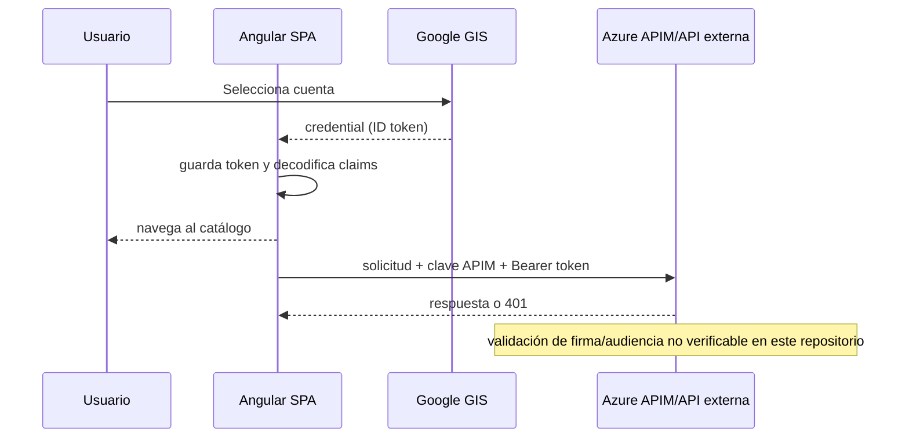

# Flujo de datos

## Autenticación

El documento existente afirma validación backend antes de navegar, pero `signIn` no hace HTTP. La primera oportunidad observable de rechazo remoto es una petición posterior.

## Publicaciones

El listado devuelve `{ totalRecords, page, pageSize, items }`. Home solicita la primera página con hasta 100 elementos y continúa con el tamaño efectivo informado por la respuesta hasta reunir el catálogo; una recarga cancela la suscripción anterior. Deduplica por `id`, rechaza paginación inválida o resultados incompletos, aplica búsqueda, categoría, precio y orden al conjunto completo, calcula el total filtrado y finalmente toma la ventana local de 12 elementos. El alta envía categoría, subcategoría, título, descripción, precio, condición y ubicación; no envía previews, archivos ni `usuarioId`.

La categoría no se transforma en la capa HTTP ni en el modelo. Home obtiene las opciones únicas directamente de `Publication.categoria`, presenta una etiqueta separada y conserva el valor original para la igualdad exacta del filtro. Así, cambiar una opción actualiza `selectedCategory` con una clave que necesariamente proviene del mismo catálogo filtrado.

Las búsquedas recientes no cruzan la frontera HTTP: `RecentSearchService` registra solo consultas enviadas, normaliza espacios y comparación por mayúsculas, limita a diez y persiste en `localStorage` con fallback en memoria.

## Identidad

El shell muestra claims `sub/email/name/picture`. Perfil y publicaciones propias no reutilizan `sub`: solicitan `USR-001`. Esta divergencia puede mostrar o modificar datos distintos de la cuenta autenticada, sujeto a cómo autorice la API externa.

## Mensajes

`GET /chats` aporta resumen de cada chat y último mensaje. No hay solicitud de historial. Después de un POST exitoso, el cliente sintetiza un `SessionMessage` y lo conserva en memoria.

## Errores

401 se trata globalmente. Otros errores llegan al componente. No existe sobre común de error tipado; `Profile` intenta leer `error.error.message`, mientras otras vistas muestran mensajes genéricos.

