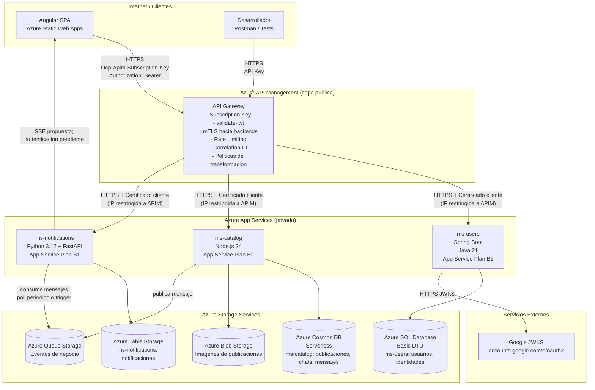

# Infraestructura Azure — Fase II

**Estado:** Propuesta — Pendiente de aprobacion
**Fecha:** 2026-10-18

> **Actualizacion Etapa B (2026-10-18):** **Verificado:** no se aprovisiono ni configuro infraestructura Azure. Los workflows nuevos son solo CI. MarketTec es exclusivamente web; las referencias historicas de esta propuesta a app movil/FCM no son alcance implementable y representan una discrepancia academica pendiente de validacion docente. SSE es la opcion preferida para tiempo real, con autenticacion navegador/APIM aun no resuelta.

---

## 1. Topologia general



---

## 2. Azure API Management

### Funcion en la arquitectura

APIM sera el unico punto de acceso para la SPA web y clientes tecnicos como Postman. Los App Services no deberan ser accesibles desde Internet directamente.

### Politicas aplicadas

**Politica global (all APIs):**
```xml
<!-- Conceptual - no implementar todavia -->
<inbound>
  <!-- 1. Verificar subscription key -->
  <validate-key ... />
  <!-- 2. Validar JWT de Google o JWT interno -->
  <validate-jwt header-name="Authorization" failed-validation-httpcode="401">
    <openid-config url="https://accounts.google.com/.well-known/openid-configuration"/>
    <audiences><audience>CLIENT_ID_DEL_PROYECTO</audience></audiences>
  </validate-jwt>
  <!-- 3. Agregar correlation ID -->
  <set-header name="X-Correlation-ID" exists-action="skip">
    <value>@(Guid.NewGuid().ToString())</value>
  </set-header>
  <!-- 4. Agregar certificado cliente para backend -->
  <authentication-certificate thumbprint="THUMBPRINT_DEL_CERT" />
</inbound>
```

**Politica de transformacion (compatibilidad Fase I):**
Mientras el frontend migra a los nuevos contratos, APIM puede aplanar el envelope `data` para la respuesta de `GET /publicaciones`.

### APIs registradas en APIM

| API | Backend URL | Ruta publica |
|---|---|---|
| Users API | `https://ms-users.azurewebsites.net` | `/usuarios`, `/auth` |
| Catalog API | `https://ms-catalog.azurewebsites.net` | `/publicaciones`, `/chats`, `/images` |
| Notifications API | `https://ms-notifications.azurewebsites.net` | `/notificaciones` |

---

## 3. Mecanismo de certificados (APIM -> App Services)

### Objetivo
Garantizar que un App Service SOLO acepta conexiones originadas desde APIM, incluso si alguien conoce la URL de Azure Web Apps.

### Estrategia seleccionada: Certificado cliente (mTLS)

1. **APIM presenta** un certificado cliente al hacer la solicitud al backend.
2. **El App Service verifica** que el certificado sea de APIM (por thumbprint o CA).
3. Sin el certificado correcto, el backend devuelve 403/SSL error.

### Alternativa complementaria: IP restriction
- Cada App Service configura "Access restrictions" para aceptar SOLO el rango IP de APIM salientes.
- APIM publica sus IPs salientes en su documentacion.

### Implementacion por microservicio

**ms-users (Spring Boot):**
```yaml
# Conceptual - application.yml
server:
  ssl:
    client-auth: need
    trust-store: classpath:apim-truststore.jks
    trust-store-password: ${TRUSTSTORE_PASSWORD}
```

**ms-catalog (Node.js):**
```typescript
// Conceptual - config/tls.ts
import https from 'https';
import fs from 'fs';
const options = {
  requestCert: true,
  rejectUnauthorized: true,
  ca: fs.readFileSync(process.env.APIM_CA_CERT_PATH!)
};
```

**ms-notifications (Python/FastAPI):**
```python
# Conceptual - config/tls.py
import ssl
ssl_context = ssl.create_default_context(ssl.Purpose.CLIENT_AUTH)
ssl_context.verify_mode = ssl.CERT_REQUIRED
ssl_context.load_verify_locations(cafile=settings.APIM_CA_CERT_PATH)
```

---

## 4. Gestion de secretos

### Azure Key Vault (recomendado)

Todos los secretos (connection strings, API keys, certificados) se almacenan en Azure Key Vault.

| Secreto | Tipo | Consumidor |
|---|---|---|
| `sql-connection-string` | Connection string | ms-users |
| `cosmos-connection-string` | Connection string | ms-catalog |
| `storage-connection-string` | Connection string | ms-notifications + ms-catalog |
| `apim-cert-thumbprint` | Certificado | ms-users, ms-catalog, ms-notifications |
| `google-client-id` | API Key | ms-users |
| `jwt-secret` | Secreto | ms-users (firma JWT interno) |

### Identidades administradas (Managed Identity)

Cada App Service usa una **Managed Identity** para acceder a Key Vault sin credenciales hardcodeadas.

```
App Service (Managed Identity) --> Key Vault Access Policy --> Secrets GET
```

### Variables de entorno

En development/testing, se pueden usar variables de entorno locales (`.env`).
En Azure App Services, las variables se configuran en "Application Settings" o se leen de Key Vault via referencia `@Microsoft.KeyVault(...)`.

**Prohibicion:** Ningun secreto debe aparecer en codigo fuente, commits o documentacion.

---

## 5. Servicios de almacenamiento Azure

### Matriz de cumplimiento de requisito academico

| Tipo de almacenamiento | Servicio Azure | Microservicio | Dato almacenado |
|---|---|---|---|
| **Tipo 1: Relacional SQL** | Azure SQL Database | ms-users | Usuarios, identidades externas |
| **Tipo 2: NoSQL Document** | Azure Cosmos DB | ms-catalog | Publicaciones, chats, mensajes |
| **Tipo 3: Table / Key-Value** | Azure Table Storage | ms-notifications | Notificaciones persistidas |
| Adicional: Blob | Azure Blob Storage | ms-catalog | Imagenes de publicaciones |
| Adicional: Queue | Azure Queue Storage | ms-catalog (pub) + ms-notifications (sub) | Eventos de negocio |

> El requisito academico de 3 tipos distintos de almacenamiento Azure se cumple con: SQL Database + Cosmos DB + Table Storage. Blob Storage y Queue Storage son adicionales.

---

## 6. Azure App Services — configuracion base

### Plan de App Service recomendado (academico)

| Microservicio | Plan | vCPU | RAM | Justificacion |
|---|---|---|---|---|
| ms-users | B2 Basic | 2 | 3.5 GB | Spring Boot requiere JVM con minimo 512 MB |
| ms-catalog | B1 Basic | 1 | 1.75 GB | Node.js eficiente en memoria |
| ms-notifications | B1 Basic | 1 | 1.75 GB | FastAPI asincronico, cargas bajas |

### Configuracion de SSE (ms-notifications)

SSE no requiere activar Web Sockets, pero antes de implementarlo se deben validar timeout, buffering y autenticacion a traves de APIM. `EventSource` nativo no permite headers arbitrarios de autorizacion o subscription key.

### Variables de entorno por microservicio

**ms-users:**
```
SPRING_DATASOURCE_URL=@Microsoft.KeyVault(sql-connection-string)
GOOGLE_CLIENT_ID=@Microsoft.KeyVault(google-client-id)
JWT_SECRET=@Microsoft.KeyVault(jwt-secret)
APIM_CA_CERT_PATH=/home/site/certs/apim-ca.pem
PORT=8080
```

**ms-catalog:**
```
COSMOS_CONNECTION_STRING=@Microsoft.KeyVault(cosmos-connection-string)
AZURE_STORAGE_CONNECTION_STRING=@Microsoft.KeyVault(storage-connection-string)
APIM_CA_CERT_PATH=/home/site/certs/apim-ca.pem
PORT=3000
```

**ms-notifications:**
```
AZURE_STORAGE_CONNECTION_STRING=@Microsoft.KeyVault(storage-connection-string)
APIM_CA_CERT_PATH=/home/site/certs/apim-ca.pem
PORT=8000
```

---

## 7. GitHub Actions — CI/CD por microservicio

Cada microservicio tendra su propio workflow en `.github/workflows/`:

- `deploy-ms-users.yml` — build Maven + deploy Azure Web App (Spring Boot JAR)
- `deploy-ms-catalog.yml` — build npm + deploy Azure Web App (Node.js)
- `deploy-ms-notifications.yml` — build Python + deploy Azure Web App (Python)

### Triggers recomendados

```yaml
on:
  push:
    branches: [main]
    paths:
      - 'app/ms-users/**'  # Solo cuando cambia ese servicio
```

---

## 8. Estimacion de costos (plan academico)

| Servicio | Tier | Costo aproximado USD/mes |
|---|---|---|
| App Service Plan B1 (x2) | Basic | ~$25 c/u = $50 |
| App Service Plan B2 (x1) | Basic | ~$75 |
| Azure SQL Database | Basic 5 DTU | ~$5 |
| Azure Cosmos DB | Serverless 1M RU/mes gratis | ~$0-$5 |
| Azure Table Storage | LRS Pay-per-use | ~$0-$1 |
| Azure Blob Storage | LRS 1 GB | ~$0-$1 |
| Azure Queue Storage | 1M ops/mes gratis | ~$0 |
| Azure API Management | Developer tier | ~$50 (o gratis en algunos accounts) |
| Azure Key Vault | Standard | ~$0.03/10k ops |
| **Total aproximado** | | **~$185-200/mes** |

> Los costos son aproximados y pueden reducirse con creditos Azure for Students o configurando planes mas basicos. Verificar disponibilidad de Azure for Students que incluye $100 de credito.

---

## 9. Requisitos de configuracion no implementados todavia

| Configuracion | Descripcion | Responsable |
|---|---|---|
| Certificado APIM | Generacion y configuracion de certificado cliente | DevOps / Equipo |
| Access Restrictions | Restriccion de IPs en App Services | DevOps / Equipo |
| Key Vault | Creacion y asignacion de secretos | DevOps / Equipo |
| Managed Identity | Asignacion por App Service | DevOps / Equipo |
| CORS en APIM | Politica de CORS para origen de Angular | DevOps / Equipo |

---

*Nota: No se deben aprovisionar recursos Azure hasta tener la arquitectura aprobada y los workflows CI/CD listos.*
