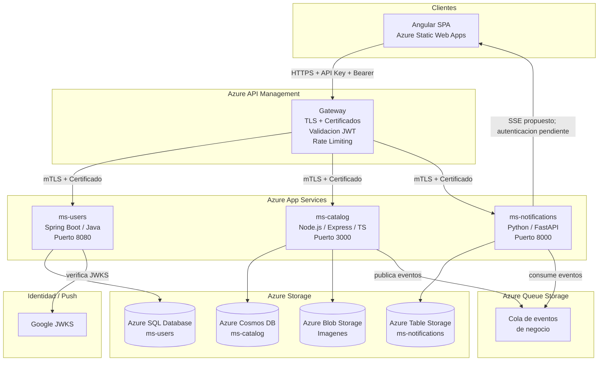

# Arquitectura de Microservicios — Fase II

**Estado:** Propuesta — Pendiente de aprobación
**Fecha:** 2026-10-18
**Revisión base:** commit `68bd4f0`, rama `main`
**Autor del análisis:** Principal Software Architect (Etapa A)

> **Actualizacion Etapa B (2026-10-18):** **Verificado:** se implemento la fundacion de los tres servicios descrita en [IMPLEMENTED_FOUNDATION.md](IMPLEMENTED_FOUNDATION.md). ADR-001 sigue `Proposed`, por lo que esta implementacion no equivale a aprobar la distribucion futura de negocio. **Correccion de alcance:** MarketTec es exclusivamente web; toda referencia posterior a app movil o FCM queda sustituida por una discrepancia academica pendiente de validacion docente y no forma parte de la arquitectura implementable actual.

---

## 1. Bounded Contexts identificados

El análisis del frontend, los modelos consumidos y los contratos actuales permite identificar los siguientes bounded contexts en el dominio de MarketTec:

| Bounded Context | Responsabilidad | Entidades clave |
|---|---|---|
| **Identidad y Usuarios** | Gestión de cuentas, autenticación, perfil y autorización | `User`, `Session`, `Identity` |
| **Catálogo y Publicaciones** | Creación, listado, búsqueda y gestión de publicaciones e imágenes | `Publication`, `Category`, `Image` |
| **Mensajería** | Conversaciones entre usuarios y envío de mensajes | `Chat`, `Message`, `Participant` |
| **Notificaciones** | Eventos de sistema, entrega en tiempo real y push | `Notification`, `Event`, `Subscription` |

> **Decisión de diseño:** Mensajería se asigna a ms-catalog porque Chat está íntimamente ligado al ciclo de vida de una publicación (ChatPublication contiene id, titulo, imagen, precio). La cohesión de dominio es más alta que si se fragmenta en un cuarto servicio. Para un equipo de 3 personas, reducir la superficie operativa es prioritario.

---

## 2. Alternativas de distribución de responsabilidades

### Alternativa A — Distribución por dominio primario (Recomendada)

Tres servicios con responsabilidad de dominio clara:

| Microservicio | Tecnología candidata | Almacenamiento |
|---|---|---|
| `ms-users` | Spring Boot + Java | Azure SQL Database |
| `ms-catalog` | Node.js + Express + TypeScript | Azure Cosmos DB (API NoSQL) |
| `ms-notifications` | Python + FastAPI | Azure Table Storage + Azure Queue |

**Responsabilidades de ms-users (Spring Boot):**
- Gestión de usuarios: registro, perfil, actualización.
- Autenticación: validación del ID token de Google (verificación de firma JWKS, aud, iss, exp).
- Autorización: emisión de JWT interno para comunicación inter-servicio.
- Gestión de identidad interna: mapping Google sub -> userId interno.
- Owns: tabla `usuarios`, tabla `identidades_externas`.

Casos de uso: `GET /usuarios/{id}`, `PUT /usuarios/{id}`, `POST /auth/google`, `GET /auth/me`

**Responsabilidades de ms-catalog (Node.js + Express + TypeScript):**
- Publicaciones: creación, listado paginado, detalle, publicaciones por usuario.
- Búsqueda y filtros server-side: categoría, texto, precio, orden.
- Carga de imágenes: generación de SAS token para subida directa a Azure Blob.
- Mensajería: lista de chats, envío de mensajes.
- Owns: colecciones `publicaciones`, `chats`, `mensajes` en Cosmos DB.

Casos de uso: `GET /publicaciones`, `GET /publicaciones/{id}`, `POST /publicaciones`, `GET /usuarios/{id}/publicaciones`, `GET /chats`, `POST /chats/{id}/mensajes`, `POST /images/upload-url`

**Responsabilidades de ms-notifications (Python + FastAPI):**
- Consumo de eventos de cola (Azure Queue Storage).
- Persistencia de notificaciones en Azure Table Storage.
- Emisión SSE propuesta para notificaciones en tiempo real en la web, sujeta a resolver autenticacion.
- Entrega web en tiempo real, con SSE como opcion preferida pendiente de resolver autenticacion compatible con navegador y APIM.
- Owns propuesto: Azure Table Storage `notifications` y conexiones SSE activas.

---

### Alternativa B — Distribución por capacidad técnica

| Microservicio | Tecnología | Responsabilidad |
|---|---|---|
| `ms-core` | Spring Boot + Java | Usuarios + Publicaciones + Autenticacion |
| `ms-messaging` | Node.js + Express + TypeScript | Mensajeria en tiempo real + WebSocket |
| `ms-notifications` | Python + FastAPI | Notificaciones push + eventos |

**Problemas identificados:**
- `ms-core` agrupa dominios demasiado distintos (usuarios != publicaciones), generando un servicio monolitico disfrazado.
- La separacion mensajeria/notificaciones obliga a coordinar dos servicios para un unico flujo de usuario.
- Mayor complejidad operativa sin ganancia de cohesion real.
- **Descartada:** incumple Single Responsibility a nivel de servicio.

---

### Alternativa C — Cuatro servicios

Separa mensajeria de catalogo y crea un cuarto servicio dedicado.

**Problemas:**
- Excede el minimo requerido de 3, aumentando la carga operativa (4 App Services, 4 pipelines CI/CD, 4 configuraciones APIM).
- Mensajeria como servicio independiente requiere llamadas inter-servicio para obtener datos de publicacion cada vez que un chat se crea.
- Para un equipo de 3 personas es inmanejable sin reducir la profundidad de los otros servicios.
- **Descartada:** complejidad operativa desproporcionada para el equipo.

---

## 3. Arquitectura recomendada — Alternativa A

### Justificacion de superioridad

| Criterio | Alt A | Alt B | Alt C |
|---|---|---|---|
| Cohesion de dominio | Alta | Media | Alta |
| Complejidad operativa para 3 personas | Baja | Baja | Alta |
| Cumplimiento: 3 tecnologias distintas | Si | Si | Si |
| Spring Boot con hexagonal | ms-users | ms-core | ms-core |
| Servicio dedicado de notificaciones | Si | Si | Si |
| 3 tipos de almacenamiento Azure | Si (SQL+Cosmos+Table) | Requiere verificar | Si |
| Esfuerzo de implementacion total | Bajo-Medio | Bajo-Medio | Alto |
| Compatibilidad con frontend actual | Total | Total | Total |
| Extensibilidad futura | Buena | Limitada | Buena |

**Conclusion:** La Alternativa A es superior porque maximiza la cohesion de dominio de cada servicio, minimiza las dependencias inter-servicio en los flujos principales y permite que cada integrante del equipo sea propietario de un microservicio completo.

---

## 4. Diagrama de arquitectura recomendada

---

## 5. Dependencias entre servicios

### Dependencias permitidas

| Origen | Destino | Mecanismo | Dato intercambiado |
|---|---|---|---|
| `ms-catalog` | `ms-users` | HTTP REST (sincronico, opcional) | Validacion de userId al crear publicacion |
| `ms-catalog` | Azure Queue | Pub (asincronico) | Evento publication.created, message.sent |
| `ms-notifications` | Azure Queue | Sub (asincronico) | Consumo de eventos |
| APIM | `ms-users` | HTTP + mTLS | Intercambio de token Google -> JWT interno |

### Dependencias prohibidas

- `ms-notifications` NO accede directamente a la base de datos de `ms-catalog` o `ms-users`.
- `ms-catalog` NO accede directamente a la base de datos de `ms-users`.
- NO existen llamadas ciclicas entre microservicios.
- Los microservicios NO se invocan entre si fuera de los contratos definidos.

---

## 6. Riesgos y tradeoffs

| Riesgo | Probabilidad | Impacto | Mitigacion |
|---|---|---|---|
| Mensajeria en ms-catalog aumenta su tamanio | Media | Bajo | Separar en modulo interno con puertos propios |
| Cosmos DB tiene curva de aprendizaje | Media | Medio | Usar API for MongoDB que es familiar; documentar particionamiento |
| FastAPI requiere aprender Python | Media | Medio | ms-notifications es el servicio mas pequenio; FastAPI tiene excelente documentacion |
| Latencia inter-servicio ms-catalog a ms-users | Baja | Bajo | Cache local de userId validado (TTL corto); fallback a sub del JWT |
| Consistencia eventual en notificaciones | Alta | Bajo | Aceptable por disenio; notificaciones no son transaccionales |
| Azure SQL costo en plan academico | Media | Medio | Usar DTU basico; evaluar Azure Database for PostgreSQL Flexible (Free Tier) |

---

## 7. Compatibilidad con frontend actual

| Contrato frontend | Microservicio responsable | Cambio necesario |
|---|---|---|
| `GET /publicaciones` | ms-catalog | Aniadir filtros server-side; compatibilidad hacia atras garantizada |
| `GET /publicaciones/{id}` | ms-catalog | Sin cambio |
| `POST /publicaciones` | ms-catalog | Sin cambio de contrato; internamente asocia userId del JWT |
| `GET /usuarios/{id}/publicaciones` | ms-catalog | Sin cambio |
| `GET /usuarios/{id}` | ms-users | Sin cambio |
| `PUT /usuarios/{id}` | ms-users | Sin cambio |
| `GET /chats` | ms-catalog | Sin cambio |
| `POST /chats/{id}/mensajes` | ms-catalog | Sin cambio |
| `POST /auth/google` | ms-users | Nuevo — reemplaza validacion cliente-only |

---

*Nota: Este documento describe una propuesta. No esta aprobada hasta recibir confirmacion explicita del equipo.*
